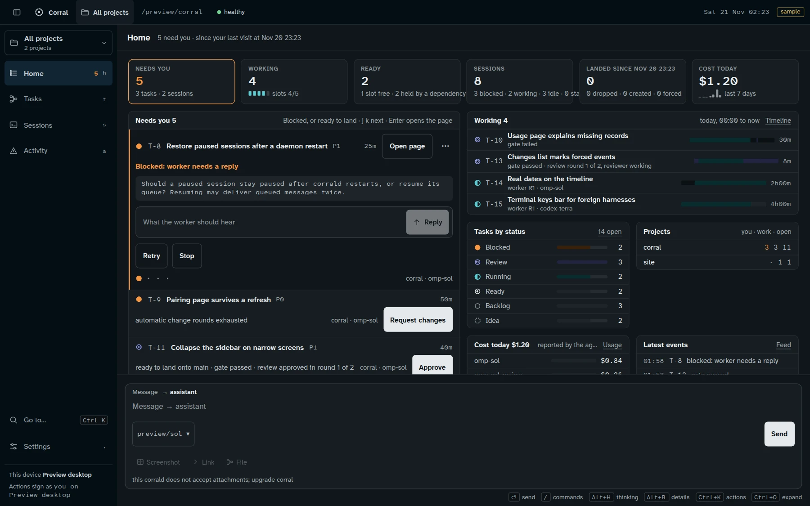
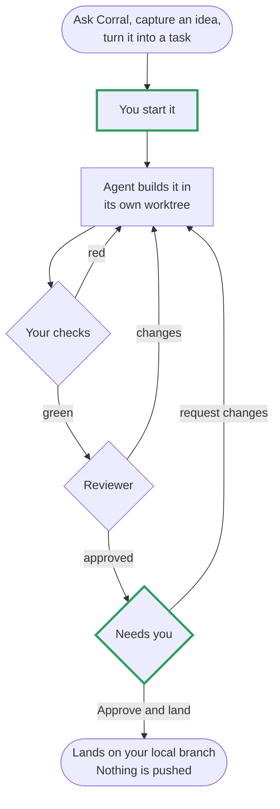

# Corral

**Stop babysitting agent chats.** Corral gives your coding agents one place to work and you one
place to see it: what is running, what is blocked, and what is ready to land. Give agents
separate worktrees, review their changes with evidence, and decide what lands.

**[Try Corral](#try-corral)** · [Latest release](https://github.com/pawissanutt/corral/releases/latest) ·
[App guide](apps/corral-app/README.md)

*Corral Home in the built-in sample preview. Every task, session and cost shown is sample data.*

## Why switch

- **One screen instead of a dozen chat tabs.** Home puts what needs you first, each with its one
  next step: reply to a blocked task, request changes, or approve and land. Below that is
  everything still working.
- **Parallel agents that never share a checkout.** Each task gets its own branch and worktree,
  so tasks don't step on each other's changes or on your checkout. Open any session to pick
  up the conversation where it left off.
- **Review the change, not the chat.** See the diff, test results, and independent review
  together when you've configured checks and a reviewer.
- **You stay the owner.** Landing waits for your approval and only fast-forwards your local
  branch; Corral never pushes. Automatic start and landing stay off until you turn them on.

## How a change moves

Outlined steps are yours by default. The diagram shows a project with checks and a reviewer configured.

## Try Corral

**Linux or macOS:** Corral runs as a daemon next to your repositories, and you use it in a
browser. [Install it](apps/corral-app/README.md#install-and-upgrade) with one script, then
[start the daemon and pair your browser](apps/corral-app/README.md#serve-the-web-app). You need
Git and an authenticated agent provider; the installer can offer to install herdr, the terminal
engine Corral uses.

**Windows:** run the Linux build in Ubuntu 24.04 on WSL 2 and open Corral in your Windows
browser. There is no Windows desktop installer in the current release.

**Use sample data:** once the app is open locally and before you pair, it offers **Preview with
sample data**: the real screens on sample tasks, never your workspace. It is an option inside
your local install, not a hosted demo.
[More on the sample preview](apps/corral-app/README.md#sample-preview).

Corral is a prototype: interfaces and configuration may still change, so back up your
workspace before upgrading.

## License

Apache-2.0. See [LICENSE](LICENSE).
