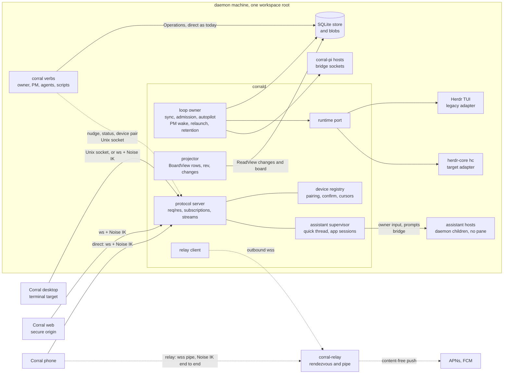
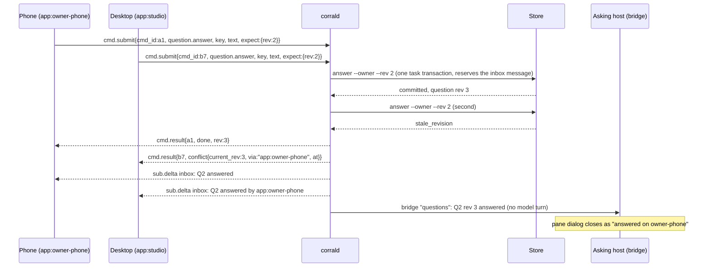

# Corral app and `corrald`: architecture

> Classic guide paths cited in this design are historical; consult Git revision
> `c79a18228` for the pre-retirement copies.

Status: proposal, 2026-11-11; assistant round added 2026-11-12, revised to one chat, then to "the assistant
lives in Agents and is never idle-stopped", then given a model selector the same day (section 13, D12 to D24,
R24 to R35, decisions 36 to 41).
Companion to `REQUIREMENTS.md` (final) and `mockup/` (visuals, owned by `ui`).
Not a task contract; grants no authority. No code was changed to write this.

This document is a historical proposal, including “Current state” and delivery phases.
Owner corrections and current integration notes below were updated on 2026-11-15.
For the implementation inventory and verification limits, use the [integration overview](README.md)
and [app guide](../../apps/corral-app/README.md). In particular, `assistant.summary_profile`
is now canonical, effective at the next assistant-host start; paid-API summary profiles
are refused without independent spending authority.

Citation legend. Corral paths are relative to `/home/owner/main-workspace/corral` as read on 2026-11-11:
`core/` = `crates/corral-core/src/`, `ops/` = `crates/corral-ops/src/`, `herdr/` = `crates/corral-herdr/src/`,
`cli/` = `crates/corral/src/`, `tui/` = `crates/corral-tui/src/`, `pi/` = `packages/corral-pi/src/`,
`redesign` = `docs/records/pm-runtime-redesign.md` (Git history), `research/` = `/home/owner/corral-board-opus/plan-research/`
(prior research, spot-checked). External: `nsh:<page>` = `https://nsh.dev/<page>.md`,
`hc:<file>` = `https://github.com/herdrdev/herdr-core/blob/master/<file>` (both read 2026-11-11).
`[INFERENCE]` marks anything not verified in a source. New names (crates, records, keys) are proposals.

---

## 1. Current state

### Processes

| Process | Started by | Lifetime | Source |
|---|---|---|---|
| `corral board` (ratatui; terminal, model, sync worker, maintenance threads) | `corral up` opens a herdr pane running `<exe> --root <root> board` | while the pane is open | `cli/up.rs:99-109`, `tui/app/worker.rs:18-22`, `tui/app.rs:109-112` |
| `corral hook` | herdr plugin event `pane.agent_status_changed` | one process per pane event | `cli/plugin.rs:70-73`, `cli/cmds/session_cmd.rs:8-64` |
| `corral sync [--watch]` | owner or script | one pass, or a 2 s loop | `cli/cmds.rs:737-748` |
| `corral <verb>` | owner, PM, agents, scripts | one command | `cli/entry.rs:42-92` |
| corral-pi host (Bun) per run, PM, assistant | `corral agent launch`, `corral pi` | one generation; bridge on a Unix socket | `docs/guide/corral-pi.md:1370-1377,1420-1435` |
| Assistant host (corral-pi, role `assistant`) | `corral pi` in a herdr pane; the host is a child of that `corral pi` process, which holds the session claim | until `/quit`, a crash or `assistant end`; one generation per start | `ops/agent/pi.rs:231-240`, `ops/agent/ops/assistant.rs:404-432,578-615` |
| Herdr TUI server | owner; `corral up` may start one | owner-managed | `cli/up.rs:50-60` |

### Who runs sync

Three drivers, all ending in `sync_passes` (`ops/sync.rs:56-131`): the board worker (2 s, backing off to
60 s, `tui/app/worker.rs:152-159`), the plugin hook (`cli/cmds/session_cmd.rs:49`), and `corral sync`.
With no board open, no pane event and no `--watch`, nothing runs: "After a reboot there is no loop and no
PM until the owner types" (`redesign:64-65`). No loop-ownership lease exists. Drivers avoid each other with
per-concern try-locks: `autopilot-<id>` (`ops/autopilot.rs:109-112`), `pm-events` (`ops/pm_events.rs:16-20`),
`hook-sync.lock` plus a dirty mark (`cli/cmds/session_cmd.rs:27-54`).

### Write path and locks

`Store` facade, one `Operation` per logical write (25 variants, `core/backend/operation.rs:640-666`),
`StoreBackend::apply` (`core/backend.rs:36-51`), one `BEGIN IMMEDIATE` SQLite transaction with logical
preconditions (`core/sqlite/mod.rs:4-8`). Each commit gets a `ChangeSeq` with touched scopes
(`core/backend/rows.rs:471-477`, `docs/guide/classic/storage.md:172-174`). Events carry `actor` and `via`
(`core/attribution.rs:136-144`).

| Lock | Kind | Used for | Source |
|---|---|---|---|
| `.corral/lock/store` | shared flock for every opener, exclusive for migrate/rollback/finalize; opener waits 2 s | maintenance exclusion only | `core/store/db.rs:3-7,34`, `docs/guide/classic/storage.md:178-185` |
| `lock/dispatch.lock` (the "board writer lock") | blocking exclusive flock, no timeout | every task and config read-modify-write | `core/store.rs:156-173,597-665` |
| `lock/<task>.lock` | blocking exclusive | per-task read-modify-write | `core/store.rs:616-618` |
| `lock/agent-pm.lock`, `pm-inbox.lock`, `config.lock`, ... | blocking exclusive | record families | `core/agent/pm_state.rs:114-115`, `core/pm_inbox.rs:456`, `core/config_events.rs:292` |
| SQLite writer | WAL, `synchronous=NORMAL`, busy handler up to 30 s, then `ApplyError::Busy` | any process | `core/sqlite/mod.rs:62,156-181` |

Attribution is one set-once default per `Store` per process (`core/attribution.rs:75-83`) plus a
thread-scoped actor override (`core/attribution.rs:98-105`). `via` values today: `hook`, `pm`, `tui`,
`cli`, `run:<run>`, `assistant:<session>` (`cli/entry.rs:71-84,162-176`).

### Herdr coupling

- `Ctx.herdr` is the concrete `Herdr` type (`ops/ctx.rs:13-16`); there is no trait. Each call is a
  `herdr [--session] <args>` subprocess (`herdr/lib.rs:1-4`).
- About 200 call sites outside tests (grep count, 2026-11-11): `pane_get` 39, `socket_path` 31,
  `pane_close` 19, `pane_run` 14, `pane_list` 13, `agent_prompt` 12.
- Persisted identity is `HerdrRef { workspace_id, pane_id, socket }` (`core/model.rs:213-217`). Ownership
  is the socket path (`docs/session-ownership.md:13-18`), checked before any sync work
  (`ops/sync.rs:123-125`, `ops/session_scope.rs:20-23,228-231`).
- No subscribe API. Events arrive only through the plugin hook. Status is `PaneInfo.status`
  (`herdr/lib.rs:26-35,62-72`) plus an OmO session-file heuristic (`ops/sync.rs:50-51`).
- Text delivery is `agent prompt` with a verified terminal fallback (`herdr/lib.rs:429-432`,
  `docs/pane-delivery.md:39-78`).

### Known failures this design must remove

| Failure | Source |
|---|---|
| 4 stalls of 4 to 8.6 h, ended only by the owner asking | `redesign:46-50` |
| Pi PM receives no board events (`pm.push_events = false`; pane paste fails) | `redesign:51-60` |
| Caps that end a long-lived PM: receipts 16,384 (`core/agent/records.rs:12`), generations 64 (`core/agent/records.rs:13`, `ops/agent/admission.rs:476-480`), bridge input keys 4,096 (`pi/bridge/protocol.ts:10`, `pi/bridge/server.ts:137-140`), budget requests 16,384 when a limit is set (`core/agent/budget.rs:73-74`) | `redesign:99-109` |
| PM `ask_user` questions live only in the Pi session journal, "not a second board-question store" | `docs/guide/corral-pi.md:142-157` |
| No quick way in: an assistant needs a herdr pane (`not_in_herdr`), capture is a board popup, and a host without a terminal has no owner UI | `ops/agent/pi.rs:69-80`, `docs/guide/classic/tui.md:398-402`, `pi/host/ask-user.ts:126` |

---

## 2. Target process model



### Single-writer decision

**Decision: `corrald` is the single loop owner, not the single store writer.** `corral <verb>` keeps
writing through `Store` exactly as today.

| Reason | Evidence |
|---|---|
| The store is already safe for several writer processes | "correctness never depends on SQLite having a single writer" (`core/sqlite/mod.rs:6-8`); every read-modify-write takes `dispatch.lock` and the task lock (`core/store.rs:612-625`); stale preconditions return `Conflict` (`docs/guide/classic/storage.md:164-166`) |
| What is unsafe is several loop drivers, not several writers | drivers need per-concern try-locks today (`ops/autopilot.rs:109`), and the Oct 31 stall was a hook holding a lock for an hour (`redesign:252-253`) |
| Agents and the PM must keep working when the daemon is down or upgrading (R5) | `corral done`, `corral agent call`, `corral question answer` are plain store writes |
| Attribution is derived from the calling process (env, cwd, pane) | `cli/entry.rs:42-92,162-176`; proxying verbs through the daemon would have to forward and trust all of it |
| The daemon can follow foreign writes without owning them | `ReadView::changes(after, limit)` and `board(since)` (`core/backend.rs:60-61`) |

Rejected: route every verb through the daemon (one writer process). It needs about 200 verbs mirrored as
RPC, makes the daemon a hard dependency of every agent command, and buys no correctness the store lacks.

**Revised by the owner on 2026-11-12 (daemon-first).** The rejection above stands only as a statement about
correctness. The owner chose to move toward the daemon as the normal path for every client, because a
client that opens the store can never run on another machine. The agreed shape: reads come from the
daemon first; then writes go through it as the typed commands of section 5 (one router shared by the CLI,
the board, the PM and the app), carrying a credential field from the first version, filled on the local
socket from today's caller classification; the direct store path stays only as a local emergency fallback
for the verbs agents need to finish work (`done`, `gate`, answering a question). Not every verb moves: of
156 leaf verbs, 27 administer the host and stay local, and the 15 that read the caller's worktree, `git` or
files keep that part local until worktrees on another machine are designed (section 7). Measurements taken
first showed the slowness itself was repeated derivation, not store contention; see corral
`docs/records/daemon-first.md` (Git history).

### `corrald` lifecycle

| Aspect | Design |
|---|---|
| Scope | One `corrald` per workspace root. Store key = first 16 hex of SHA-256 of the canonical root path. |
| Single-instance lease | `Store::try_lock("daemon")` on `.corral/lock/daemon.lock`, held for the process lifetime (kernel-held flock, released on crash; `core/store.rs:176-206`). A second instance exits 0 with "already running". |
| Loop fence | `sync_passes` runs only under the lease. `corrald` holds it for its lifetime. `corral daemon run --once` (and its alias `corral sync`) takes it for one pass and exits; it is the daemon's own loop code, kept for recovery and fixtures. The classic board and the hook never run a pass; they nudge. Result: one loop driver at any time (R2). |
| Endpoints | `$XDG_RUNTIME_DIR/corral/<store-key>/corrald.sock` (dir 0700, socket 0600, peer uid check as the Pi bridge does, `docs/guide/corral-pi.md:1420-1422`); optional `ws://` listeners from `[daemon] listen`. |
| systemd user unit | `~/.config/systemd/user/corrald@<store-key>.service`: `ExecStart=corrald --root <root>`, `Restart=always`, `RestartSec=2`, `WantedBy=default.target`. Start at boot needs `loginctl enable-linger`. Written by `corral daemon install`. |
| launchd | `~/Library/LaunchAgents/dev.corral.corrald.<store-key>.plist` with `KeepAlive` and `RunAtLoad`. |
| No service manager | `corral daemon run` in the foreground (WSL2 without systemd, containers). The health line then shows `degraded · unsupervised`. |
| Start | take lease, open store (shared gate), `settling::recover` and launch-journal recovery as sync already does (`ops/sync.rs:126-129`), rebuild projection, listen, first pass. Never starts a Herdr TUI server; starts `hc` only when `[runtime.hc] supervise = true` (REQUIREMENTS section 5). |
| Stop | `corral daemon stop [--drain]`: finish the running pass, close streams with `bye`, release lease. In-flight external effects rely on the existing durable journals (`docs/session-ownership.md:6-11`). |
| Upgrade | The existing replaced-binary latch (`ops/sync.rs:120-122`, `tui/app/worker.rs:19-21`) makes the daemon finish its pass and exit 75; the service manager restarts the new binary. Clients reconnect and renegotiate. Coherent install = `corral daemon stop --drain`, install, start. |
| Crash | Lease released by the kernel, unit restarts in 2 s, projection rebuilt, clients resync by cursor. |
| Heartbeat | `<runtime-dir>/heartbeat` touched each pass (no store write). A `daemon/state` record is written only on transitions (started, degraded reason, recovered, stopped), so the change feed stays quiet. |
| Lock watchdog | A thread reports `degraded · lock dispatch held 95s by pid N (argv)` from `lock/store.holders/` (`docs/guide/classic/storage.md:181-182`); required by `redesign:252-253`. |
| Assistant hosts | The daemon supervises pane-less assistant hosts (the quick thread and sessions opened from the app) as plain child processes (section 13.2). Stop and upgrade drain them with bridge `shutdown`; after a crash, leftover hosts are fenced and stopped, not re-adopted. |

### Health line

| Segment | Values | Computed from |
|---|---|---|
| daemon | `healthy`, `degraded · <reason>`, `down` | `down` is decided by the client or CLI: no session, or heartbeat older than 3 passes. Degraded reasons: `sync stalled <age>`, `lock <name> held <age> by pid <n>`, `foreign runtime <id>`, `pm stores <pct>`, `budget ledger <pct>`, `restarting for upgrade`, `relay unreachable`, `unsupervised`. |
| runtime | `herdr-core ok`, `herdr-core unreachable` | `Runtime::probe()` of the target adapter. While any open ref is on the legacy adapter, a second segment `herdr-tui ok \| unreachable` is shown next to it. |
| PM | `live`, `relaunching`, `absent` | Bound host verified by bridge liveness; `relaunching` during a supervised relaunch or generation roll; `absent` when no PM is configured or relaunch is refused. |

### What moves

| Today | After | Phase |
|---|---|---|
| Board worker runs `sync_with_attention` every 2 to 60 s (`tui/app/sync_step.rs:5-15`) | Daemon loop thread. Classic board becomes a viewer: nudge, then read back. | 1 |
| Board maintenance thread (`maintain_database`, WAL checkpoint every 2 s, `docs/guide/classic/storage.md:36`) | Daemon maintenance thread | 1 |
| `corral hook` runs a coalesced full sync | `corral hook` sends `nudge{source:"hook"}` and exits without opening the store. During the Phase 1 cutover only, it keeps the legacy pass (under the lease) when no daemon is installed. | 1 |
| `corral sync --watch` | Removed; prints a pointer to `corral daemon run`. | 1 |
| `pm act` runs a full workspace sync inline (`redesign:527-528`) | Nudge and bounded wait for the pass; with no daemon the action is recorded and the verb says nothing will advance | 1 |
| `refresh_active_usage` after each board pass (`tui/app/sync_step.rs:13`) | Daemon, after each pass | 1 |
| PM event push by pane paste (`ops/pm_events.rs:16-58`) | Kept for OmO PMs only; Pi PMs get keyed inbox wakes (section 11) | 1 |
| Owner notice through `herdr notification show` (`ops/owner_notice.rs:307`) | Daemon notifier with producers: local desktop, herdr (legacy), push | 5 |
| Keyed async reads, skeletons (planned for `board-next`) | Daemon reader pool plus client cache | 2 |
| `corral pi` supervises an assistant host in the owner's pane (`ops/agent/pi.rs:231-240`) | Unchanged for pane sessions. The daemon supervises pane-less hosts for the quick thread and app sessions (section 13). | 2 |
| Capture popup on the board (`docs/guide/classic/tui.md:398-402`) | A message in the composer **Ask**, which the assistant files (section 13.5), the share sheet, or `corral new --idea`; the popup goes with `corral-tui` | 2 |

### `corral <verb>` with and without a daemon

| Case | Daemon running | Daemon not running |
|---|---|---|
| Store writes (`done`, `new`, `question answer`, `agent call`, ...) | Direct write, then best-effort `nudge` so the next pass is immediate | Direct write. If the verb's effect needs the loop (dispatch, enqueue, approve) it prints `corrald is not running; nothing will start`. |
| Reads (`list`, `show`, `log`, `wait`) | Direct read. `corral list --view` reads the projection over the socket. | Direct read; `--view` refuses. |
| `corral sync` | Refuses with "corrald owns sync"; use `corral daemon nudge` | Alias of `corral daemon run --once`: one pass under the lease |
| `corral daemon status / install / run / stop / nudge / connect` | New verb family; `status` prints the health line and exits non-zero when degraded or down | `status` prints `daemon down` |
| `corral device pair / list / revoke / rename` | Over the socket | Refuses |
| `corral ask "<text>"` | Sends to the quick thread and prints the streamed answer (section 13.9) | Refuses with the health line |

**Plugin hooks.** The manifest keeps its one `[[events]]` entry (`cli/plugin.rs:70-73`) while the Herdr TUI
adapter exists, because that adapter has no other event source. The hook becomes a nudge. Panes and actions
(`board`, `capture`, `artifacts`) stay until `corral-tui` is retired. With herdr-core the adapter subscribes
to `events.subscribe` and no hook exists.

**`corral up`.** Becomes: init if needed (unchanged, `cli/up.rs:15-48`), ensure the unit is installed and
`corrald` is healthy, print the health line, then open the app (desktop if installed, else the loopback web
URL; `--tui` runs the terminal target). `corral up --classic` keeps today's board pane path
(`cli/up.rs:97-118`) until retirement.

---

## 3. Crate and package layout

Rule kept: `corral -> {tui, ops} -> {core, herdr, git}`; leaves never depend on each other. Two new leaves
(`protocol`, `runtime`) and one new layer above `ops` (`daemon`).

```
corral, corrald ─> daemon ─> ops ─> core, git, protocol, runtime
corral ─> tui (until retired) ─> ops
runtime adapters: corral-herdr ─> runtime;  corral-hc ─> runtime        (wired only in corral and daemon)
corral-client ─> protocol        (no core, no ops, no nsh_*; builds for native and wasm32)
apps/corral-app ─> corral-client, protocol, nsh_*
corral-relay ─> protocol (relay module only)
```

| Crate / package | New | Owns | Notes |
|---|---|---|---|
| `crates/corral-protocol` | yes | Wire types (serde + `schemars`), method table, frame codec, error codes, `schema/corral.v1.json` | No corral deps. View DTOs (`BoardRow`, detail views) live here so `ops` and clients share one definition. |
| `crates/corral-runtime` | yes | `Runtime` trait, `RuntimeRef`, `SpawnSpec`, `Delivery`, fake runtime for tests | `Delivery`/`DeliveryVia` move here from `corral-herdr` (`docs/pane-delivery.md:3-20`). |
| `crates/corral-herdr` | changed | Herdr TUI adapter: existing CLI wrapper plus `impl Runtime for Herdr` | Deleted at the end of the migration. |
| `crates/corral-hc` | yes | herdr-core adapter: JSON-RPC client over the `hc` socket, framed attach, event subscription | Connects to the socket directly; never shells out for probes. |
| `crates/corral-ops` | changed | `boardview/` (rows, changes mapping, detail readers), `question_context/`, `pm_wake/`, `pm_retention/`, `usage_buckets/`, `ask/` (thread entries, device owner input, late rule, session roll), `filing/` (op `idea_file`, duplicate guard, `owner_request` protection, file-as-written), `owner_prompts/`; `Ctx.herdr: Herdr` becomes `Ctx.runtimes: Runtimes` | Each file under 800 SLOC; `sync.rs` is 902 lines today, so nothing is added to it. |
| `crates/corral-daemon` | yes | lib + bin `corrald`: lease, loop, projector, protocol server, command router, device registry, confirm, stream pumps, assistant supervisor, relay client, notifier, watchdog | std threads + `tungstenite` + `snow`. No async runtime, matching the workspace (`research/tui-arch.md:201-203`). |
| `crates/corral` | changed | `daemon_cmd.rs`, `device_cmd.rs`, `ask_cmd.rs`, `daemon_client.rs` (blocking Unix-socket client, std only) | `entry.rs` classifies `ask` as owner-only; `idea_cmd.rs` and every other verb are unchanged. |
| `crates/corral-client` | yes | Sans-IO client core: session, Noise, path selection, cache, subscriptions, outbox, composer drafts, view-models | The framework-independent half of the app. |
| `apps/corral-app` | yes | NSH Rust app: `nsh.json`, `src/screens/**`, `src/shell/{phone,desktop,terminal}.rs`, `src/glue.rs`, `shims/{ios,android,desktop,web}` (key store, camera, push token, share targets) | Outside the workspace `default-members`, with its own gate lane (as the Pi lane is separate, `AGENTS.md:59-60`). |
| `crates/corral-relay` | yes | bin `corral-relay`: rendezvous, pipe, push sender or forwarder | Outside `default-members`; may use tokio (internet-facing, many idle sockets). |
| `packages/corral-pi` | changed | OSC 7501 status under `hc`, `owner_ask` mirror, `provider_limits` event; host mode `remote` (`OwnerUi` seam, bridge `owner_input`, `prompt_resolved`, `events_follow`, answer deltas); tool `corral_file_idea` (op `idea_file`) | Sections 6, 7, 12, 13. |

Extracted from `corral-tui` before deletion: `app/sync_step.rs::run_with_attention` and
`app/worker.rs::periodic_wait` (to `corral-daemon`), data providers `attention.rs`, `obligations.rs`,
`resources.rs`, `plan/tracker.rs::load` (to `corral-ops`, as `research/tui-arch.md:247-249` recommends), the sync
work-budget test (`app/sync_budget.rs`), and `render/*` only if `cli/artifact_show.rs` still needs it.

Deleted at the end (Phase 6 unless noted): `crates/corral-tui`; `Cmd::Board|Capture|Artifacts|Settings`
(`cli/cmds.rs:753-758`) and `via=tui`; `corral hook`, the plugin `[[events]]` entry and `hook-sync.lock`;
`corral sync --watch` (Phase 1); `corral up` board-pane logic; `[ui]` board keys; `crates/corral-herdr`
and `docs/herdr-cli.md` once no open ref names a Herdr TUI socket.

### New names at a glance

| Kind | Names |
|---|---|
| Record areas | `daemon` (key `state`), `devices`, `device-cursors`, `app-commands`, `owner-decisions`, `pm-causes`, `usage-buckets`, `quota-observations`, `burnup-buckets`, `assistant-threads`, `thread-entries`, `owner-prompts` |
| Record changes | `RuntimeRef` replaces `HerdrRef`; `AgentQuestion` gains `options_v2`, `followups`, typed `context_refs`; PM and assistant containers gain questions; `AssistantSession.kind` (`quick`); generation `host` (`pane`, `daemon`); `OwnerInputSource::{Device, Cli}` and `OwnerInput.{device, typed_at, citable}`; task `owner_request` (write-once) and `filed_from`; device `caps` |
| Event kinds | `daemon_started`, `daemon_degraded`, `daemon_recovered`, `device_paired`, `device_revoked`, `owner_confirmed`, `assistant_thread_rolled`, `owner_prompt_opened`, `owner_prompt_answered` |
| `via` values | Implemented: stable `app:<device-id>`, with device id and display name in provenance; existing values unchanged |
| Config | Implemented direct access uses `[daemon] listen`, `web_endpoint`, `web_origins` and `[daemon.push]`; no insecure-Origin override. Summary selection is `assistant.summary_profile`. The runtime/relay/machine config names elsewhere in this proposal are not an implementation inventory. |
| Files outside the store | `$XDG_STATE_HOME/corral/<store-key>/identity.key`; `$XDG_RUNTIME_DIR/corral/<store-key>/{corrald.sock,heartbeat}`; cache root `boardview-v1.bin` |

---

## 4. Read model

### BoardView row (`corral_protocol::BoardRow`)

| Field | Type | Source today |
|---|---|---|
| `id`, `title`, `project`, `plan`, `goal` (80 chars) | ids, strings | `TaskHead` (`docs/guide/classic/storage.md:211-215`), `parent` (`core/backend/rows.rs:46`), `ApprovedScope.goal` (`core/plan.rs:93-95`) |
| `group` | `needs_you \| verifying \| producing \| queued \| held \| parked` | derived: attention (`ops/attention.rs:263`), status, hold, park |
| `rail[4]` | `{glyph: ✓ ◐ ✗ ◌ ○ ·, sha7, at}` for run, gate, review, land | run outcome, `GateRecord` (`core/model.rs:247`), `ReviewRecord` (`core/model.rs:308`), `AutoStage` (`core/model.rs:367`); `◌` when the record's SHA is not the current candidate |
| `now` | `{code, text ≤ 60, since}` | `run.progress` (`core/model.rs:509`), stage, wait reason. Vocabulary from the board proposal: `needs you`, `gating`, `reviewing`, `landing`, `queued · after <id>`, `held · <reason>`; never bare `ready` or `blocked` |
| `held_reason` | string, shown as `held · <reason>` | `TaskHold.reason` (`core/hold.rs:7-9`), `dispatch_hold` (`core/model.rs:818`, a bare flag: the move path must record a reason) |
| `questions`, `attention[≤4]` | counts, keys | `ops/questions/mod.rs:322`, attention ledger |
| `agent` | `{session, role, profile, runtime, machine}` | run binding, `RuntimeRef` (section 7) |
| `cost_usd`, `cost_basis` | number, `reported \| estimated \| mixed` | `Usage` (`core/usage.rs:8-34`) |
| `last_event` | `EventSeq` | newest owner-visible event of the task |
| `rev` | `ChangeSeq` | see below |

Group names shown to the owner: Needs you, Corral is verifying, Workers producing, Queued, Held, Parked.

### `rev`, epochs and cursors

| Item | Rule |
|---|---|
| `rev` | The store `ChangeSeq` (`core/backend/rows.rs:20`) of the fold pass in which the row's content last changed. The daemon allocates nothing of its own. |
| Fold | Projector reads `changes(folded_through, 256)` (`core/backend.rs:61`), maps each `ChangeScope` (`core/backend/rows.rs:425-469`) to affected task ids, recomputes only those rows, and compares content hashes. |
| Wake sources | pass finished, nudge, runtime event, and a `seq()` poll every 500 ms while a client is subscribed (2 s otherwise). |
| Epoch | `epoch` = random u64 chosen at each full rebuild. Clients hold `(epoch, rev)`; a different epoch means full resync (189 open tasks on 2026-11-08, `research/claim-check.md:66`). |
| Restart | Rows and `folded_through` are saved to the cache root (`boardview-v1.bin`, rebuildable). `FeedError::Gap` (`core/backend/error.rs:91-94`), a missing file or a schema bump triggers a rebuild from `board(None)` and a new epoch. |
| Changes feed | Ordered by durable `EventSeq`; one `events(q)` range read mapped to change lines. |
| Seen-cursor | Record area `device-cursors`, key = device id, value `{seen_event_seq, seen_at}`. `▲` on a row when `row.last_event > seen_event_seq`. Advanced by `seen.advance` when the device leaves Changes or opens the item (owner setting). Per device, so the phone's visit does not clear the desktop's marks. |
| Agent wall | Separate in-memory topic `agents` with its own non-durable revision; fed by runtime events and bridge state. |
| Assistant | Topic `assistant`: one row per thread and session `{id, kind, title, state, live_in: pane \| daemon \| none, pending, cost_usd, rev}` from assistant records and bridge state. Detail `thread` pages `thread-entries`; answers stream on the transcript channel. Open prompts and assistant questions also appear in `inbox` (section 13). |

Event-to-change mapping lives in `ops/boardview/changes.rs` as one table: event kind, change class, one-line
template, group affected. Verified kinds it must cover: `gate_started`, `gate`, `verdict`, `approved`,
`done`, `needs_me`, `stuck`, `blocked`, `escalated`, `question_*`, `commented`, `annotation_*`,
`automation_blocked`, `automation_resumed`, `operating_policy_confirmed`, and the condition kinds
`queued`, `dispatch_failed`, `landing_stale`, `autopilot_error` (`docs/guide/classic/events.md:18-23,49-51,108-124,
140-147,217-221`). Unmapped kinds are class `other`, hidden by default, never dropped.

### Bounded work

- Fold cost is O(change entries since the last fold); rebuild is O(open heads). Neither reads history rows.
- Rows read heads, projections, facts and keyed rows only (the `hot` class, `docs/guide/classic/storage.md:274`).
- Proof follows `AGENTS.md:34-35`: exact work counters equal at two small history sizes, for fold, rebuild,
  Changes page and each lazy reader.
- Lazy detail is served by a daemon reader pool (4 interactive, 1 background), coalesced by key, cancelled
  when the client drops interest, cached by `etag = (kind, id, rev)`.

### Data for the six visualizations

| View | Exists today | New |
|---|---|---|
| Plan graph (R18) | `Task.depends_on` (`core/model.rs:797`), `TaskHeader.edges` (`core/backend/rows.rs:48-49`), `plan_progress` (`ops/tracker.rs:60,181`) | `detail.get{plan}` returns members with dependency layers (no layer or depth computation exists in `ops/tracker.rs`; `research/data-sources.md:104-106`) and each member's `rail` from its `BoardRow` |
| Run timeline (R19) | `Run.started/ended` (`core/model.rs:558-560`), gate and review records, `timeline()` (`ops/timeline.rs:134`), condition runs (`docs/guide/classic/events.md:106-117`), `idle_no_report` (`ops/sync.rs:47-49`) | Reader `timeline.range{from,to}`: spans `{task, run, agent, machine, phase, from, to}` from an `events` time-window read. No new record. Stalls = heartbeat gaps from `daemon/state` plus `attention_overdue`. |
| Agent wall (R20) | `PaneInfo` (`herdr/lib.rs:62-72`), run binding, Pi `get_state` (`docs/guide/corral-pi.md:1422-1423`) | `AgentRow{session, role, task, run, runtime, machine, status, now_line, since}`; `machine` is new (section 7) |
| Usage (R21) | `UsageEntry` with connection, billing, model, tokens, reported and estimated USD (`core/usage.rs:37-60`); `AvailabilityClass::QuotaExhausted{reset_at}` (`core/availability.rs:140-156`) | Records `usage-buckets`, `quota-observations`; config `[usage.limits]` (section 12) |
| Code review (R22) | `ReviewPacket` with `ObjectRef{base, head, diff_file}` (`ops/review_packet.rs:50,216-219`), annotation events (`docs/guide/classic/events.md:49-53`), `Artifact` (`core/model.rs:698`), `Operation::Verdict` | `detail.get{review}`: unified patch per file with a size cap and truncation flag, annotation threads, artifact list; screenshots as blob streams. NSH `DiffView` takes a `patch` (`nsh:elements/diff-view`). |
| Goal burn-up (R23) | `ApprovedScope.goal` and acceptance (`core/plan.rs:93-95`), `PlanProgress.counts` (`ops/tracker.rs:31-38`), `approved` landings | Record `burnup-buckets`: `(scope = plan or project, day) -> {total, landed, criteria_covered}`, appended by the fold when membership or landed count changes; one off-path backfill from events |

---

## 5. Protocol

### Transport per reach path

| Reach state | Carrier | Security layer | Used by |
|---|---|---|---|
| `direct · loopback` | Unix socket | file mode + peer uid | `corral` CLI, desktop app, terminal target |
| `direct · loopback` | `ws://127.0.0.1:<port>` | Origin allowlist + Noise IK | web client, tools that cannot open Unix sockets |
| `direct · lan` | `ws://<lan-ip>:<port>` | Noise IK | native apps |
| `direct · tailscale` | `ws://<100.64.0.0/10 or *.ts.net>` | Noise IK | native apps; web through an HTTPS front [INFERENCE: tailnet address range and `tailscale serve` not verified here] |
| `relay · e2e` | `wss://<relay>` opaque pipe | Noise IK end to end | any device with no direct path |
| `offline · last sync HH:MM` | none | none | cache and outbox only |

SSH reach (D7): `ssh <host> corral daemon connect` bridges stdio to the Unix socket. It has no reach state
of its own in the contract; it is shown as `direct · loopback` with `via ssh` in the connection inspector.
Path selection: loopback, lan, tailscale, relay, tried in parallel with staggered starts; a relay session
is replaced when a direct path answers.

### Framing

```
frame  = kind:u8  stream:u32le  payload
kind 0 CONTROL   one JSON-RPC 2.0 message, UTF-8, at most 60 KiB
kind 1 DATA      stream bytes, at most 32 KiB
kind 2 CREDIT    u32le: bytes the receiver consumed on that stream
```

Unix socket: each frame is prefixed with `len:u32le`. WebSocket: one binary message per frame. Under Noise
a frame is the plaintext of one transport message (Noise caps a message at 65,535 bytes, hence the sizes).
Nothing larger than one frame exists: deltas, pages and detail bodies are paginated or sent as a stream.
JSON-RPC 2.0 is chosen because herdr-core and the Pi bridge already speak line JSON
(`hc:schema/README.md`, `pi/bridge/protocol.ts:1-2`).

### Schema, versioning, capabilities

| Topic | Rule |
|---|---|
| Source of truth | Rust types in `crates/corral-protocol/src/`. `schemars` emits `schema/corral.v1.json` (OpenRPC: methods, params, results, errors). The file is checked in; a test fails when it is stale. |
| Compatibility test | A second test diffs against the last released schema and fails on removals or type changes, the policy herdr-core documents ("The API only grows", `hc:schema/README.md`). |
| TSX codegen | Not needed for the Rust-only client (section 10). If TSX screens are added, TypeScript types are generated from the same OpenRPC file [INFERENCE: generator not chosen]. |
| Version | `hello{proto:{major,minor}, caps[], client{kind, version}}`, `welcome{proto, caps[], daemon{version, store, epoch}, health}`. The daemon serves majors N and N-1. Minor = additive only. Unknown fields ignored; enums carry an `other` arm. |
| Capabilities | Feature strings, intersected at hello: `board.v1`, `changes.v1`, `detail.v1`, `closed.v1`, `cmd.v1`, `confirm.v1`, `stream.transcript.v1`, `stream.terminal.raw.v1`, `stream.terminal.snapshot.v1`, `push.v1`, `relay.v1`, `machines.v1`, `assistant.v1`. A session on the legacy adapter lacks `stream.terminal.raw.v1`; a daemon-hosted assistant has no terminal stream at all. |

### Message catalog

| Name | Dir | Purpose |
|---|---|---|
| `hello` / `welcome` | C→D / D→C | Version and capability negotiation; first messages after the security layer |
| `ping` / `pong`, `bye` | both | Liveness (15 s), orderly close with reason |
| `nudge` | CLI→D | "Store changed, run a pass now"; carries `source` |
| `health.get` | C→D | Health line snapshot: daemon, runtime(s), PM, loop age, store gauges |
| `sub.open{topic, since}` | C→D | Subscribe to `health`, `board`, `inbox`, `changes`, `agents`, `assistant`, `plans`, `usage`, `devices`, `settings` from a cursor |
| `sub.delta{topic, epoch, rows[], left[], cursor, more}` | D→C | State delta: upserts and removals since the cursor |
| `sub.reset{topic, epoch}` | D→C | Cursor unusable; client drops the topic cache and resubscribes |
| `sub.ack{topic, cursor}` / `sub.close` | C→D | Flow control (one delta in flight per topic) / unsubscribe |
| `detail.get{kind, id, etag?, page?}` | C→D | Lazy detail: `story`, `question`, `plan`, `review`, `diff`, `timeline`, `evidence`, `usage_series`, `burnup`, `settings`, `thread`, `closed` (with `closed.v1`: done/dropped tasks newest-updated first, at most 50 per page behind an opaque `before` anchor; the board never carries closed tasks); answers `not_modified` on an etag match |
| `blob.open{ref}`, `blob.put{sha256, bytes, mime}` | C→D | DATA stream down for an artifact, log or screenshot; up for a message attachment (content-addressed, so a retry is a no-op) |
| `cmd.preview{name, args}` | C→D | Dry run for commands that need one: effects, `preview_id`, digest, `confirm` requirement |
| `cmd.submit{cmd_id, name, args, expect, issued_at, expires_at, confirm?}` | C→D | Execute one owner command |
| `cmd.result{cmd_id, state, result?, error?}` | D→C | `done`, `conflict`, `refused`, `expired`; replays return the stored result |
| `confirm.challenge` / `confirm.response` | D→C / C→D | Fresh local confirmation for high-risk commands (section 8) |
| `seen.advance{through}` | C→D | Move this device's seen-cursor |
| `pair.begin`, `pair.offer`, `pair.claim`, `pair.sas`, `pair.confirm`, `pair.done` | see section 8 | Pairing |
| `device.list`, `device.rename`, `device.revoke`, `device.push_register` | C→D | Devices: name, platform, last seen, reach path, revoke |
| `machine.list` | C→D | Settings › Machines (Phase 7) |
| `stream.open{kind, session, mode, cols?, rows?, resume?}` | C→D | `kind`: `transcript` or `terminal`; `mode`: `observe` or `control` |
| `stream.opened{stream, snapshot?}`, `stream.resize`, `stream.close{reason}` | both | Stream lifecycle; bytes travel as DATA and CREDIT frames on `stream` |
| `session.reply{cmd_id, session, text}` | C→D | The transcript reply box; a `cmd.submit` specialisation delivered through the delivery module |
| `assistant.send{cmd_id, thread, target, text?, intent?, typed_at, context[], attachments[]}` | C→D | Composer **Ask**: one field, one Send. The daemon stores the message before any model runs. `target` is `assistant` (typed `text` becomes owner input at delivery) or `pm` (PM inbox item). `intent: "file"` is set by a share without a caption; sections 13.3, 13.5, 13.6 |
| `assistant.warm{thread}`, `assistant.stop{session, turn}` | C→D | Start the host when it is not running (first use, after a daemon restart, after the host exited), while the owner types; cancel the running turn |
| `assistant.session{op, session?, task?, profile?}` | C→D | `new`, `resume`, `take_over`, `end`: what `/new`, `/resume` and `assistant end` do in a pane. `set_profile`: the composer's model selector (section 13.4); `thread` detail carries the selectable profiles and the current one |
| `cmd.submit` names `message.file_as_idea`, `message.withdraw`, `idea.edit`, `idea.merge`, `idea.discard` | C→D | Owner actions on a thread entry: file a waiting message as written with no model; withdraw a queued or waiting message; the Edit, Merge and Discard actions of a `filed · T-<n>` card (section 13.5) |
| `prompt.answer{cmd_id, key, choice, scope?, expect}` | C→D | Answer an assistant write-permission prompt; confirm-class prompts use `confirm.*` |

### Subscriptions and backpressure

- Topics are state, not logs. The daemon keeps per subscriber a set of dirty row ids, not a message queue;
  a slow client gets the latest row once. Memory per subscriber is bounded by the open row count.
- One `sub.delta` (at most 100 rows) is in flight per topic until `sub.ack`.
- `changes` beyond the live window is pulled by page (`limit ≤ 200`), never pushed.
- Streams use byte credit (window 256 KiB), as herdr-core's attach does (`hc:schema/README.md`, CREDIT
  frames). An `observe` terminal stream that runs out of credit for 5 s is switched to "authoritative
  repaint when credit returns" instead of buffering. Transcript streams are append-only with a sequence and
  resume from it.

### Commands: idempotency and the offline queue

| Rule | Detail |
|---|---|
| Key | `cmd_id` is a client-generated UUIDv7. |
| Record | Area `app-commands`, key `<device>/<cmd_id>`: `{digest(name,args), state: reserved \| settled, result, at}`. Reserved by an insert-if-absent `PutRecords` before the effect, settled after. |
| Replay | Same id and digest returns the stored result. Same id, different digest: `invalid_params: cmd_id_reused`. |
| Uncertain crash | A `reserved` entry is re-run only because every retryable command carries `expect` (revision or state); a second execution is then a `conflict`, not a second effect. One exception: a keyed create (a message's thread entry, a PM item, `message.file_as_idea`) stores its key on the created record and is looked up before creating. |
| Bound | 2,048 entries per device; settled entries older than 7 days are evicted, unsettled never. Commands older than `expires_at` or than the eviction horizon are refused `expired`, so eviction cannot cause re-execution. |
| Router | One table maps each command name to the same `corral-ops` entry point its CLI verb calls. The daemon adds no mutation of its own except devices, cursors and confirmations. |
| Attribution | Implemented router attribution is `actor=owner`, stable `via=app:<device-id>` and device id/display-name provenance. |

Current offline support is narrower than the original queue proposal: only bounded
assistant messages/drafts persist for offline composition/delivery. Other mutations,
session input and settings changes refuse offline. Commands already submitted retain
their IDs for uncertain-result recovery; this is not permission to queue new commands.

Local persistence must acknowledge its transaction before send acceptance, matching
draft retirement or command submission. Per-item namespace records, revisions/CAS,
cross-instance refresh and cancellation tombstones prevent stale tabs from overwriting
other words. Credential-checked offline boot restores complete Board/Inbox/Plans/Health
snapshots marked stale, never live authority. Queued messages stay visible/cancellable;
delivery races and storage failures remain explicit. See the app guide for exact
store/key names and bounds.

### Error model

| Code | Meaning | Client behaviour |
|---|---|---|
| `unauthenticated`, `revoked` | No valid device session | Stop; show pairing or "revoked" |
| `unsupported_version` | No common major | Show "update app" or "update daemon" |
| `method_not_found`, `invalid_params`, `too_large` | Contract misuse | Report; no retry |
| `not_found` | Unknown id | Drop from cache |
| `conflict{current_rev, by, via, at}` | Stale `expect` (store `Conflict`, `stale_revision`) | Show who won; never auto-retry with a new revision |
| `refused{code, reason}` | Policy refusal; `code` is the CLI's refusal code unchanged (`question_closed`, `out_of_scope`, ...) | Show reason |
| `confirm_required{challenge}` | Fresh local confirmation needed | Run the confirm flow |
| `busy{retry_after_ms}` | Store `ApplyError::Busy` (`docs/guide/classic/storage.md:150-151`) | Retry same `cmd_id` |
| `unavailable{reason}` | Runtime unreachable, PM absent, loop degraded | Show health; retry same `cmd_id` later |
| `expired` | Command older than its `expires_at` | Surface in Inbox |
| `internal` | Bug | Report with correlation id |

### Example exchanges

**A. Connect and subscribe (desktop, loopback).**

```json
→ {"jsonrpc":"2.0","id":1,"method":"hello","params":{"proto":{"major":1,"minor":0},"caps":["board.v1","cmd.v1"],"client":{"kind":"desktop","version":"0.1.0"}}}
← {"jsonrpc":"2.0","id":1,"result":{"proto":{"major":1,"minor":0},"caps":["board.v1","cmd.v1"],"daemon":{"version":"0.5.0","store":"9f2c41d07ab3e615","epoch":7718},
     "health":{"daemon":"healthy","runtime":"herdr-core ok","pm":"live"}}}
→ {"jsonrpc":"2.0","id":2,"method":"sub.open","params":{"topic":"board","since":{"epoch":7718,"rev":48211}}}
← {"jsonrpc":"2.0","method":"sub.delta","params":{"topic":"board","epoch":7718,"rows":[{"id":"T-890","group":"verifying","rail":["✓","◐","○","○"],"now":{"code":"gating","text":"quick gate 1751bd2","since":"2026-11-11T13:51:00Z"},"rev":48219}],"left":["T-871"],"cursor":48219,"more":false}}
```

**B. Answer a question; one answer wins (R17).** Phone and desktop both show `T-852/R3/Q2` at revision 2.



The store already gives the guarantee: every question action names the revision and a stale one is refused
(`docs/guide/classic/questions.md:16-18`); the answer and its inbox message commit together
(`docs/guide/classic/questions.md:89-92`); the host is told over the bridge (`docs/guide/corral-pi.md:1288-1291`).
The app must not turn the loser into a supersede. Supersede is a separate, explicit owner command with
`expect:{rev:3}` (`docs/guide/classic/questions.md:106-108`).

**C. High-risk command with fresh confirmation.**

```json
→ {"id":9,"method":"cmd.preview","params":{"name":"operating.confirm","args":{"selection":"project:corral"}}}
← {"id":9,"result":{"preview_id":"pv-31","digest":"b3:9c1e…","effects":["Autopilot on 14 tasks until 2026-11-12T08:00Z"],"confirm":"device"}}
→ {"id":10,"method":"cmd.submit","params":{"cmd_id":"0193…","name":"operating.confirm","args":{"preview_id":"pv-31"},"expect":{"digest":"b3:9c1e…"}}}
← {"id":10,"error":{"code":"confirm_required","data":{"challenge":"c-77","nonce":"…","binds":"pv-31|b3:9c1e…","ttl_s":60}}}
→ {"id":11,"method":"confirm.response","params":{"challenge":"c-77","signature":"…"}}
← {"id":10,"result":{"cmd_id":"0193…","state":"done"}}
```

---

## 6. Question context assembly (R12 to R16)

| Requirement | Where it comes from today | Missing | New record or field | Who attaches it |
|---|---|---|---|---|
| R12 options with consequences | `AgentQuestion.options` (≤ 6 strings), `recommendation` (`core/agent/question.rs:156-159`, `docs/guide/classic/questions.md:50-58`); PM cards carry a closed `PmAction` (`ops/pm_workset.rs:75`, `ops/pm_decisions.rs:21-25`) | No consequence per option | `options_v2: Vec<{label, next, unblocks[], cost}>` on `AgentQuestion` (version bump) | Asker contract: `next` is required per option and `ask` refuses without it. Daemon derives `unblocks` (reverse `depends_on`) and `cost` (for known action classes, from the task's own run history). For `PmDecision` cards the daemon derives all three from the action kind. |
| R13 place | Goal via `parent` and `ApprovedScope.goal` (`core/plan.rs:93-95`); graph via `depends_on` (`core/model.rs:797`); blocked run state | Nothing stored is missing | None: `detail.get{question}` composes `{goal, plan position, waiting_on_answer[]}` at read time | Daemon derivation |
| R14 evidence inline | `context_refs` (≤ 16 strings of 256 bytes, opaque, `docs/guide/classic/questions.md:56`); `blocked_excerpt` on NeedsMe (`ops/sync.rs:38-40`) | No typed, resolvable evidence refs | Ref grammar added to `context_refs`: `diff:<task>/<run>@<sha>#<path>:<l1>-<l2>`, `file:<path>@<sha>#<l1>-<l2>`, `gate:<task>/<run>/<attempt>#tail=<n>`, `artifact:<task>#<path>` | Asker contract: at least one typed ref for `technical_choice` and `permission`. Daemon resolves refs to bounded blocks (hunk, excerpt, log tail, image blob). Fallback when the asker gave none: last gate log tail, else the blocked excerpt. |
| R15 thread | None before answering. Closest: task comments with `--send` (`docs/guide/classic/events.md:3-5`), PM triage notes | A follow-up channel on the question | `followups: Vec<{by, text, at, message_id}>` (≤ 8) on the question; message kind `question_followup` reserved in the asker's inbox in the same commit, as answers are (`docs/guide/classic/questions.md:89-92`); asker replies with `ask{reply_to}` | Owner writes from the app or `corral question followup`. Asker contract: a follow-up is not an answer; reply, keep waiting. Each entry bumps the revision. |
| R16 history | Tried: runs, `ChangesRound` (`core/model.rs:342`), gate attempts, checkpoint decisions. Owner decisions: answered questions, `pm-decisions` records (`ops/pm_decisions.rs:19-25`), operating confirmations (`docs/guide/classic/events.md:219`) | No cross-task index of owner decisions | Record area `owner-decisions`: `{id, at, source, task, project, kind, summary, answer, via}`, appended in the same commit as the answer | Daemon and ops derivation. "Related" = same task, then same plan, then same project and kind; at most 5 shown. |
| R17 PM asks | `ask_user` deferred questions live in the Pi session journal (`docs/guide/corral-pi.md:142-157`); OmO PM questions are read from a harness transcript of up to 32 MiB (`ops/pm_questions.rs:1,16,109`) | No canonical record, so two surfaces cannot race safely | `AgentQuestion` on the PM or assistant container, key `PM/<scope>/Q<n>` or `A-<n>/Q<n>`, opened by a new host op `owner_ask` | Asker (host) mirrors every deferred question. Answers become corral-first: the pane dialog and the app both submit with `--rev`; the loser sees "answered on <device>". OmO PMs keep today's transcript path and are shown read-only with "answer in pane". |

All new fields are bounded like the existing ones and refused, not truncated, when over
(`docs/guide/classic/questions.md:48-58`). One screen = one `detail.get{question}` response of at most 60 KiB plus
blob streams for images.

---

## 7. Runtime port

### Trait surface (derived from actual `corral-herdr` use)

| Port method | Replaces (call sites) | Herdr TUI adapter | herdr-core adapter (`hc` OpenRPC) |
|---|---|---|---|
| `probe() -> RuntimeHealth` | `available` (4), `version`, `require_running` (`herdr/lib.rs:150`, `herdr/engine.rs:96,119`) | `--version`, `workspace list` | `hello`, `server.status` on the socket; no process spawn |
| `identity() -> RuntimeId` | `socket_path` (31) (`herdr/session.rs:13`) | herdr socket path | `hc` socket path `<session>.sock` (`hc:docs/security.md`) |
| `spawn(SpawnSpec) -> RuntimeRef` | `workspace_create` (8), `tab_create` (1), then `pane_run` (14) | `workspace create`, `pane run` | `terminal.run{argv or line, cwd, env, name, labels, machine}` |
| `run_line(ref, line)` | `pane_run` into an existing shell (relaunch) | `pane run` | `terminal.send` to the kept shell, or `terminal.run` with `parent` [INFERENCE: relaunch-in-place semantics to be checked] |
| `list() -> Inventory` | `pane_list` (13), `workspace_list` (11) | `pane list`, `workspace list` | `terminal.list{labels: corral.store=<key>}` |
| `get(ref)` | `pane_get` (39) | `pane get` | `terminal.get` |
| `foreground(ref)` | `pane_process_info` (11) | `pane process-info` | `foreground` field and event (pid, name, argv, cwd) |
| `read(ref, lines)` | `pane_read` (3), `pane_read_if_present` (4), `input_pending` (1) | `pane read --source recent-unwrapped` | `terminal.read{lines}` |
| `deliver(ref, text, mode) -> Delivery` | `agent_prompt` (12), `pane_send_text`, `pane_send_text_recorded` (1) | `agent prompt`, verified paste fallback (`docs/pane-delivery.md:56-78`) | `terminal.send{text, wait, status condition}`; the verified-paste fallback is not needed when the send result is authoritative [INFERENCE: to be confirmed against `terminal.send` results] |
| `keys(ref, keys)`, `interrupt(ref)` | Enter retries inside delivery | `pane send-keys` | `terminal.keys`, `terminal.interrupt` |
| `label(ref, title, tokens)`, `clear_label` | `pane_report_metadata` (9), `pane_clear_metadata` (1) | `pane report-metadata --source custom:corral` | `terminal.label`, `labels` on `terminal.run` |
| `release_status(ref, source, seq)` | `pane_release_agent` (1) | `pane release-agent` | not needed: status belongs to the program (OSC 7501) |
| `close(ref)`, `close_group(group)` | `pane_close` (19), `workspace_close` (7) | `pane close`, `workspace close` | `terminal.kill` then `terminal.rm` |
| `subscribe() -> Option<Events>` | plugin hook process | none; the hook nudges the daemon | `events.subscribe` with snapshot, sequence and `missed` (`hc:schema/README.md`) |
| `attach(ref, opts) -> Option<ByteStream>` | none | none; snapshot polling of `read` at 1 Hz at most, only while a client watches | `terminal.attach` framed stream: first paint, live bytes, RESIZE, CREDIT |

Leaves the port: `notify` (1 call, `ops/owner_notice.rs:307`) moves to the daemon notifier; `pane_focus`
(5) becomes "open session in the app" and stays a Herdr-TUI-only convenience; `plugin_link`,
`plugin_linked` stay in the legacy adapter's installer.

### Status

| | Today (Herdr TUI) | herdr-core |
|---|---|---|
| Source | herdr's detection in `pane list` (`herdr/lib.rs:62-72`); corral-pi hosts report as `custom:corral-pi` with sequence fencing (`docs/session-ownership.md:111-127`); OmO corrected by session-file activity (`ops/sync.rs:50-51`) | Only what the program reports through OSC 7501; "hc never infers status from the screen. Programs that don't speak 7501 have no status" (`hc:schema/README.md`) |
| Change needed | none | corral-pi host emits `ESC ] 7501;state=<working\|idle\|blocked>:app=corral-pi ESC \` (form shown at `https://herdr.dev/core/`). Other harnesses report nothing, so corral keeps its own evidence: Pi bridge liveness, OmO session-file activity, and a launch wrapper that emits `working` at start and `done` at exit. |
| Invariant kept | "herdr status is a projection of the host's state, never an input to ownership, recovery or a run's outcome" (`docs/session-ownership.md:125-127`) | same |

### Session ownership restated for herdr-core

| Rule today | Under the port |
|---|---|
| Identity is the socket path; pane ids are server-scoped (`docs/session-ownership.md:3,13-18`) | `RuntimeRef { kind, server, machine, terminal, group }` replaces `HerdrRef` (legacy rows decode as `kind = herdr-tui`). `server` is the `hc` socket path. |
| The socket is saved with the launch reservation before any external creation (`docs/session-ownership.md:6-8`) | Unchanged; the reservation also saves `kind`. |
| A foreign invocation is a silent successful no-op (`docs/session-ownership.md:20-25`) | Unchanged for one-shot callers. The daemon reports `degraded · foreign runtime <id>` instead of staying silent (`redesign:242-246`). |
| Conflicting saved socket identities fail closed (`docs/session-ownership.md:79-80`) | Changed on purpose: one identity per runtime kind. A store may own refs on one Herdr TUI socket and one `hc` session during migration; two identities of the same kind still fail closed. |
| Corral never acts on panes it does not own; never starts a server the owner did not configure | The adapter never runs the `hc` CLI to probe, because "the CLI starts a background core when it needs one" (`hc:docs/security.md`). With `[runtime.hc] supervise = true` the daemon runs a dedicated core `HC_SESSION=corral-<store-key>` and is its supervisor. With `supervise = false` it only connects. |
| Labels | Every corral terminal is labelled `corral.store`, `corral.task`, `corral.run`, `corral.role`. Labels are a filter, not evidence: `hc` has "no separate API password or per-client permission check" (`hc:docs/security.md`). Ownership evidence stays the saved ref. |
| Adopted panes (`docs/session-ownership.md:87-109`) | Unchanged for Herdr TUI. Under `hc`, a terminal the owner started is adopted the same way: never killed, never typed into once its host is gone. |

### Per-run migration (no flag day)

1. Config: `[runtime] default = "herdr-tui" | "hc"`, `[projects.<p>] runtime`, `corral dispatch --runtime`.
2. A run's runtime is fixed at its launch reservation. Gate panes, reviewers and plan reviews of that run
   use the run's runtime. Every later call resolves the adapter from the saved `RuntimeRef`.
3. Sync inventories each configured runtime separately and applies the ownership guard per runtime.
4. The PM moves at its next relaunch when `[pm] runtime = "hc"`; this ends any adoption, as moving panes
   does today (`docs/session-ownership.md:92-93`).
5. The owner switches the default when ready. Running work finishes where it started.
6. Retirement: no open ref of kind `herdr-tui` for 14 days, then the adapter, the plugin and
   `docs/herdr-cli.md` are removed.

### Multi-machine extension point (R6)

`RuntimeRef.machine` and `SpawnSpec.machine` exist from the first port version and are `None` now. herdr-core
addresses remote terminals as `<alias>/<terminal>` over SSH, with the remote core owning programs and files
(`hc:docs/machines.md`). Later: `[machines.<alias>] target = "user@host"`, `root = "/path"`; `machine.list`
feeds Settings › Machines; `AgentRow.machine` feeds the agent wall. Not designed now: worktrees and
`corral-git` on a remote machine. The daemon and the store stay on one host.

---

## 8. Security

### Threat model

| Adversary | Can reach | Must not be able to | Control |
|---|---|---|---|
| Network attacker (LAN, internet path) | Packets | Read content, issue commands, pair | Noise IK on every non-Unix path; pairing token plus verification code |
| Malicious or compromised relay | Ciphertext, metadata, push channel | Read or alter content, issue commands, pair a device | End-to-end Noise; relay holds no key material; see relay table |
| Thief of an unlocked or locked phone | A paired device | Use it for long, or do high-risk actions | Revocation; keys in the platform keystore; fresh confirmation with user presence |
| Someone holding a paired, unlocked device and the Ask composer | Free text to an assistant that has bash and owner actions | Do more through text than through commands; turn shared content into instructions | The daemon journals device input with its device; per-device capabilities; confirmation parity, freshness and taint rules; attachments are never owner input (section 13.3). What remains is stated there: assistant access is shell access mediated by a model. |
| Someone who photographs the pairing QR | Daemon key, reach hints, one-time token | Complete pairing unnoticed | Token is single-use and short-lived; verification code confirmed on the trusted surface |
| Malicious web page or local process hitting the loopback port | `ws://127.0.0.1` | Open a session | Origin allowlist; Noise static key required |
| Hostile content from agents (terminal escapes, Markdown, HTML, diffs) | The app's renderers | Run code or fetch remote resources in the app | Terminal emulator answers no file or clipboard writes without a user gesture; `TextView` loads no remote content; NSH `capabilities.network` lists only the daemon and relay hosts (`nsh:docs/sandbox-and-capabilities`) |
| Process running as the owner's uid on the daemon host | Store files, Unix socket, `corral` CLI | n/a: inside today's trust boundary | Unchanged and stated: "cooperative local CLI enforcement, not protection against a hostile same-user process" (`docs/records/team-of-pms-design.md:191-193`) |

### Identity and key storage

| Party | Keys | Storage |
|---|---|---|
| Daemon | X25519 static (Noise), Ed25519 relay-auth key | `$XDG_STATE_HOME/corral/<store-key>/identity.key`, mode 0600, outside the workspace so `storage backup` and worktrees never copy it |
| Device registry | Public keys, name, platform, paired-at, last seen (coarse), last reach, revoked-at | Store record area `devices`; events `device_paired`, `device_revoked` |
| iOS / Android | Native packaged secure-key integration remains unverified | The earlier Secure Enclave/biometric-key proposals are not shipped guarantees |
| Native Unix app / terminal | Enrolled device id, trusted peer UID | Private `0600` `corral-app/devices.json`; visibly identified file fallback, not an OS keychain |
| Web | X25519 static wrapped by a non-extractable WebCrypto AES-GCM key | IndexedDB `corral-app` v1, `credentials`; same authority as native, no browser-only reduction |

NSH Storage is for preferences/non-secret markers, not credentials or the transactional
outbox. Native/browser persistence lives in app-local `src/client/` modules, not the
proposed `shims/` or a standalone `corral-client` crate. Fresh confirmation is a tap plus
daemon-validated device proof; OS user-presence/biometric verification is not implemented.

### Pairing

```mermaid
sequenceDiagram
  participant T as Trusted surface (owner CLI or any admin app)
  participant D as corrald
  participant N as New device
  T->>D: pair.begin (authenticated admin device or owner CLI)
  D-->>T: pair.offer{qr}
  Note over T: QR = daemon public key, reach hints (lan, tailscale, relay id), one-time token, expiry
  N->>N: scan/open offer, create device keys (web: encrypted IndexedDB)
  N->>D: Noise IKpsk2 handshake (psk from token) + pair.claim{device_name, platform, app_version}
  D->>D: token valid and unused? burn it, hold claim as pending
  D-->>T: pair.sas{code: 6 digits from the handshake hash, device_name, platform, reach}
  D-->>N: pair.sas{code}
  Note over T,N: owner compares the two codes
  T->>D: pair.confirm{pair_id}
  D->>D: write device record, event device_paired (actor=owner, via of T)
  D-->>N: pair.done (enrolled device; no relay ticket implemented)
  D-->>T: device list updated
```

No confirmation within the TTL discards the claim. A second claimant with the same QR fails on the burned
token. A native Unix app enrols over the trusted peer-UID channel without a QR, but
still gets a device record and stable `via=app:<device-id>` provenance.

### Transport encryption

| Choice | `Noise_IK_25519_ChaChaPoly_BLAKE2s` for sessions, `Noise_IKpsk2_...` for pairing, via the `snow` crate |
|---|---|
| Why IK | The device always knows the daemon's static key (from the QR), and sends its own static key encrypted in the first message, so the daemon can look it up or reject before any application byte. One round trip. |
| Why not TLS with pinned keys | Browsers cannot pin; self-signed certificates need trust prompts on iOS and Android; the relay path would still need an end-to-end layer inside TLS. One mechanism on every path is simpler to review. |
| Why not XX | Costs a round trip and hides nothing we need hidden; the daemon key is already known. |
| Web caveat | Secure origins only: HTTP loopback or HTTPS; plain LAN HTTP origins are refused with no insecure override. Remote browsers require operator TLS/Tailscale Serve, `daemon.web_endpoint` WSS and exact `web_origins`. Noise remains end-to-end; corrald has no embedded TLS. |
| Rekey and lifetime | Rekey every 2^20 messages or hourly. No session resumption: a reconnect is a fresh IK handshake. |

The earlier wasm32/Noise feasibility uncertainty is resolved; see [transport proof](TRANSPORT-PROOF.md) and the app guide for the distinction between that proof and integrated-app verification.

### Replay, revocation, authority

| Topic | Rule |
|---|---|
| Replay | Noise transport nonces reject replayed frames. The IK first message is replayable by design, so the daemon accepts no command in handshake payloads; `hello` follows the handshake. Commands carry `cmd_id`, `issued_at`, `expires_at` and `expect`. |
| Revocation | Implemented: any admin device or owner CLI can revoke; sessions close and future attach/handshakes refuse. Browser push subscriptions are cleared. Relay ticket/native push registration remains unimplemented. |
| Daemon key compromise | `corral device rotate-daemon-key`: new key, all devices re-pair. |
| Authority ceiling | The app can do exactly what the owner can do in the CLI: the router calls the same ops entry points, so grants, holds, owner-only settings and candidate freshness are enforced where they are today. No rule is relaxed for remote use (REQUIREMENTS section 4). |
| Fresh local confirmation | Implemented Confirm/Admin commands need a fresh matching daemon preview and device-bound proof. The owner taps; the daemon checks command, expectation, target freshness and expiry. No biometric, passcode, typed-phrase or user-presence-signature claim follows. Canonical classes are in `corral-protocol/src/cmd/mod.rs::Command::app_class`. |
| Carrier parity | Browser and native use the same authority checks; the carrier does not reduce permission. Any admin device can pair/revoke and edit authority; self-raise is refused and setting `admin=true` needs proof. Authority-change notifications refresh active sessions and invalidate pending confirmations. |
| Audit | Ordinary app events use `actor=owner`, stable `via=app:<device-id>`, plus device id/display-name detail. |
| Owner input from devices | Only typed composer text becomes device owner input. Context chips, shares, screenshots, tool output and PM replies are not owner input. Late delivery cannot create acting authority. |
| Text never beats the button | D18 keeps land/approve, plan accept, revert and finish Confirm-class; session termination and assistant permission revoke also confirm. Dispatch, queue, park, unstick and verdicts are Act-class. Config, modes and raw keys are Admin-class. Per-device `reply`, `act`, `assistant`, `assistant_act`, `admin` flags apply equally to browser/native; attachment and standing-grant confirmation rules are not bypassed through text. |

### What a relay can and cannot do

| Can | Cannot |
|---|---|
| See relay id, ticket hashes, push tokens, IPs, timing, sizes | Read or change any frame |
| Drop, delay or reorder ciphertext (denial of service; reordering breaks the session, which reconnects) | Issue or replay a command (Noise nonce, `cmd_id`) |
| Send or withhold content-free pushes, including a false "daemon unreachable" | Pair a device (needs the token and the confirmation on a trusted surface) |
| Refuse service | Learn task ids, titles, questions, diffs or terminal bytes |

---

## 9. Relay and push

| Component | Does | State |
|---|---|---|
| Rendezvous | Daemon keeps one outbound `wss://relay/v1/daemon`, authenticated by signing a relay challenge with its Ed25519 key; `relay_id` = hash of that public key, bound on first use. Devices open `wss://relay/v1/device?rid=<relay_id>` with their ticket. | `relay_id -> key`, ticket hashes |
| Pipe | Each device connection becomes a channel on the daemon connection (`chan:u32` prefix). Bytes are opaque Noise messages. | none |
| Push sender | Daemon registers `push_handle -> {platform, token}`; sends `push{handle, collapse_key, ttl, blob}`. The sender forwards to APNs or FCM. | handles |
| Dead-man | If the daemon connection is absent for `deadman_secs` (300), the relay itself sends "Corral daemon unreachable" to that daemon's handles. This is the only statement a relay can truthfully make, and it covers R11 "daemon unhealthy" when the daemon cannot speak. | timer |

Push payload: fixed visible text ("Corral: something needs you" or "Corral daemon unreachable"), a collapse
key, and an optional sealed blob of at most 512 bytes (`{kind, count, event_seq}` under a per-device key
agreed at pairing). No task id, title or text. The app syncs over the encrypted session after it opens.

| Topic | Design |
|---|---|
| Kinds (R11) | `[daemon.push] kinds = ["needs_you", "plan_awaiting_acceptance", "stuck", "escalated", "daemon_unhealthy"]`, overridable per device. Available and off by default: `assistant_answered` (R34), sent when a turn ends and no device has that thread open. Assistant questions and prompts use `needs_you`. Filtering happens in the daemon; the relay never sees the kind. |
| Producer | Push is one more producer in the existing notification accounting (`notification_claimed`, `owner_notified`, `owner_notify_failed`, `docs/guide/classic/events.md:206-209`), next to the herdr notifier, so the attention ladder counts it. At most one push per device, collapse key and minute. |
| APNs and FCM credentials | They belong to whoever published the app build. `corral-relay --push-gateway <url>` lets a self-hosted relay forward content-free requests to the publisher's gateway; a self-hoster who builds the app sets `--apns-key` and `--fcm-key` directly. |
| Hosting footprint | One static binary behind any TLS terminator; 1 vCPU and 256 MB is ample for one owner [INFERENCE]; state is one small file; no database, no accounts. `--allow <relay_id>` restricts a private relay to listed daemons. Limits: connections and bytes per relay id, idle timeout. |
| Self-host | `corral-relay` plus `[daemon.relay] url`. The QR carries the relay URL, so devices need no configuration. |
| NSH gap | NSH documents local `Notifications` only (permission, show, badge, press; `nsh:modules/nsh`); nothing on APNs or FCM tokens or background delivery. The phone app is therefore a thin native host (Swift, Kotlin) embedding the NSH view (`nsh:docs/ios`, `nsh:docs/android`), which registers for remote notifications and passes the token over the documented `host` channel. |
| Deferred | Rich notification text decrypted on device (iOS notification service extension, Android data messages), Web Push, UnifiedPush, NAT hole punching, multi-region relays, accounts. |

---

## 10. Client architecture on NSH

### NSH facts this design depends on

| Question | Finding | Source |
|---|---|---|
| Long-lived streaming on every target | TSX: global `WebSocket` on native hosts and the browser's on the web. Rust: `fetch` returns the whole body (no streaming); long-lived connections run in `background(…)` tasks with ordinary crates (`tokio-tungstenite`, `tokio::net`) on native targets, and through `web-sys` `WebSocket` on the web. The terminal target is a native host. | `nsh:docs/networking`, `nsh:modules/standard-modules`, `nsh:modules/globals`, `nsh:docs/web`, `nsh:docs/tui` |
| Rust-only networking and background work | `spawn` for tasks, `background` and `blocking` on native threads; results return to components through tasks and signals. The app's own Rust code is outside NSH's capability checks. | `nsh:docs/rust`, `nsh:modules/standard-modules` |
| Unix sockets | Not mentioned; available to Rust through `std` on native targets [INFERENCE] | |
| `Terminal` element and external bytes | "A `Terminal` starts nothing": the app feeds bytes with `write(data)` and receives input from `onData`, size from `onResize`. Runs on every target including web and terminal. | `nsh:elements/terminal` |
| Web target | UI as HTML and CSS in the DOM; the Rust engine and a Rust app's crate compile to `nsh.wasm` (3.3 MB, 0.75 MB brotli for the whole Rust gallery); a TSX app downloads about 1.1 MB. | `nsh:docs/web`, `nsh:docs/rust` |
| Push and background on phones | Local notifications only; a `lifecycle` accessor (`active`, `inactive`, `background`). No remote push, no background execution API. | `nsh:modules/nsh` |
| Secure storage, camera, QR | Not documented. Host apps can register native views and functions. | `nsh:docs/native-components`, `nsh:docs/ios` |
| Hot reload | TSX: hot updates. Rust: rebuild and restart. | `nsh:docs/rust` |
| Updates | Desktop self-update; phones get a store link; TSX can ship as signed OTA packages. | `nsh:docs/app-updates` |
| Global hotkey, tray, small second window | Documented for macOS, Windows and Linux: `GlobalShortcut.register` (Rust `register_global_shortcut`) "reaches the app whichever app has the keyboard" and answers `false` when the keystroke is taken; `Tray.set`; window kinds including `popup` ("Launchers, tray popovers, command palettes"); `window.defaultVisible: false` starts with the main window hidden; `singleInstance`. On Linux shortcuts go through the desktop portal, where "the keystroke is only a preference", and GNOME needs the AppIndicator extension for the tray. | `nsh:modules/nsh-desktop` |
| Share sheet | Not documented; the docs cover URL schemes only (`ACTION_VIEW`, `CFBundleURLTypes`). An iOS share extension and an Android `ACTION_SEND` filter are native targets of the host apps. | `nsh:modules/nsh` |
| Maturity | 0.5.0, Apache-2.0, breaking changes between minor releases [INFERENCE: version from the scout's read of the repository] | |
| Gaps found while building the mockup | No graph element: the plan graph is custom layout on `Canvas`. `DiffView` lists "review annotations" (`nsh:llms.txt`) but the element page shows no slot for threaded comment rows between hunks: spike before Phase 4. `TabBar` badges and `Sheet` detents are undocumented. Biometric or PIN confirmation and QR scanning need native shims. Hatched timeline fills likely need `Canvas`, not `Plot` [INFERENCE]. | `mockup/DESIGN.md` |
| Toolchain (observed while scaffolding `main-workspace/corral-app`, 2026-11-12) | NSH 0.5.0 crates refuse rustc below 1.97 (`nsh-core@0.5.0 requires rustc 1.97`); corral pins 1.94. The app therefore carries its own `rust-toolchain.toml` and cannot be built by the corral workspace's toolchain, which fits "outside `default-members`, own gate lane" (section 3) but rules out one shared `cargo` invocation. `corral-client` must keep an MSRV of 1.94 if `corrald` or the CLI ever link it. | build output, `corral-app/rust-toolchain.toml` |
| Build prerequisites (observed) | Web: the `wasm32-unknown-unknown` target plus `clang` and `llvm-ar` (zstd is compiled from C). Linux window: GTK 4.14 development packages; the template links `nsh-platform-linux` into the library crate, so without them even the web and headless builds fail until the platform crates are feature-gated. Headless, terminal (in-memory) and web test runs need neither. | build output, `corral-app/Cargo.toml`, `corral-app/.cargo/config.toml` |
| Findings from the shell build (2026-11-12) | The shell exists as `main-workspace/corral-app` (sibling project, not yet under `apps/`). What it showed: web idiom is decided by pointer and hover media queries, not width; a font file registers as one weight, so static faces are shipped per weight; the system `TabBar` cannot be driven by the headless test driver and takes no room in phone browsers, so the phone shell also draws its own tabs; `DockAreaLayout` has no public JSON form; component builders take no test id; prelude names `color` and `Overlay` collide with app names. Full list with sources: `corral-app/docs/NSH-NOTES.md`. | observed |

### Decision: Rust-only app over a sans-IO Rust client core

| Criterion | Rust-only | TSX | Mixed (Rust core, TSX screens) |
|---|---|---|---|
| Hot reload | No; rebuild and restart | Yes | Yes for screens |
| Types shared with `corral-protocol` | Direct, no codegen | Generated from the schema | Generated declarations at the Rust and TSX boundary |
| Web bundle | Engine plus crate in wasm; no JS VM | About 1.1 MB, browser JS engine | wasm plus JS |
| Agent-editability | One language, the repo's existing conventions and gate (800 SLOC, Clippy, nextest); compile errors instead of runtime errors | Fast loop; second toolchain and gate lane | Both toolchains |
| Security surface | No JS VM, no OTA code path in a remote-control app | QuickJS and OTA packages to secure | Both |
| Reactive boundary | Signals set from Rust tasks, as documented | n/a | Rust state read reactively from TSX is the least documented part [INFERENCE] |

Chosen: Rust-only. The lost hot reload is offset by `corral-client`'s fixture transport (replay a recorded
session, restart lands on the same screen) and headless UI tests under `cargo test` (`nsh:docs/rust`). TSX
stays available later for screens that change often; the OpenRPC file is produced regardless.

### State, cache, offline

| Part (`crates/corral-client`) | Responsibility |
|---|---|
| `session` | Handshake, hello, reconnect with backoff, path selection, reach state |
| `cache` | Rows by topic and id with `(epoch, rev)` cursors; detail LRU by etag (16 MiB); last health |
| `outbox` | Offline queue with the rules of section 5; persisted |
| `streams` | Transcript and terminal channels, credit accounting, resume |
| `ask` | Composer draft, message outbox with attachments, thread cache, provisional answer buffer |
| `viewmodel` | Pure functions from cache to per-destination sections (groups, rail cells, inbox items, question screen) |
| `io` trait | The host supplies transport, clock, key store and persistent storage |

- Sans-IO: `handle(input) -> outputs`. No threads, no sockets, no `nsh_*` import (checked in CI).
- Glue (`apps/corral-app/src/glue.rs`) runs the transport in `background(…)` (native) or `web-sys` (web)
  and copies view-model changes into NSH signals.
- Persistence: rows, inbox, outbox and health (well under NSH `Storage`'s 5 MB, `nsh:modules/nsh`) so an
  offline start shows the last known state with `offline · last sync HH:MM`. Detail is persisted on native
  targets only.
- Phones hold no connection in the background. On `lifecycle = active` the client reconnects and syncs from
  its cursors. Live terminals pause in the background.

### Per-idiom layout strategy

One navigation model (destination, selection, inspector tab), three shells keyed by `idiom()`
(`Idiom::Terminal` exists, `nsh:docs/tui`).

| Idiom | Shell | Opens on | Detail | Decide and reply |
|---|---|---|---|---|
| Phone | Tab bar: Inbox, Now, Agents, Plans, More (Changes, Review, Timeline, Usage, Settings). Ask is not a tab: a compose control on every screen opens the composer with the field focused (R24). Inbox carries the head of Changes ("Since HH:MM") under Needs you, so Changes needs no tab of its own. | Inbox | Pushed pages | Sheets |
| Desktop, web | `DockArea`: Now list, inspector, context; visual views as dockable panels | Now | Inspector and panels | Inline bar |
| Terminal | Same dock reduced by cell width to list plus inspector; keyboard first; command palette | Now | Inspector | Inline bar |

Each destination is one screen component over one view-model. Idiom-specific code is confined to
`src/shell/`. Platform limits are stated in the UI, not hidden: no images in terminal cells (the item shows
metadata and "open on another device"); QR scanning only where a camera shim exists; sessions on the
legacy runtime show the snapshot view.

### Terminal target and `corral-tui` retirement

`corral app --tui` runs the NSH terminal build of the same app over the Unix socket, or over
`ssh <host> corral daemon connect`. Parity means:

1. Every classic mode (`Board`, `Capture`, `Artifacts`, `Settings`, `tui/lib.rs:49-59`) and every pushed
   view has a destination, or an owner-approved removal on a written list.
2. Every action reachable by key in classic is reachable from the command palette.
3. Works inside a herdr pane and over SSH; no mouse required.
4. Time to first rows is no worse than classic on the live board.
5. The work-budget guarantees of classic (`tui/app/work_budget.rs`) are held by the projection tests.

Retirement gate: 14 days of owner use without opening classic.

### Exit path if NSH fails

| Framework-independent (kept) | Thrown away |
|---|---|
| `corrald`, the protocol and schema, `corral-client` (session, Noise, cache, outbox, view-models), `corral-relay`, native shim code | `apps/corral-app/src/screens/**`, `src/shell/**`, `glue.rs` |

Replacement routes: terminal with ratatui over the same view-models (the layouts of
`corral-board-opus/plan/board-next-plan.md`); desktop, web and phone with any toolkit that can host a Rust
core or consume the OpenRPC schema [INFERENCE].

---

## 11. Alignment with `pm-runtime-redesign.md` and the bounded stores

The redesign's loop owner ("`corral sync --watch` runs under a systemd user unit", `redesign:239-240`)
**is `corrald`**. No second service is added. Mapping:

| Redesign item | In this design |
|---|---|
| 3a wakes through the Pi inbox, keyed by cause, publication, cursor (`redesign:190-235`) | `ops/pm_wake/`, run by the daemon loop; record area `pm-causes` |
| 3b supervised sync: explicit identity, ownership health, herdr dependency, heartbeat, lock watchdog (`redesign:237-253`) | `corrald` lifecycle, health line, watchdog (section 2) |
| 3c one relaunch entry point, continuing the conversation, corral-owned pane, no focus (`redesign:255-287`) | Daemon PM supervisor; health shows `PM relaunching`; under `hc` the pane is a labelled terminal |
| 4a one retention operation; 4b usage archive before generation retirement; 4c the other caps; 4d rotation behind a barrier (`redesign:301-366`) | `ops/pm_retention/`, scheduled by the daemon; rules below |
| Part 2 (tiers, notes, standing policy) | Out of scope here; nothing in this design blocks it |

### Built state on 2026-11-12 (supersedes "to build" for the rows above and for Phase 1b)

The redesign's Part 1 and part of its Part 2 are merged to corral `main` and installed on the owner's machine
(`redesign`, section "Live rollout"). This section was written before that. Use the built names; do not
rebuild these pieces.

| Item | Built as | Difference from this document | What Phase 1 does |
|---|---|---|---|
| 3a wakes and wait deadlines | `ops/agent/pm_event_wake.rs`, `pm_wait_wake.rs`, `pm_wake_keys.rs`, `pm_wake.rs`; record areas `pm-event-wakes` and the wait-deadline side records | `ops/pm_wake/` and `pm-causes` do not exist | Nothing to build; the daemon loop runs them because they are part of a sync pass |
| 3b supervised sync | `ops/pm_supervisor.rs` (`corral_ops::supervise`), called by `corral sync --watch` under a hand-installed `corral-sync.service`; heartbeat is the store record `pm-supervisor`, written at most every 10 s | A second loop driver beside the board, which this design forbids; heartbeat is a store record, not a file | Phase 1a moves the call into the `corrald` loop, removes `sync --watch` and that unit, and adds the heartbeat file and transitions-only `daemon/state` record of section 2 |
| 3c relaunch | `corral pm relaunch [--replace]` | None | The daemon's PM supervisor calls the same entry point |
| 4 retention | One retention operation, usage archive before generation retirement, `input_limit` treated as relaunch with redelivery | Not built: retention at a 75% watermark on every pass, the proactive generation roll at 50% of the receipt cap and 75% of bridge input keys, the 256-slot reserve. [The built thresholds were not re-read for this note.] | Phase 1b decides which of these rules are still needed and adds only those |
| 4d rotation | `corral pm rotate`, manual, freeze then decide | None | The quick-thread roll (section 13.4) reuses its barrier |
| Cost attribution (redesign Part 2) | Turn markers and `corral report --by-item` | Not known to section 12 | Section 12's per-task and per-ask cost reads this attribution |
| Typed PM actions (redesign Part 2) | Op `pm_action` (`act`, `park`, `attend`) | A second typed command path beside the command router of section 5 | Phase 2 routes both through one `corral-ops` entry point per command |
| PM `ask_user` questions | Still only in the Pi session journal; their state reaches the PM as a journaled host message | The mirror of section 6 is still to build | Phase 2, unchanged |
| `pm act` | Runs a project-scoped sync inline | This design makes it a nudge with a bounded wait | Phase 1a |

Measured on the owner's store (1.1 GB) during that rollout: one sync pass costs about 7 CPU-seconds, native
PM `brief` and `next` take about 8 s each, and two loop drivers running together pushed both reads past the
host's 60-second call limit once. These support the single loop owner and the projector; they are also the
budget the daemon loop has to respect.

Paused in the redesign because this design changes their premise: separate project PMs with leases and
per-scope cursors (they assumed no daemon), and removing the PM's shell in favour of more typed actions
(waits for the command router).

### Phase 1 as built on branch `corrald` (2026-11-12), and where it deviates from section 2

| Section 2 says | Built | Why |
|---|---|---|
| A `corrald` binary | The process is `corral daemon run`; there is no second binary | One executable to install keeps the "coherent pair" a pair; a thin `corrald` binary can be added with packaging |
| Store key = first 16 hex of SHA-256 of the canonical root | The existing store id (`st-<16 hex>` of the `.corral` directory) | The Pi bridge already uses it for `$XDG_RUNTIME_DIR/corral/<id>/`; the daemon's socket and heartbeat live in the same directory |
| `sync_passes` runs only under the lease; the board and hook never run a pass | The daemon holds the lease for its lifetime, and a fence in `sync_passes` makes every other driver's pass a no-op while it does. With no daemon running, the board, hook, `corral sync` and `pm act` drive passes exactly as before | Automatic fallback during cutover, with no setting to forget. The legacy drivers are deleted with `corral-tui` in Phase 6 |
| `corral sync` refuses while the daemon runs | It nudges, waits up to 20 s and exits 0, saying whether the requested pass completed | The outdated-board handoff and existing PM habits call `corral sync`; they keep working |
| `corral sync --watch` prints a pointer | The flag is removed (clap rejects it); the `sync` help names `corral daemon run` | No shim |
| `pm act`: nudge and bounded wait | As specified; the action result records the daemon's acknowledgement | |
| Heartbeat file plus a record on transitions | Both built. Nothing reads the heartbeat file yet: a client reports `down` when no daemon answers on the socket | The file is for external monitors |
| Health reasons | Built: `sync stalled`, `lock <name> held`, `foreign runtime`, `pm stores <pct>`, `restarting for upgrade`, `unsupervised`. Not built: `budget ledger`, `relay unreachable` | No budget limit is set and no relay exists |
| Unit `ExecStart=corrald --root <root>` | `corral daemon install` writes `ExecStart=<corral> --root <root> daemon run` plus `HERDR_SOCKET_PATH` and a `PATH` taken from the installing shell | A user manager's default PATH lacks `herdr`; found on the owner's machine |
| Daemon writes attributed | `actor=system`, `via=daemon` | As the hook attributes its passes (`system`, `hook`) |
| Loop pacing | The board's rule, moved to `corral_ops::loop_pacing`: wait 19 times the CPU a pass used, between 2 and 60 s; a nudge starts the next pass at once | A fixed 2 s loop cost 0.7 core on the owner's store |
| Legacy drivers and the lease | A non-daemon pass holds the lease in shared mode for the whole pass; the daemon holds it exclusively and waits up to 120 s for in-flight legacy passes at start | Found in review: a probe-and-release check let a daemon start in the middle of a legacy pass |
| Unit restart policy | `Restart=on-failure` (launchd `KeepAlive` with `SuccessfulExit` false) | With `Restart=always` a deliberate `corral daemon stop` was undone two seconds later |
| Daemon verbs | `run`, `stop` and `install` are owner-only; `status` is a read; the PM may `nudge` | A PM shell could otherwise stop or reinstall the loop owner |

Phase 1c as built (commit `f7e16531`): the projector (own thread, own store handle, fold on a clone and
swap), topics `board` and `health` on the Unix socket (`sub.open`, `sub.delta`, `sub.ack`, `sub.reset`,
`sub.close`; one delta of at most 100 rows and one frame in flight per topic), `corral list --view`, and
`crates/corral-protocol/schema/corral.v1.json` with a stale test. On a copy of the owner's store the
projection of 191 open tasks is built in under a second and `corral list --view` answers in 0.02 s, where
`corral pm brief` takes about 13 s.

Live on the owner's machine since 2026-11-12 16:20 UTC: branch `corrald` is merged to corral `main`, the unit
`corrald@st-0123456789abcdef.service` owns the loop, the earlier `corral-sync.service` is removed and the
classic board runs as a viewer. Measured there: first pass after start about 70 s under host load, later
passes about 10 s; the daemon answered `healthy · herdr-tui ok · PM live`. One defect found live and fixed:
the board nudged on every periodic tick, which defeated the daemon's pacing (31% of a core); periodic ticks
now only read back. Not yet exercised live: PM recovery by the daemon and a reboot.

First app slice (2026-11-12, corral branch `corral-app`): the app moved into the corral repository as
`apps/corral-app/` (its own Cargo workspace and toolchain, as section 3 planned; the sibling checkout
`/home/owner/main-workspace/corral-app` is superseded). A native build started with `CORRAL_SOCKET` set
(`corral daemon socket` prints the path) opens in a third data state, `DataState::Daemon`: a blocking
session over the Unix socket (`src/client/`, on `corral-protocol`) feeds owned model data
(`src/model/daemon.rs`), and the health strip, the Now list and the selected task's row facts are live.
Every other destination, Ask and all commands say the daemon does not serve them yet. Deviations from
this document: there is no separate `crates/corral-client` crate yet (the client is a module of the app;
the model stays free of NSH and of I/O, so it can be lifted out when a second consumer exists); the
session is a blocking socket handed to NSH's `blocking` threads, not a sans-IO core; the web build has no
transport (Phase 2's WebSocket with Noise is still to build) and compiles the client out.

Daemon-first, first step (2026-11-13, corral `main` at `d4dda6fc`): the daemon serves `pm next`, `pm brief`
and the classic board's read-back from a reader thread (method `read`, capability `read.v1`: a response
followed by data frames; reused while under 10 s old and no change other than read-lease bookkeeping has
reached the store; a client is served only with the daemon's own executable path and build identity; every
failure falls back to computing in the caller). Opt-in timing records exist for every process and pass. The
command router is not started. Numbers and remaining costs: corral `docs/records/daemon-first.md` (Git history).

Daemon-first, second round (2026-11-13, corral `main` at `b01b2313`, installed): the command router is built
and on. `cmd.submit` and `cmd.result` (capability `cmd.v1`) carry 79 control verbs; the daemon runs the same
`corral_ops::command` code a local run uses, journals each command under `app-commands`, and a client runs a
command itself only when it provably never reached the daemon (`[daemon] commands = false` or
`CORRAL_DAEMON_COMMANDS=0` keeps everything local). A quiet pass no longer writes to the change feed. The PM
agent's `read_brief` and `read_next` are served by the daemon. The daemon computes the classic board's frame,
announces it on topic `classic` (capability `classic.v1`) and serves it as read kind `classic_frame`; the
`board_readback` read kind is gone, and the board process no longer derives plan progress or runs `git`. The
pass can skip steps whose inputs did not change; `[daemon] pass = "incremental" | "audit" | "full"` selects
the mode, and the owner's workspace runs `audit` (full passes that report what the rules would have missed)
until it has been watched under PM activity. Numbers, incidents and what is unverified: corral
`docs/records/daemon-first.md` (Git history), section "Second round".

Differences from sections 4 and 5 that the app must know:

| Topic | Built | Follow-up |
|---|---|---|
| Cursor | `BoardCursor { rev, after }` (a revision plus the last task id sent within it), not a bare number | After a rebuild every row shares one `rev`, and a delta must fit one 60 KiB frame, so paging has to resume inside a revision |
| `BoardRow.last_event` | Always null | No head or fact carries the newest event sequence of a task; the event-append path would have to maintain it. Needed for the `▲` marks of the Changes feed (Phase 2/3) |
| `agent.runtime`, `agent.machine` | Always null | Arrive with `RuntimeRef` in Phase 3 |
| `held_reason` for a bare `dispatch_hold` | Null, shown as `held · dispatch hold` | The move path must record a reason |
| Ideas and Backlog tasks | Appear in group `queued` with text `queued` | The vocabulary has no word for an Idea; decide whether Ideas belong on the board at all |
| Removed rows | Tombstones are kept for the whole epoch and cleared only by a rebuild | Bounded by the number of tasks that leave the board between rebuilds |
| Schema compatibility test | Only the stale test exists | The "API only grows" test starts with the first released schema |
| `welcome.caps` | `board.v1` only | Other capabilities arrive with their phases |

### What `corrald` must do to run indefinitely

Why `hello_refused: receipt_limit` happens today: `pm_capacity` refuses when the family holds 16,384
receipts and `reclaim_receipts` evicts nothing (`ops/agent/receipts.rs:65-75`); reclaim never touches the
current generation (`core/agent/pm_records.rs:378-386`) and runs only once the family is full
(`core/agent/pm_records.rs:374-377`). A PM whose single generation wrote the receipts cannot be relaunched,
because the launch's own hello needs a receipt. About 88% of PM receipts are budget accounting
(`redesign:108-109`), so one long generation fills the family in days.

| Store | Cap | Daemon rule | Result |
|---|---|---|---|
| Receipts | 16,384 per container | (1) Retention runs at a 75% watermark on every pass, not at full. (2) When the current generation alone exceeds 50% of the cap, the daemon rolls the generation (relaunch continuing the conversation, `redesign:268-271`) so its settled receipts become evictable. (3) Opening a generation ends the previous one **before** the capacity check, then reclaims, then writes the hello receipt. (4) The last 256 slots are reserved for `hello`, recovery and retention receipts; ordinary ops are refused at cap minus 256 and that refusal triggers (2). | Startup from a store at the cap succeeds: the dead generation is ended first and reclaimed, and hello has reserved room. `corral pi --pm` and the daemon's relaunch never return `hello_refused: receipt_limit` (the check in `redesign:372-373`). |
| Generations | 64 per container | Retire ended generations that hold no receipts, no pending effects and no usage references, after archiving their usage attribution (one-way schema step, `redesign:325-340`); keep a monotonic generation floor. Health warns at 48. | The 65th launch opens (`redesign:374`). |
| Bridge input keys | 4,096 per generation | The daemon counts its submissions per generation and rolls at 75%; an `input_limit` refusal is treated as "roll now", then the refused wake is delivered (`redesign:344-347`). App replies (`session.reply`) use `cmd_id` as the input key, so retries do not consume keys. | No wake is lost to `input_limit`. |
| Budget requests | 16,384 per container, only when a limit is set | Gauge in health (`degraded · budget ledger 90%`). Enabling a hard limit in Settings shows days-to-cap and is refused when folding is unavailable. Folding stays deferred with the redesign's conditions (`redesign:348-350`). | No silent stall; unbounded while no limit is set, which is today's configuration. |
| Assistant containers (quick thread) | The same 16,384 receipts and 64 generations; no reclaim exists for assistants and append refuses at the cap (`ops/agent/receipts.rs:53-59`) | Session roll at 48 generations, 75% of receipts or 30 days, at a barrier; end-before-check and the hello reserve apply; a message that meets a cap rolls first (section 13.4) | The quick thread is never refused at a cap and needs no one-way archive. |
| Daemon's own stores | `app-commands` 2,048 per device; `devices` 32; `device-cursors` one per device; `owner-decisions` 4,096 newest; `thread-entries` 512 per session, never evicting an undelivered message; `owner-prompts` 64 pending per session, 24 h each; usage and burn-up buckets by retention window; change feed 7 days (`docs/guide/classic/storage.md:172-174`) | Evict oldest settled; a feed gap triggers a projection rebuild, never a failure | The daemon adds no cap that can stop it. |

Rollback note carried over: generation retirement is one-way from its first run (`redesign:424-425`).

---

## 12. Usage visibility (R21)

| Quantity | Source | Kind |
|---|---|---|
| Tokens per response (input, output, cache read, cache write), model, time | `UsageEntry` (`core/usage.rs:37-60`), collected from transcripts by `refresh_active_usage` (`ops/usage.rs:77`) | Measured |
| Provider connection and billing mode (`subscription`, `metered`, `local`) | `UsageEntry.connection`, `.billing` (`core/usage.rs:39-42`, `core/connection.rs:8-11`) | Recorded |
| Cost, provider-reported | `reported_usd` (`core/usage.rs:54`) | Provider-reported, where the harness exposes it |
| Cost, API-equivalent | `estimated_usd` from configured or catalog prices (`core/usage.rs:70-93`, `docs/pricing.md`) | Estimated; on subscription profiles this is quota burn, not an invoice (`redesign:37-39`) |
| PM and assistant usage | Session journals under `.corral/agent/sessions/` (`redesign:36-37`) | Measured, same shape |
| Cost per ask and per session (R33) | Usage entries between a turn's start and end, attached to the thread entry (filing an idea is part of the turn that did it); session total in `AssistantSession.usage` (`core/assistant.rs:82-83`) | Measured; reported or estimated as above; counted under role `assistant` |
| Quota exhaustion and reset time | `AvailabilityClass::QuotaExhausted{account, reset_at}`, `Transient{retry_after_secs}` (`core/availability.rs:140-156`) | Provider-reported, but only at failure time |
| Remaining quota before failure | Not captured anywhere today | Missing |

New, all in `corral-ops/src/usage_buckets/`:

| Item | Shape | Fed by |
|---|---|---|
| Record `usage-buckets` | `(connection, profile, model, hour) -> {tokens by class, reported_usd, estimated_usd, requests}`; 90 days hourly, then daily | The daemon after each usage refresh; O(new entries) |
| Record `quota-observations` | `{connection, scope, window, used?, limit?, reset_at?, source: error \| header \| declared, at}`; newest 64 per connection | Exhaustion events now; a new Pi host event `provider_limits` (rate-limit headers) later |
| Config `[usage.limits.<connection>]` | `window = "5h"`, `tokens = N` or `usd = N` | Owner-declared plan limits |
| Topic `usage`, detail `usage_series` | Series per provider and profile, with headroom = limit minus use in the window | Buckets plus observations |

The Usage destination labels every number: `reported`, `estimated`, or `declared limit`. Headroom from a
declared limit is an estimate and is shown as such.

Seam for a later quota-aware router (not built, D10): `trait QuotaView { fn headroom(&self, connection,
model, at) -> Headroom }` in `corral-ops`. Today only the Usage view reads it. A router would read the same
trait from routing (`core/routing.rs`) and availability; no router code, config or scheduling exists in
this design.

---

## 13. Assistant and capture (D12 to D18, R24 to R35)

Shared names are used as fixed: composer **Ask** (one field, one Send, no modes); target **Assistant** or
**PM**; no destination of its own: assistant sessions are listed in **Agents**, the quick thread first (decision 38); the **quick thread** ("Quick thread · A-<n>"). Asking and sending an
idea are the same act (D13): the assistant decides what a message is. One point of the contract is
sharpened, not renamed: the assistant files through a typed File-class tool, not through bash `corral new`
(13.5).

### 13.1 What exists

| Area | Today | Source |
|---|---|---|
| Opening an assistant | `corral pi` in a herdr pane only: `not_in_herdr`, `pane_unknown` | `ops/agent/pi.rs:69-80`, `ops/agent/ops/assistant.rs:139-145,287` |
| Process | The host is a plain child of the `corral pi` supervisor, which holds the session claim | `ops/agent/pi.rs:231-240`, `ops/agent/ops/assistant.rs:404-432,578-615` |
| Host modes | Interactive pane TUI, or headless: no terminal UI, nothing reads the terminal, a plain log on stdout | `pi/host/main.ts:172-185`, `pi/host/headless.ts:1-5,42-55`, `pi/host/session.ts:333` |
| Owner UI without a terminal | None. Deferred `ask_user` returns `no answer` unless `ctx.mode` is `tui`; a confirm-class action refuses without UI; `/new` and `/resume` are not offered; a write prompt refuses | `pi/host/ask-user.ts:126,137-139`, `pi/host/session.ts:1275`, `pi/host/main.ts:126-127`, `docs/guide/assistants.md:259-262` |
| Owner input | Only text typed into the pane (`source === "interactive"`) is journaled, by the host, before the model sees it. Bridge input never is. Sources `pane`, `dialog`, `confirmation`, `permission`; 16 KiB; newest 64 | `pi/host/session.ts:1203-1215,1248-1271`, `core/assistant.rs:21-23,145-155`, `ops/agent/ops/owner_input.rs:50-97` |
| Bridge input | 8 KiB per input; `/resume` over the bridge is rejected `owner_only_command` | `pi/bridge/protocol.ts:7`, `pi/host/session.ts:1609` |
| Answer stream | Host events are coarse (turn start and end, denials), in a ring of 512 events of at most 8 KiB; Pi's in-process stream has text deltas | `pi/bridge/events.ts:5,38`, `pi/extensions/subagent/session.ts:24-27` |
| Filing an Idea | `corral new --idea` and the board capture popup. From an assistant shell `corral new` for an Idea is a File-class command, and the task record still says origin `owner` (the CLI default); the contract tells the model to file "only on the owner's request", which nothing enforces | `cli/main.rs:258-267`, `docs/guide/assistants.md:190-192,539,556-559`, `docs/guide/classic/tui.md:398-402` |
| Owner-intent rule | For origin `owner` only: any change of title or body, and any drop, decline, merge or defer, needs a recorded `owner_decision` for that revision (`--owner-ok`). Other origins return early. `Origin::Assistant` exists and is set today only by co-work finish | `core/origin.rs:10-16,79-148`, `ops/assistant/scratch/finish.rs:614`, `docs/guide/classic/sprint-review.md:60-74` |
| Message to the PM | PM inbox item from `owner` or `assistant:A-<n>`, with a retry key; a Pi PM gets `pm_inbox_wake`; an outcome notice goes only to an assistant author | `core/pm_inbox.rs:35,187,212-214,428-433`, `docs/guide/classic/pm.md:110-158` |
| Caps | An assistant container holds ordinary generations and receipts; reclaim exists only for the PM; append refuses at the cap | `docs/guide/assistants.md:292-296`, `ops/agent/receipts.rs:53-75`, `ops/agent/admission.rs:476-480` |

### 13.2 Host without a pane

**Decision: a daemon-hosted assistant host is a plain supervised child process of `corrald`: no
terminal, no pane, not a session on the runtime port.**

| Reason | Evidence |
|---|---|
| The host is already a supervisor's plain child; only the supervisor changes | `ops/agent/ops/assistant.rs:578-615` |
| A host that reads no terminal already exists | `pi/host/headless.ts:1-5` |
| The container already allows no pane | `pane: Option<String>`, `herdr_socket: Option<PathBuf>` (`core/assistant.rs:118-119`); `corral assistant create` makes unbound records (`docs/guide/assistants.md:282-283`) |
| Ask must work while the runtime is unreachable or mid-migration | The health line has a separate runtime segment (section 2) |

Rejected: an owned session on the runtime port. It ties the quick thread to herdr health, creates a
terminal nobody reads and a second input surface that is not owner input, and uses runtime capacity.
Consequence: a daemon-hosted session has a transcript and no raw terminal. D5's "raw terminal one tap
away" holds for pane and runtime sessions.

| Supervision | Rule |
|---|---|
| Claim | The daemon holds the existing session claim while it runs a host, so `corral pi --resume A-<n>` in a pane refuses `assistant_alive` (`docs/guide/assistants.md:146-147`). One live host per session (R31). |
| Pane sessions in the app | Listed in Agents with transcript, questions and prompts. Text input is refused until the owner takes the session over: `assistant.session{op:"take_over"}` is today's resume (fence, next generation, `docs/guide/assistants.md:148-153`), which needs the pane host stopped first. |
| Daemon stop or upgrade | Drain sends bridge `shutdown`; sessions are suspended, not ended (`docs/guide/assistants.md:133-139`). Each restart costs one generation per live host. |
| Daemon crash | On start the daemon fences every generation it hosted and stops any leftover process; under systemd the unit's control group has already ended it [INFERENCE]. The owner's messages are in the thread. A message whose turn was cut shows the failure with an explicit resend, never a blind replay (the rule for interrupted sends, `docs/guide/classic/events.md:239-240`). |

| Admission check today | For a daemon-hosted launch |
|---|---|
| `not_in_herdr` (`ops/agent/pi.rs:69-80`) | Not applied. Pane launches keep it. |
| `pane_unknown` (`ops/agent/ops/assistant.rs:139-145,287,342`) | Not applied. The generation records `host = daemon`, `pane = None`. |
| hello requires `pane` (`ops/agent/ops/hello.rs:28-29`, `pi/host/main.ts:172`) | `pane` becomes optional: a daemon-hosted generation must send none, a pane generation must send its pane. |
| `assistant_cap`, `assistant.max_live` default 4 (`ops/agent/ops/assistant.rs:98-116`) | The quick thread holds one reserved host and is not counted. Sessions the owner opens from the app count like pane sessions; over the cap the app shows the live list and offers `over_cap`. |
| `machine_load` (`ops/agent/ops/assistant.rs:125-131`) | Kept. Messages are stored and shown `waiting for assistant` with the probe values as the reason (13.5). |
| Profile, assets and credentials preflight | Unchanged |
| (new) `daemon_required` | The remote host mode launches only from `corrald`. |

New host mode `remote`, beside `interactive` and `headless` (`pi/host/session.ts:333`):

| Concern | Interactive | Headless | Remote (new) |
|---|---|---|---|
| Enabled by | default | capability `headless` (worker, reviewer) | a launch field only the daemon sets; no config key or role can turn it on |
| Terminal | Pi TUI in the pane | none; log to the pane | none; log to `<runtime-dir>/assistant-<id>.log` |
| Owner text | typed in the pane, journaled by the host | none | bridge command `owner_input`, journaled by the daemon first (13.3) |
| `ask_user` | Pi dialog; deferred widget | `no answer` | mirrored as `AgentQuestion` `A-<n>/Q<n>` through `owner_ask` (decision 16); every question is deferred |
| Write permission, confirm-class action | Pi select and confirm | refuse | `owner-prompts` record (13.8) |
| `/new`, `/resume`, `/quit`, `/questions` | typed in the pane | absent | never text: `assistant.session{op}` and Inbox. Text that starts with `/` is delivered as plain text through the path dialog answers use (`sendUserMessage`, `pi/host/session.ts:633`), which runs no command [INFERENCE] |
| Answer deltas | Pi renders them | none | `assistant_delta` events while the daemon follows (13.7) |
| Journal writes by the host | `pane`, `dialog`, `confirmation` | none | none: `event owner_input` from a remote generation is refused. The host reads IDs; the daemon writes entries. |

Seam: `ask-user.ts`, `permissions.ts` and `confirmOwnerAction` call `ctx.ui` today. They take one
`OwnerUi` interface with a pane implementation (unchanged) and a remote one backed by records. No Pi SDK
change is assumed. `get_state` reports `mode: "remote"`.

### 13.3 Device input as owner input

1. The owner types in the composer. The client sends `assistant.send{cmd_id, thread, target:"assistant",
   text, typed_at, context[], attachments[]}` inside the device's Noise session. Only `text` is typed input.
2. The daemon checks: device not revoked; device capability `assistant`; rate (default 20 messages per
   minute and device); `text` at most 16 KiB (`core/assistant.rs:23`).
3. The daemon stores the message as a thread entry (text, digest, device, `typed_at`, `received_at`) and
   answers `sent`. Every device shows it. No host and no model is involved yet (R25).
4. Delivery, when a generation is reserved and its host is bound: the daemon journals
   `OwnerInput{source: device, device, via: "app:<device-name>", sha256(text), text, typed_at, citable}` as
   `A-<n>/g<gen>/i<seq>` and hands it over with a new bridge command `owner_input{id, text, sha256, key:
   cmd_id, parts[]}`. `submit_input` keeps its 8 KiB limit and never carries owner input.
5. The host checks the digest and gives the model the text followed by `[owner input A-<n>/g<gen>/i<seq>]`
   (`pi/roles/assistant/owner-action.ts:15-16`), then each context brief and attachment as a separate
   fenced part labelled as data. A late input is marked as such in that line.
6. `corral_owner_action` cites the ID as today. Corral applies the source rules below before it reserves.

| Never owner input | Treatment |
|---|---|
| Context chip ("Ask about this") | The daemon builds a bounded brief (`task_brief`, 24 KiB, `ops/assistant/focus.rs:5,28`; typed briefs for plan, run, question, review and file) and attaches it as data |
| Shared text, link, screenshot (share sheet, paste, drop) | Attachment part with its digest on the thread entry; outside the input's `text` and `sha256` |
| A share with no typed caption | No owner input is journaled. The gesture travels as the structured flag `intent: "file"`; it can cause a File-class filing and nothing else (13.5). |
| Tool output, web pages, PM replies, corral notices | As today: never journaled (`docs/guide/assistants.md:642-644`) |

Dictation is system dictation into the composer, so it is `text`.

What text adds over the command path, and the controls:

| Through text, a device can now | Command-path equivalent | Control |
|---|---|---|
| Run shell commands as the owner: bash is a core assistant tool, and the fixed bash rules "are not a security boundary" (`docs/guide/assistants.md:183,207-209`) | None; the command set is closed. Nearest: a terminal `control` stream. | Per-device capability `assistant`, changed only with confirmation; revocation; rate; every `owner_input` event names the device |
| Read any file the owner can read and see it in the thread | Board-shaped reads only | Same. Nothing short of the `strict` preset narrows it. |
| Get an ordinary-class owner action by phrasing: `approve` (which lands), `plan_accept`, `dispatch`, `revert` and `finish` run "on the instruction" (`docs/guide/assistants.md:660-663`) | `land` and `plan.accept` need a fresh confirmation (section 8) | Parity (D18): from a device, `approve`, `plan_accept`, `revert` and `finish` are confirm-class and wait for a confirmation on the device. `dispatch`, `queue`, `park` and verdicts run on the owner's word. The existing confirm class is unchanged. |
| Create standing write grants: "Allow for 1 hour", "for this session" (`docs/guide/assistants.md:215-218`) | None | A grant answer from a device needs user presence; "Allow once" and "Deny" do not |
| Cause an action through injected content that the model pins on a real earlier input, since corral checks "only that the cited input is from this session" (`docs/guide/assistants.md:653-654`), or through a message that arrives long after it was written | None | Late rule: an input delivered more than 15 minutes after `typed_at` is journaled with `citable = false`; citing it refuses `not_owner_input`. Freshness: a citable `device` input stays citable only while it is one of the session's two newest citable inputs and under 15 minutes old. Taint: if the turn since that input holds an attachment, a share, or a `web` or `browser` tool result, the action is confirm-class. |
| Flood ideas, comments and PM items | The same through commands | Per-device rate limits; the PM inbox and task stores keep their own bounds |

| Rule | Detail |
|---|---|
| Per-device authority (D17, corrected 2026-11-15) | `reply`, `act`, `assistant`, `assistant_act`, `admin` gate device actions equally on browser and native. Newly enrolled devices start with all flags; admins edit them. No browser-only acting restriction. |
| `typed_at` | Device typing time and daemon receipt time are distinct; late input does not gain authority by being queued. |
| Confirmation | Fresh daemon previews and device-bound proofs must match the acting device and intended effect. The UI asks for a tap, not a biometric/PIN claim; standing write grants retain their dedicated confirmation path. |
| `corral ask` | Source `cli`. Admitted only for actor owner via `cli`; refused from `CORRAL_ASSISTANT`, `CORRAL_PM=1` and run worktrees by the entry classification (`cli/entry.rs:52-84,162-176`). It adds nothing over the plain CLI on the same host. |
| Pane sessions | Unchanged: the host journals pane typing, and the pane rules apply. |

Rejected: let the host journal bridge text as `pane` (the party that authenticated the device must write
the provenance); chat-only device sessions with no owner actions (D14); every owner action confirm-class
from a device (each instruction would become a dialog).

### 13.4 Quick thread

| Aspect | Design |
|---|---|
| Identity | Record `assistant-threads/quick`: `{session: "A-<n>", chain[], rolled_at}`. The session is an ordinary `AssistantSession` with the new field `kind = "quick"`, shown as "Quick thread · A-<n>". One per workspace, shared by every device (D16). |
| Creation | Lazily, at the first `assistant.send`, `assistant.warm` or `corral ask`. Focus `workspace`, no project. |
| Lifetime | Rolling: the pointer moves to a new session when a roll rule fires. Ended sessions stay readable; the thread view pages back through `chain`. |
| Host lifetime | The daemon never stops an assistant host for being idle (decision 36). The quick-thread host runs until it exits on its own, the daemon restarts, or the session rolls. `assistant.warm` is sent when the composer or the hotkey window opens and starts the host only when it is not running, so `starting` is seen on first use, after a daemon restart and after a host exit, not after a pause. |
| Compaction | Pi's own compaction stays on (`docs/guide/assistants.md:173`). Quick generations launch with a small trigger (`compact_at_tokens`, default 80,000), written into the generation's capability snapshot, which is resolved per generation (`docs/guide/assistants.md:163-167`). |
| Model | The thread answers with `assistant.agent` by default (decision 39). The composer has a selector over `[assistant.quick] models`, a list of corral-pi profile names (`[profiles.<name>]`: harness, model, effort; `docs/guide/configuration.md:412-423`). An entry that is not a corral-pi profile naming a model is rejected at config load, the rule assistant profiles already follow (`docs/guide/assistants.md:42-44`). The choice is thread state (`assistant-threads/quick.profile`), so every device shows the same one, and it applies to the next message: `assistant.session{op:"set_profile"}`, then bridge `set_model{provider, model, effort}`, then the host's existing in-process switch. That switch refuses during a turn (`model_switch_refused`, `pi/host/subscriptions.ts:41-61`), so the daemon applies it at the turn boundary, before it delivers the next message. The conversation is kept. When the host refuses because the provider was not approved at startup (`credentials_unavailable … start a new session`, `pi/host/subscriptions.ts:47-50`), the daemon opens the next generation with the profile as launch overrides, as `corral pi --model --provider --effort` do (`docs/guide/assistants.md:40`); that costs one generation. Each `answer` entry records the profile that produced it, and cost follows the model's price (section 12). A switch loses the provider's prompt cache for the conversation so far [INFERENCE]. Daemon-hosted named sessions get the same selector; pane sessions keep Pi's own picker; the PM target shows none, the PM runs its own profile. `corral ask --profile <name>` sets it from a terminal. |
| Generation use | One per host start: daemon restarts, host exits, `input_limit` rolls (`cmd_id` is the bridge input key; roll at 75% of 4,096, section 11). With no idle stops a quiet day uses none. |
| Roll / summary | The generation/receipt/age rollover thresholds in this proposal are historical design, not current acceptance evidence. Implemented quick-thread compaction uses optional `assistant.summary_profile`, or the session model when unset. The choice is captured at the next assistant-host start, makes one summary request, and retains profile/model/connection usage attribution. Independent paid-API summary profiles are refused without separate spending authority; do not use the obsolete `[assistant.quick] summary_agent` key. |
| Never refused at a cap | A send that meets a cap rolls first, then launches. End-before-check and the hello reserve of section 11 apply to assistant containers. |
| Two devices at once | The daemon serialises per thread. Each message gets the next `i<seq>` and is delivered with busy policy `follow_up`: it queues behind the running turn and never steers it. Both devices see both entries in the daemon's order. |
| Cold start | Launch, hello and first token take seconds [INFERENCE: not measured]. The message is stored at once (`sent`); the session state is `starting`, then `thinking`. The composer stays usable and later messages queue as follow-ups. |
| Filing work | Ideas are filed by this same session (13.5). The cost to the thread and its bounds are stated there. |
| Named sessions | "New session" is `assistant.session{op:"new", task?}`: an ordinary daemon-hosted session, counted in `max_live`, with the `--task` brief when a chip is attached. `corral pi --resume` moves it into a pane and the app can take it back. Its host runs until the work is done or it stops on its own: a session bound to a task (focus or co-work finish) is suspended, resumable, once that task is Done or Dropped and no turn, question, prompt or repair request is open; a session with no task runs until the owner ends it or the host exits. Over `max_live` the app shows the live list and offers `over_cap` (13.2). |

Rejected: one immortal `A-<n>` with PM-style retention extended to assistant containers (it needs the
one-way usage archive for a second container family, and old generations of a quick thread have no value);
a thread per device (D16).

### 13.5 Messages, filing and an unavailable assistant

**Decision: one chat. The quick-thread assistant reads every message and, when it is an idea, files the
Idea itself in that turn.** No mode, no second session, no suggestion step (D13).

| Message state | Meaning |
|---|---|
| `queued on this device` | In the device outbox (offline). At most 64 messages and 32 MiB of attachments per device; no expiry; delivered once, in order, under `cmd_id`. |
| `sent` | Stored by the daemon as a thread entry and visible on every device, before any model runs |
| `waiting for assistant` | Stored, and the host cannot take it now; the reason is shown (table below) |
| `late · cannot instruct` | Delivered more than 15 minutes after it was typed: answered and filed from, never cited by an owner action (13.3) |

| While waiting | Rule |
|---|---|
| Reasons | `host down` (launch failed or crashed; three attempts with backoff, then the session shows `host down · resume`); `machine load` (`machine_load` admission, `ops/agent/ops/assistant.rs:125-131`, re-probed each pass); `provider quota`, with the reset time when the provider gave one (`AvailabilityClass::QuotaExhausted{reset_at}`, `core/availability.rs:148-152`, raised from the host's provider failure, `pi/host/session.ts:1302-1305`; retried at the reset, else every 15 minutes); `provider unavailable` (`Transient`, `Unavailable`; backoff); `sign-in needed` and `setup` (credentials, profile or assets preflight; the owner must act) |
| How long | Without limit. A waiting message is never dropped and never expires; `thread-entries` eviction skips undelivered messages. After 15 minutes it will be late on delivery. |
| A turn cut by a provider failure | Re-queued automatically only when that turn committed no receipt. Otherwise the failure is shown with an explicit resend. |
| "File as idea now" | Owner action on a waiting message: `message.file_as_idea{entry, expect:{state: waiting}}`. A keyed create with no model: origin `owner`, title = first line cut at 120 characters, body = his words as written plus attachment refs, `filed_from = message:<entry>` (looked up under the board writer lock that creation already takes, `core/store.rs:579-581`, by token, `core/backend.rs:80-87`). The message leaves the assistant's queue. Result `saved · T-<n>`. |
| The daemon on its own | Never files. It cannot tell a question from an idea without a model, and filing is the owner's or the assistant's act. Rejected: auto-file after a timeout; expire waiting messages. |
| Stale context | A chip carries `{kind, id, rev}` from the moment of typing. The brief is built at delivery from the current state and says so when the revision moved or the item is gone. It never blocks delivery. |

Filing by the assistant:

| Aspect | Design |
|---|---|
| Tool | `corral_file_idea`, backed by a new agent op `idea_file{basis, title, project?, labels[], size?, acceptance_md, notes_md?, decision?}`. File class: the same authority as `corral new` for an Idea (`docs/guide/assistants.md:539`), nothing more. |
| Basis | Required: an owner input of this session (a late one is fine; filing is not an owner action) or a share-intent entry. Any other basis is refused, so the assistant cannot file from tool output or on its own initiative. This enforces what is only contract text today (`docs/guide/assistants.md:190-192`). |
| Owner's words | Corral copies them from the journal entry into the task: field `owner_request{source, ref, sha256, text}` and a body section. The model does not retype them, so "verbatim" is a property of the code. |
| Duplicate check first | Inside the op: one index query over title and owner words (`ops/search.rs`), top 5, 2 s deadline. With a likely duplicate and no `decision`, the op creates nothing and returns the candidates (at most 5 one-line rows). The assistant then asks with `ask_user` (merge or file separately); the answer is a `dialog` owner input and is cited in `decision`. `separate` creates the Idea. `merge{into}` appends the owner's words to that task as a comment (File class). A deadline miss counts as no candidates. |
| Idempotency | A receipted op: a replay returns the same `T-<n>`. |
| Thread card | Entry `idea{task, disposition, basis}`, shown as `filed · T-<n>`. Edit, Merge into T-… and Discard are owner commands (`idea.edit`, `idea.merge`, `idea.discard` with `expect.rev`) that call the existing ops behind `corral edit` and `corral idea <ID> merge` or `drop` (`cli/idea_cmd.rs:17-27`). |
| No cap | No daily limit on this work (D13). Cost is visible per message and per session (R33). |

What filing in the quick thread costs, and what bounds it:

| Cost | Bound |
|---|---|
| Context: each filed idea adds the message, one tool call, a result of at most about 2 KiB and the reply [INFERENCE: roughly 1 to 3 thousand tokens, not measured] | The op returns candidates, never a board listing (`corral list --json` is 353 KB for 190 tasks, `/home/owner/corral-board-opus/DESIGN.md:118`); compaction at `compact_at_tokens`; session roll (13.4) |
| Ideas that need reading code or docs to write criteria | The contract tells the assistant to delegate to the read-only `explore` child (`subagents` is on in the standard and full presets, `docs/guide/assistants.md:171`). Children "do not inherit your conversation", have no shell, MCP or recursion, and return findings capped at 32,768 characters (`pi/extensions/subagent/index.ts:16-23`); the instruction asks for a short summary. |
| Serialisation: one host, so a filing turn delays the next question | Messages queue as follow-ups and are answered in order; the composer never blocks; a burst of shares is processed one by one |
| The filing itself cannot be delegated | Children have no shell and no corral ops (`pi/roles/common/execution.ts:31-35`), so the parent calls `idea_file` |

Attribution and the owner-intent rule:

| | Filed by the assistant | Filed by the owner ("File as idea now", `corral new --idea`) |
|---|---|---|
| `origin` | `assistant` (existing value, `core/origin.rs:10-16`) | `owner` |
| Events | actor `assistant`, via `assistant:A-<n>` as File commands already record (`docs/guide/assistants.md:556-557`), detail `owner_input` | actor `owner`, via `app:<device-name>` or `cli` |
| Owner's words | `owner_request`, write-once: no operation by any actor changes it | The title and body are his words |
| Edit of title or body | Not an owner specification: the rule returns early for a non-owner origin (`core/origin.rs:80-82`), so the owner's Edit a minute later needs no `owner-ok`. | Unchanged: every replacement needs the explicit owner decision (`core/origin.rs:103-109`). In the app, the owner's own Edit command is that decision and the router records it, as `--owner-ok` does (`docs/guide/classic/sprint-review.md:74`). |
| Drop, decline, merge, defer by the PM or an agent | Still need owner approval: the guard is extended to tasks that carry `owner_request` | Unchanged |
| Promotion | An Acceptance section can make the Idea eligible (`docs/guide/classic/automation.md:665-667`); policy unchanged | Same |

Share intent. An outbox item is `{cmd_id, intent, caption?, parts[]}`. With a caption, the caption is
typed owner input and the parts are data. Without one, the client sets `intent: "file"` from the gesture.
The daemon stores a `share` entry, journals no owner input, and delivers a fixed daemon-written line ("the
owner shared the attached item without a caption; file it") with the parts as data. `idea_file` accepts
`basis = share:<entry>` once per entry. Nothing in a share is citable by an owner action, and a share
taints its turn (13.3).

Rejected:

- A separate refiner session writing suggestions (the earlier decision 24): a second surface and a second
  step, against D13.
- Bash `corral new` as the filing path: the owner's words would be retyped by the model, the origin would
  stay `owner`, a retry could file twice, and the duplicate check would dump search output into the thread.
- Origin `owner` for assistant-filed Ideas: the owner would need `owner-ok` to edit text the assistant
  wrote a minute ago.
- Origin `assistant` with no `owner_request`: the PM could drop what the owner asked for.
- A fabricated "file this" owner input for a bare share, or intent read from shared content: a shared
  page could then instruct.

### 13.6 PM target

**Decision: a message to the PM is a PM inbox item posted as `owner`, not input into the PM host.**

| Step | Mechanism |
|---|---|
| Send | `assistant.send{target:"pm"}` posts an item `{from: "owner", kind: question or routing, subject: first line, quote: text, key: cmd_id}` (`core/pm_inbox.rs:428-433`; the owner may post, `docs/guide/classic/pm.md:129-130`). State `queued for PM`. Thread entry `pm_message` with its `PMI-<n>`. |
| Wake | Pi PM: the existing `pm_inbox_wake` (`core/pm_inbox.rs:35`), which is the cause `pmi:<id>` of the Phase 1b wake design (`redesign:198`). OmO PM: the `inbox` card on its sweep (`docs/guide/classic/pm.md:147-151`). |
| `delivered` | The PM claimed the item, or its host observed the wake. |
| `PM replied` | The PM resolves the item with an outcome of at most 4 KiB (`core/pm_inbox.rs:24`). The daemon folds `pm_inbox_resolved` into a `pm_reply` thread entry. It is shown in the thread and is not fed to the assistant model. An owner-authored item has no notice session (`core/pm_inbox.rs:234-237`), so nothing else is delivered. |
| PM `relaunching` or `absent` | The item waits. The composer shows the PM segment of the health line. Supervision is never interrupted (R29). |
| Withdraw | The owner can withdraw an open or claimed item from the thread (`core/pm_inbox.rs:623-626`). |
| Queued or late | A message to the PM that sat in a device outbox is posted when it arrives, whatever its age; the item body notes when it was typed if that was more than 15 minutes ago. There is no citability to lose: owner words in an item are "evidence of intent, never authority" (`core/pm_inbox.rs:132`). `waiting for assistant` does not apply to this target; the PM states do. |

Rejected: bridge `submit_input` into the PM host. It steers or queues into a turn that is supervising,
needs a live PM, bypasses the wake causes and their deadlines, and leaves no item to track.

### 13.7 Streaming and stop

| Topic | Design |
|---|---|
| Channel | The session transcript stream of section 5 (`stream.open{kind:"transcript", session}`). The thread view is that stream merged with `thread-entries`. |
| Deltas | In remote mode the host turns Pi's `message_update` text deltas into `assistant_delta{turn, message, text}` events, at most one per 100 ms or 2 KiB, plus `tool_started` and `tool_ended` summaries. A new bridge command `events_follow` holds one connection open for them, instead of polling `events_since`. |
| Buffer | The daemon keeps the running turn's text (at most 256 KiB), so a device that joins or reconnects gets the answer so far, marked provisional. At `message_end` the transcript's final message replaces it. A ring gap (`pi/bridge/events.ts:71-74`) can only lose provisional text. |
| R34 | The host runs under the daemon, so a turn finishes with no client attached. The answer is in the session file and the thread entry whether or not anyone watched. |
| Stop | `assistant.stop{session, turn}` calls bridge `cancel(turn)` (`pi/host/session.ts:1656-1665`), which answers `turn_not_current` for a stale turn. Any device may stop. Stop does not undo an executed owner action or a finished tool call; their cards keep their receipts. |
| Links (R27) | One rule is added to the assistant contract: cite records by canonical id (`T-<n>`, `T-<n>/R<n>`, `A-<n>`, `PMI-<n>`, question keys, `path:line`). The client turns known ids into links and leaves the rest as text. |
| Cost (R33) | At turn end the daemon attaches the turn's usage to the `answer` thread entry (section 12). |

Rejected: tailing the session file (written per message, so no streaming); polling `events_since` at a
high rate (latency and bridge load).

### 13.8 Questions and prompts

| Prompt | Today | Remote mode | Answer |
|---|---|---|---|
| `ask_user` | Pi dialog; deferred questions: 8 pending per session, 24 h TTL (`pi/host/pending-questions.ts:8-10`) | `AgentQuestion` `A-<n>/Q<n>`, in the thread and in Inbox | `question.answer` with `expect.rev`; one answer wins (section 5, example B); journaled as `dialog` with the device |
| Write permission | Pi select with a 5-minute timeout, after which nothing is written (`pi/roles/assistant/permissions.ts:108,115`, `docs/guide/assistants.md:259`) | `owner-prompts` record `A-<n>/P<n>`: tool, path, operation, preview (40 lines or 4 KiB, as today), choices, scope candidates, revision | `prompt.answer` runs the existing `write_permission` decide op (`ops/agent/ops/write_permission.rs:238`); journaled as `permission` |
| Confirm-class owner action | Pi confirm in the pane (`pi/host/session.ts:1274-1280`) | `owner-prompts` record with the exact command line and the tool request | `confirm.challenge` and `confirm.response` on a device; journaled as `confirmation` |

What replaces the 5-minute timeout:

- The tool call waits `[assistant.quick] prompt_wait_secs` (default 120) while a device is connected, and
  not at all otherwise. Without an answer the tool result is `deferred`: nothing is written or run, and the
  session state is `waiting on you`.
- The prompt stays answerable for 24 hours, the TTL deferred questions already have. It is listed in
  Inbox under Needs you and uses the `needs_you` push kind.
- A late answer is journaled and delivered as an inbox message that starts a follow-up turn. A late
  "Allow once" becomes a one-shot grant bound to the canonical path and content digest of the refused
  write, valid 10 minutes. A late confirmation makes the host send the identical owner-action request
  again, which is how confirmations already replay (`docs/guide/assistants.md:674-677`).
- Expiry, cancel and stop journal nothing and authorise nothing, as today
  (`docs/guide/assistants.md:259-260`).

Rejected: keeping a 5-minute block (a phone owner is often away longer); auto-deny on timeout (a Deny is
journaled and suppresses re-asking; silence must not be recorded as a decision).

### 13.9 Clients and entry points

| Entry point (D15) | Mechanism | NSH support | Native shim |
|---|---|---|---|
| In the app, one key or tap | The composer belongs to the shell on every idiom; `assistant.warm` on open | In-app shortcuts, `Command` | none |
| "Ask about this" | The focused item becomes a removable chip, sent as `context[]` | none needed | none |
| Desktop global hotkey, main window closed | `register_global_shortcut` opens a `popup` window. The app keeps running with its main window hidden and a tray icon; single instance. | Documented (section 10): `GlobalShortcut`, `Tray`, window kinds, `defaultVisible`, `singleInstance`. Linux: portal-mediated, so the key must be rebindable. | none per the docs |
| Web and terminal target | No global hotkey: the platform cannot (R7 exception). In-app key only. | n/a | none |
| Phone share sheet | iOS share extension; Android `ACTION_SEND`. Optional caption and Send; the share lands in the quick thread. No caption means "file this", carried as `intent: "file"` (13.5). | Not documented | Native targets in the host apps (section 9's thin host) |
| `corral ask "<text>"` | Unix socket, `assistant.send` to the quick thread; prints the stream until the turn ends. Ctrl-C detaches and the answer continues; `--stop` cancels; `--pm` targets the PM; `--session A-<n>` picks a session; `--profile <name>` selects a model from `[assistant.quick] models` first. When the assistant cannot run it prints `waiting for assistant` with the reason and detaches; the message stays in the thread. | n/a | none |

Share extension, exactly once:

- The iOS extension is a separate, short-lived process [INFERENCE: platform limits not verified here]. It
  holds no daemon session and no Noise key. It writes one outbox item `{cmd_id, intent, caption, parts}`
  into the container it shares with the app, shows `queued on this device`, and exits.
- The app delivers the outbox when it next runs, in the foreground or in a background refresh where the
  platform grants one [INFERENCE]. The `cmd_id` was minted in the extension, so delivery can be retried
  any number of times.
- Android can handle the share inside the app's own process [INFERENCE] and use the client outbox directly.
- The outbox item keeps `typed_at`, so a share delivered much later is a late message like any other.

Rejected: a daemon session inside the extension (device keys in a second process and a second transport
stack inside an extension's limits).

CLI. `corral ask` is the only new verb. The `corral idea` disposition verb (`cli/idea_cmd.rs:17-22`) is
untouched. With the daemon down, `corral ask` refuses, prints the health line and names
`corral new --idea "<text>"`, which needs neither daemon nor model (R35).

### 13.10 States, protocol and records

| Shown state | Meaning |
|---|---|
| `starting` | Generation reserved or host launching; not yet bound |
| `thinking` | Turn open, no answer text yet (model or tools) |
| `answering` | Answer deltas arriving |
| `waiting on you` | A question, prompt or confirmation of this session is pending |
| `stopped` | The owner stopped the last turn; the next message continues |
| `host down · resume` | The host died or a launch was refused; the reason and a resume action are shown |
| `queued on this device`, `sent`, `waiting for assistant`, `late · cannot instruct` | Owner message: in the device outbox; stored by the daemon; stored but the host cannot run (reason shown); delivered more than 15 minutes after typing |
| `filed · T-<n>`, `saved · T-<n>` | Idea filed by the assistant (card with Edit, Merge into T-…, Discard); message filed as written by the owner with no model |
| `queued for PM`, `delivered`, `PM replied` | PM inbox item open; claimed or wake observed; resolved |

A live, idle session shows no state. The owner-action card comes from the receipt: exact command, class
(runs on instruction, or confirm on device) and outcome `executed`, `refused` or `declined`
(`docs/guide/assistants.md:689-691`). A reservation still running shows as pending, and `outcome_unknown`
(`docs/guide/assistants.md:699-700`) is shown as unknown, never as executed.

| Layer | Additions |
|---|---|
| App protocol (section 5) | `assistant.send` (with `intent`, `typed_at`), `assistant.warm`, `assistant.stop`, `assistant.session` (including `set_profile`), `prompt.answer`, `blob.put`; `cmd.submit` names `message.file_as_idea`, `message.withdraw`, `idea.edit`, `idea.merge`, `idea.discard`; topic `assistant`; detail `thread`; capability `assistant.v1` |
| Bridge, corral to host | `owner_input`, `prompt_resolved`, `events_follow`, `set_model`; existing `cancel`, `questions`, `shutdown` |
| Agent ops, host to corral | `owner_ask` (decision 16), `owner_prompt_open`, `idea_file` |
| Records | `assistant-threads`; `thread-entries` (newest 512 per session, undelivered messages never evicted; kinds `message`, `share`, `answer`, `idea`, `pm_message`, `pm_reply`, `action`, `question`, `prompt`, `notice`); `owner-prompts`; `AssistantSession.kind`; generation `host`; `OwnerInputSource::{Device, Cli}` with `OwnerInput.{device, typed_at, citable}`; task `owner_request` and `filed_from`; device `caps` |

### 13.11 Risks added by this section

| Risk | Note |
|---|---|
| Assistant access from a device is shell access mediated by a model | Stated in 13.3. The controls limit who, how fast and which actions need presence; they do not limit what bash can do. |
| The remote mode touches the Pi host's owner-UI paths | Three call sites behind one interface; pane behaviour must stay identical under the existing tests |
| Generation churn | Only host starts use generations (daemon restarts, host exits); the roll rule bounds it at the price of one summary turn per roll |
| Hosts that never idle-stop hold memory | One host process per live session, the quick thread always among them [INFERENCE: per-host memory not measured]. Bounds: `assistant.max_live`, suspension when a session's task is Done, and `machine_load`, which refuses new launches but never kills a running host |
| The summary profile's model may not be offered by corral-pi | `gpt-6-luna` is in the price catalog, but `docs/pricing.md:112` attributes that row to the OmO catalog; whether the corral-pi host's model registry lists it was not checked. The switch preflight answers `model_unavailable` (`pi/host/subscriptions.ts:51-54`) and the roll falls back to the thread's profile, so a wrong guess costs money, not correctness |
| A model switch mid-conversation | The new model reads a history another model wrote; tool-call formats are the SDK's concern [INFERENCE: cross-provider continuation inside one Pi session not exercised here]. If a switch fails the current model is unchanged, by the host's own guard |
| Filing shares the quick thread's context and host | Costs and bounds are in 13.5; if measured context growth is too high, the fallback is a lower compaction trigger, not a second surface |
| The duplicate guard depends on search latency | Deadline-bounded; a miss files a possible duplicate, which the owner merges from the card |
| Assistant-origin Ideas have an unprotected spec | The PM or an agent may edit the drafted title and body without owner approval; `owner_request` is write-once and dispositions stay protected |
| Bash `corral new` from an assistant shell still records origin `owner` | Left as is for pane sessions; aligning it is open question 16 |
| iOS share delivery waits for the app to run | Visible as `queued on this device` |
| Linux hotkey and tray | Portal-dependent key; no tray on stock GNOME |

---

## 14. Phased delivery

| Phase | Scope | Owner-observable exit | Deliberately not done | Main risk |
|---|---|---|---|---|
| 1. Projection and daemon loop | `corrald` (lease, loop, maintenance, heartbeat, watchdog, units), nudge, hook to nudge, classic board as viewer, removal of `sync --watch`; PM wakes through the Pi inbox, relaunch, retention (section 11); BoardView projection; Unix socket with `hello`, `health`, `board`; `corral daemon ...`, `corral list --view` | After a reboot with nothing open, queued work is dispatched, gated and reviewed. Killing the PM host shows `PM relaunching`, then `live`, same conversation. A store at the receipt cap still launches the PM. `corral daemon status` prints the health line. The Nov 11 replay produces a PM turn per gate event (`redesign:291`). | Any app, WebSocket, devices, runtime port | Two loop drivers during cutover; the lease and fence land first, behind a setting, with the classic board as fallback |
| 2. Protocol, "Needs you" and Ask on desktop and web | (a) `corral-protocol` v1 with schema tests, command router, `app-commands`, local device enrolment, `ws://127.0.0.1` with Noise, `corral-client`, NSH app with Inbox and Now ("Needs you"), question screen with R12 to R16 (new fields, `owner-decisions`, PM ask mirror), answer and follow-up. (b) The composer, whole: thread entries and message states, remote host mode, assistant supervisor, device owner input with the 13.3 controls, `idea_file` with the duplicate guard and `owner_request`, "File as idea now", transcript stream with deltas, `owner-prompts`, PM target, `corral ask`, desktop hotkey window, the assistant part of Agents (quick thread, assistant sessions, "Filed from chat"; workers and gates join in Phase 3) | (a) The owner answers a worker question and a PM question from the desktop app and from a browser tab, with options, place, evidence, thread and history on one screen; a second surface shows "answered on <device>". (b) With the main window closed, the hotkey opens the composer. A question is answered as a stream and is still there after the window closes. An idea typed the same way comes back as `filed · T-<n>` with his words intact, and Edit needs no approval step. "Approve T-x" asks for a confirmation on the device. With the provider cut off, a message shows `waiting for assistant` and "File as idea now" gives `saved · T-<n>`. A message to the PM comes back as `PM replied`. | Remote reach, phone, terminals, other destinations | NSH maturity and `snow` on wasm (first two spikes); in (b), the owner-UI seam in the Pi host |
| 3. herdr-core adapter, sessions, terminal | `corral-runtime`, adapters, `RuntimeRef`, per-run migration, OSC 7501 from the Pi host, Agents destination, transcript stream, raw terminal one tap away, Changes destination | A task dispatched with `--runtime hc` runs, gates and lands while others stay on Herdr TUI; its session shows a live transcript and a typed-into terminal in the app | Removing the Herdr TUI adapter; machines | herdr-core 0.1.x API drift; the port and the per-run choice are the hedge |
| 4. Phone and direct pairing | LAN and Tailscale listeners, QR pairing, Devices settings with per-device capabilities, confirmation flow, native host apps with shims (key store, camera, lifecycle, share targets), composer and Agents on the phone, message outbox, remaining destinations (Plans, Review, Timeline, Usage, Settings) on all idioms | The owner pairs a phone by QR on the home network and, from the phone, accepts a plan, confirms a grant with a biometric prompt, watches an agent terminal, and shares a link from the browser that comes back as `filed · T-<n>` | Relay, push | Parity cost of plan authoring and settings on a phone |
| 5. Relay and push | `corral-relay`, relay client, tickets, push registration, content-free pushes, dead-man, the `assistant_answered` kind | Away from home the phone shows `relay · e2e`, receives "something needs you", and answers; stopping the daemon produces the unreachable push | Rich notification text, Web Push | Store review and push credentials; the gateway split keeps self-hosting possible |
| 6. Terminal parity and retirement | Terminal shell polish including the composer, parity list, removal of `corral-tui` (with its capture popup), hook, plugin event, `via=tui` | 14 days without opening classic; `corral up` opens the app; the crate is gone | New features | Terminal rendering limits of NSH (media, plots) |
| 7. Multi-machine | `[machines]`, `SpawnSpec.machine`, Settings › Machines, agent wall by machine | One task runs on a second machine over SSH and appears on the wall with its machine | Remote stores, remote daemons | Worktree and git placement on remote hosts is undesigned |

Phase 1 lands in three independently shippable steps: (a) daemon loop, lease and health; (b) PM wake,
relaunch and retention; (c) projection and socket. Step (a) alone removes "nothing runs after a reboot";
(a) and (b) together remove the recorded stall causes (`redesign:57-65`).

Phase 2 lands in two shippable steps. (a) is the original D11 slice and nothing else. (b) is the composer,
whole: nothing of it ships before the remote host mode exists, because a composer that can only store
messages would be a capture mode under another name. Until (b), `corral new --idea` and the classic
capture popup remain the way to file. (b) depends on Phase 1b (PM wakes, the retention rules) and not on
the runtime port, because the host is a daemon child. "Ask about this" chips arrive with each destination.

---

## 15. Decision log and open questions

| # | Decision | Alternatives rejected | Why |
|---|---|---|---|
| 1 | `corrald` is the single loop owner; verbs keep writing the store directly | Daemon as the only writer process | Store is multi-writer safe (`core/sqlite/mod.rs:6-8`); agents must work with the daemon down; attribution is per calling process |
| 2 | Loop exclusivity by a flock lease (`lock/daemon.lock`) that `sync_passes` checks | PID file; a store record lease with TTL | Kernel releases it on crash; same mechanism as every other corral lock |
| 3 | `rev` is the store `ChangeSeq`; a projection epoch handles rebuilds; the seen-cursor is an `EventSeq` | A daemon-allocated counter; one cursor for both | Durable across restarts with no daemon state; Changes must survive rebuilds |
| 4 | Projection kept in memory with a rebuildable cache file | Projection rows as store records | Derived data in the store would feed its own change feed and add WAL load |
| 5 | JSON-RPC 2.0 control messages, three frame kinds, 60 KiB cap | Protobuf or CBOR; unbounded messages | Same family as herdr-core and the Pi bridge; fits a Noise message; forces pagination |
| 6 | Schema generated from Rust types, checked in, with staleness and compatibility tests | Hand-written schema; TypeScript-first | One source of truth; herdr-core's proven policy |
| 7 | Noise IK on every non-Unix path, direct and relayed | TLS with pinned keys; Noise XX; plain ws on LAN | One reviewable mechanism; mutual auth by device keys; relay E2E for free |
| 8 | Web client only on secure origins | Serve the page over LAN HTTP | A page delivered in clear cannot protect its own keys |
| 9 | High-risk commands need a fresh device confirmation bound to a preview digest; host-only is optional | Host-only for all high-risk actions; no extra step | D4 requires grants on the phone; a stolen unlocked session must not land code |
| 10 | Idempotent commands with client keys plus mandatory `expect` for anything retryable or queued | Exactly-once by daemon bookkeeping alone | A crash between reserve and settle is then harmless |
| 11 | Runtime port as a trait crate with adapters; runtime fixed per run at launch reservation | Rewrite ops against `hc` directly; flag-day switch | Two runtimes share no agents; live work must finish where it started |
| 12 | Under `hc`, the daemon talks to the socket and supervises a dedicated session only when told to | Shell out to `hc` | The CLI would start a core the owner did not configure |
| 13 | Rust-only NSH app over a sans-IO `corral-client` | TSX app; mixed | Shared types, one toolchain and gate, no JS VM in a remote-control app; the core survives a framework change |
| 14 | Daemon on std threads; relay may use tokio | tokio in the daemon | No async runtime exists in the workspace; one owner, few devices |
| 15 | Relay = rendezvous + pipe, with the push sender separable as a gateway; relay-originated dead-man push | One monolith holding APNs keys; daemon-only health pushes | Self-hosting without Apple and Google credentials; a dead daemon cannot announce itself |
| 16 | PM and assistant owner questions get canonical `AgentQuestion` records, answered corral-first | Keep them in the Pi session journal and bridge answers | R17 needs one revisioned record to race on |
| 17 | Receipt cap handled by watermark retention, generation roll, end-before-check and a hello reserve | Evict only when full; raise the cap | Raising the cap was already done once (2,048 to 16,384, `docs/guide/corral-pi.md:1738`) and only moved the date |
| 18 | A daemon-hosted assistant is a plain supervised child: no terminal, off the runtime port | An owned runtime session; headless in a hidden pane | The host is already a supervisor's child and can run without a terminal; Ask must not depend on herdr |
| 19 | New host mode `remote`, set only by the daemon; owner UI behind one `OwnerUi` interface | Reuse headless and drop owner UI; re-implement Pi's TUI context remotely | `ask_user`, permissions and confirmations must work; no SDK dependency |
| 20 | Device text is owner input journaled by the daemon (`source = device`); a remote host cannot write the journal | Host journals bridge text as `pane`; chat without owner actions | D14, R30; the party that authenticated the device writes the provenance |
| 21 | Text never needs less confirmation than the button; late, freshness and taint rules; per-device capabilities (lists fixed by decisions 34 and 35) | Pane rules unchanged for devices; every owner action confirm-class from a device | Closes the bypass of section 8 without turning each instruction into a dialog |
| 22 | The quick thread is a pointer to a rolling assistant session (roll at 48 generations, 75% of receipts or 30 days) | One immortal session with PM-style retention; a thread per device | Only existing session operations; no one-way archive; D16 |
| 23 | The quick-thread host holds a reserved slot outside `assistant.max_live` | Count it | Ask must not be refused because panes are open. Its lifetime is decision 36. |
| 24 | (rewritten) One chat: the quick-thread assistant files ideas itself through one typed File-class op, `idea_file`, which copies the owner's words from the journal and runs a bounded duplicate guard that forces an `ask_user` before a likely duplicate is filed; code reading goes to a read-only `explore` child; no daily cap | A separate refiner session with a suggestion record (the earlier 24); bash `corral new` as the filing path; delegating the filing itself | D13, owner answer to Q13. Verbatim words, origin, idempotency and ask-before-filing are enforced by code; children have no shell or corral ops |
| 25 | A message to the PM is an owner-authored PM inbox item; the reply is the item's outcome folded into the thread | `submit_input` into the PM host | Never interrupts supervision; reuses the wake causes; works for OmO and Pi PMs |
| 26 | Answers stream as coalesced delta events on the transcript channel, with a provisional buffer in the daemon | Tail the session file; poll `events_since` | The file is written per message; a ring gap may only lose provisional text |
| 27 | Prompts are records answerable for 24 h; the tool call waits 120 s, then defers | Keep the 5-minute block; auto-deny | The owner may be on a phone or away; silence still authorises nothing |
| 28 | (rewritten) Every message is stored by the daemon before any model runs and queues offline without expiry; one delivered more than 15 minutes after typing is journaled as not citable. A queued PM message is posted on arrival. | Not queueing asks (the earlier 28); expiring queued messages | R25. A stale instruction cannot act, and the question or idea is still served |
| 29 | The share extension only writes an outbox item; the app delivers it | A daemon session in the extension | Exactly once by `cmd_id`; keys stay in one process |
| 30 | (withdrawn) The `corral idea "<text>"` capture form is dropped; `corral ask` is the only new verb, and with the daemon down it names `corral new --idea` | n/a | Revised contract, R35; the disposition verb is untouched |
| 31 | An assistant-filed Idea has origin `assistant` and a write-once `owner_request`; its drafted spec is editable without `owner-ok`, its dispositions stay owner-protected. An Idea the owner filed himself keeps today's rule. | Origin `owner` (edit ceremony for text the assistant wrote); origin `assistant` with no protection (the PM could drop the owner's request) | R26; `core/origin.rs:79-148` |
| 32 | When the assistant cannot run, messages wait in the thread with the reason, without limit. "File as idea now" is an owner action (keyed, no model). The daemon never files by itself. | Auto-file after a timeout; expire waiting messages | The daemon cannot tell a question from an idea; R25 says the owner can file it |
| 33 | Share intent is a structured flag set by the gesture. A bare share journals no owner input and can only cause a filing. | A synthesised "file this" owner input; intent read from the shared content | Shared content must never instruct |
| 34 | Corrected 2026-11-15: browser and native have the same per-device authority; any admin device pairs/revokes, admin grants need device-bound proof and self-raise is refused | Browser-only ask/file restriction (superseded) | Owner correction to D17 |
| 35 | From a device, `approve`, `plan_accept`, `revert` and `finish` are confirm-class; `dispatch`, `queue`, `park` and verdicts run on the owner's word | Only the commands already in `[daemon.authority] confirm`; everything confirm-class | Owner decision D18 (was open question 10) |
| 36 | No idle stop: the daemon never stops an assistant host for being idle. A host runs until its work is done or it stops on its own (it exits, the owner ends the session, its task is Done, the daemon restarts). | Idle stop after 15 minutes with warm-on-open (the earlier 23) | Owner decision (was open question 12). The stop only saved memory, and it cost a cold start and one generation per pause. |
| 37 | Both filing paths record origin `assistant`: the `idea_file` op and bash `corral new` from an assistant shell, in a pane or under the daemon. An Idea filed the second way without an owner input gets no `owner_request`. | Leave pane filing at origin `owner` | Owner decision (was open question 16). It changes which Ideas the owner-intent rule protects in existing pane use: specs a pane assistant drafts become editable without `owner-ok`. |
| 38 | The assistant has no destination of its own. Agents lists assistant sessions with the other agents, the quick thread first. Phone tab bar: Inbox, Now, Agents, Plans, More; Ask opens from a compose control on every screen. | A separate Assistant destination; Ask as the centre tab with Agents under More | Owner decision: asking is a chat to an agent, so it lives where the agents are |
| 39 | The quick thread answers with the assistant profile. The composer has a model selector over a configurable list of profiles (`[assistant.quick] models`); the choice is thread-wide and applies between turns through the host's existing in-process switch. | One fixed fast profile for the quick thread; a model field on every message; free-text model ids | Owner decision (was open question 11). Profiles already carry harness, model, effort and the credential preflight; the host already switches models between turns |
| 40 | Optional canonical `assistant.summary_profile` selects quick-thread compaction summaries at the next host start; unset uses the session model, paid-API profiles refuse without separate spending authority | Obsolete `[assistant.quick] summary_agent` proposal | D23, now implemented; see app guide |
| 41 | Standing write grants (one hour, this session) can be given from a phone, with user presence; "Allow once" and "Deny" need none | No standing grants from a phone | Owner decision (was open question 15); it is the rule already stated in 13.3 |

### Open questions for the owner

| # | Question | Recommended default |
|---|---|---|
| 1 | Client language: Rust-only now, TSX screens later if iteration speed proves to be the bottleneck? | Yes, Rust-only; revisit after Phase 2 with measured edit-to-screen times |
| 2 | Which commands need a fresh confirmation, and should any be host-only? | The list in section 8; nothing host-only |
| 3 | Seen-cursor: advance when leaving Changes, or only when an item is opened? Per device or shared? | On leaving Changes; per device |
| 4 | Who runs the push gateway for the published app builds, and under which Apple and Google accounts? | The owner's accounts; relay and gateway on one small VM |
| 5 | May the daemon supervise a dedicated `hc` session (`corral-<store-key>`) by default once `hc` is selected? | Yes; `supervise = true` is set by `corral daemon install --runtime hc`, never implicitly |
| 6 | Is the one-way generation retirement (usage archive) acceptable in Phase 1, or should Phase 1 ship without it and rely on the generation roll alone? | Ship retirement in Phase 1b behind a schema version, after one backup |
| 7 | Web client on a LAN: require HTTPS in front of the daemon, or allow plain HTTP with a warning? | Require a secure origin; loopback and Tailscale HTTPS cover the owner's cases |
| 8 | The owner's workstation is WSL2: is a Windows-side keep-alive acceptable so the daemon is truly always on? | Yes; document `systemd=true` and a keep-alive task; health shows `degraded · unsupervised` otherwise [INFERENCE: WSL2 idle shutdown behaviour not verified here] |

The questions added with the assistant round (section 13) are all answered: 9, 10 and 13 are decisions 34, 35
and 24; 12 and 16 are decisions 36 and 37; 11, 14 and 15 are decisions 39, 40 and 41.
