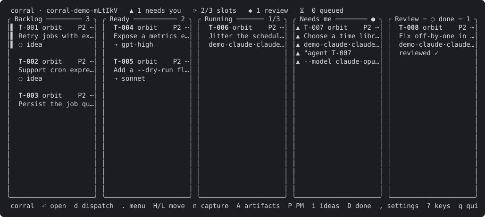
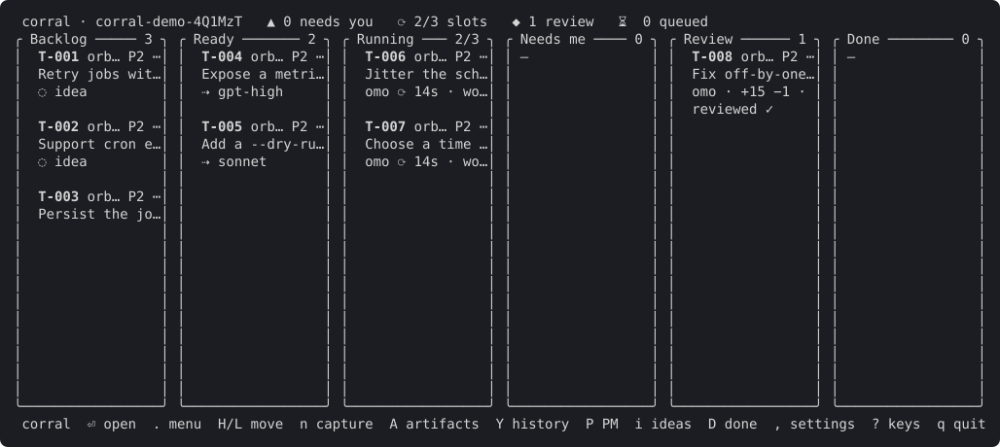
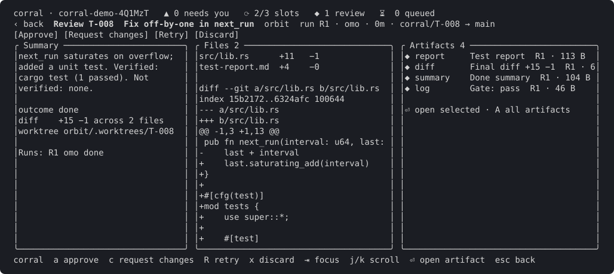
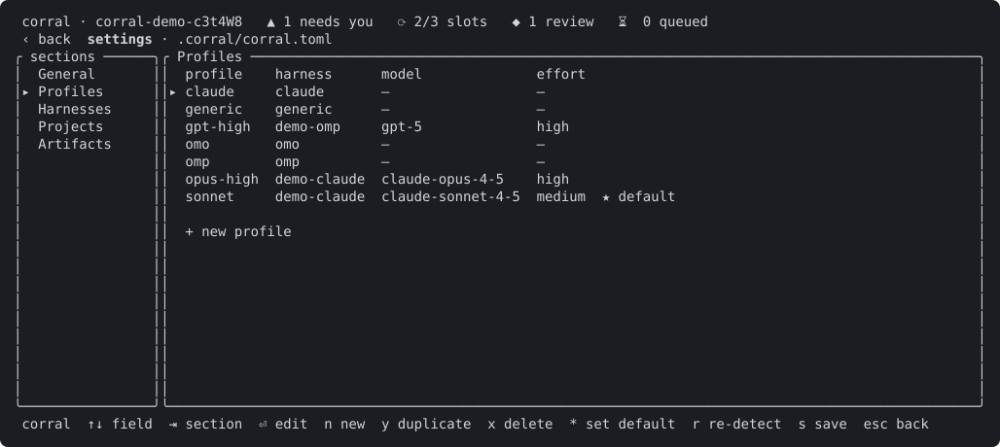

# The terminal UI

`corral board` is the main screen; the other screens open from it. Everything can be done with the keyboard
alone or with the mouse alone (typing into a text field is the one exception). Press `?` on the board for the
key list; the footer of every screen shows the keys that work right now, and each hint is clickable.

Inside herdr, `corral plugin install` links the plugin and prints keybindings for the board, the capture popup
and the artifact finder (with herdr's default prefix: `ctrl+b k` board, `ctrl+b n` capture, `ctrl+b a`
artifacts).

## Board

Columns: **Backlog**, **Ready**, **Running** (with `n/limit` slots), **Needs me**, **Review** and **Done**.
Preferences selects visible columns and WIP display. `D` temporarily toggles Done, which shows
the newest finished tasks (within `[ui] done_window`, at most `done_max`) with
their landed commit; the column foot `+N older ›` opens the history view; ideas are Backlog cards you can filter with `i`. A card shows the id, project, priority,
title and the profile that will (or did) run it; Needs me cards show the agent's question, and Review cards show
the autopilot state (`⧗ gating`, `👁 reviewing`, `↺ changes 1/2`, `⛔ blocked: <reason>`, `✓ reviewed`); a run whose foreground command is stuck shows `⚠ stuck: <command>`
(see [the watchdog](automation.md#the-watchdog-stuck-commands)). The header counts what needs you and shows
Assist or scoped Autopilot, with the same Working, Waiting, Needs your decision or Complete status
as `corral mode status --json` and PM brief. Scoped accepted/running counts are separate from board
counts; blockers identify tasks and say whether independent work continues. Paused mode stops new
automatic actions while running work and receipts continue. Autopilot toasts tell you when a run landed automatically, was escalated to
you or is blocked, with the reason; click one to open the task.

Attention is loaded with the board refresh from the same read-only assessment as
`corral attention --json`. A card gains at most one short attention line for an unexpected
stall, an owner decision, or an overdue condition: class, age and reason, shortened to the
card width. Compact cards retain their existing title row. The board's attention header
shows `overdue N` only for a positive count across the store, including cards outside the
visible columns. Keyed PM conditions use `[pm] attention_secs`; owner conditions use
`[pm] attention_owner_secs`. An unexpired handling note pauses its condition until
`next_check`. A notification does not resolve a condition.

Sync, autopilot and watchdog diagnostics appear as toasts instead of writing over the board. Press `M`
for the session's message log (the latest 200 entries, newest first); `j`/`k` and Page Up/Down scroll it.
An identical diagnostic for the same task and operation appears once until its text changes. Headless
commands still print diagnostics to stderr.

With `profile` enabled in `[board.card].fields` (or a column override), cards show
`implementer -> reviewer` from Backlog onward in rich and compact density. Before plan
approval the pair is planner -> plan reviewer. Running and Needs me cards retain the
run's recorded implementer and vendor; a launched reviewer's recorded identity takes
precedence over a newly configured reviewer. Route warning triangles are hidden by default.
Set `[ui] route_warnings = true` to show the yellow `⚠` for same-vendor review, an
unmapped vendor, and a default-profile fallback in every card density. This display
preference does not change route pairs, review enforcement (`require_cross_family`),
or stuck, idle, expired-wait and slot warnings.
Route discovery runs on a background worker and is cached by task and configuration
revision; painting and navigation never probe a model catalog.

| Key | Action |
|---|---|
| `h j k l` or arrows | move the selection |
| `⏎` | open the task overview, in every status |
| `a` | jump to the agent's herdr pane |
| `r` | reply inline to a blocked agent |
| `d` | dispatch sheet |
| `X` | drop an unfinished task (asks first; optional reason) |
| `H` / `L` | move the card left or right (Backlog and Ready) |
| `.` | card menu: every action valid for this card |
| `n` or `c` | capture an idea |
| `A` | artifact finder |
| `Y` | history of finished and dropped tasks |
| `M` | board message log |
| `P` | open or focus the PM agent pane |
| `i` / `D` | toggle ideas only / show Done |
| `,` | settings |
| `O` | open operating mode, finite scope and delegated authority |
| `?` | help: getting around in plain words, with the keys from your herdr config, then every board key |
| `t` | replay the welcome tour (shown once, on the first board open) |
| `esc` | back or close a popup |
| `q` | close the board, after a popup that explains agents keep running and `corral up` comes back |
| `ctrl+c` | quit from anywhere |

**Dispatch sheet** (`d`): pick the profile (`h`/`l`), override the model (`M`, with a filterable picker) and
effort (`e`) for this run only, or save the combination as a new profile (`p`). It previews the command that
will be sent.

**Drop** (`X`, or **drop…** in the card menu): available for Idea, Backlog, Ready, Running,
Needs me and Review cards, never Done or Dropped. The popup explains the consequences before
anything changes. `⏎` or `y` confirms; `esc` or `n` cancels. Press `Tab` or click the optional
reason field to edit it; while editing, `y` and `n` are ordinary text. `Tab` returns to
confirmation, `⏎` confirms with the reason, and `esc` still cancels.

With no run, only the task's status changes. With a run, the existing discard operation closes
owned panes and removes the worktree and branch when possible; artifacts remain available.
Cleanup warnings appear in the message log (`M`), and operation errors appear as toasts.
Dropped cards leave the board and appear in history (`Y`) with `✗`. The event log records
the owner's drop, its optional reason and the TUI source.

**Mouse:** click a card to select it, click the selected card (or double-click) to open it, right-click or click
`⋯` for the card menu, and scroll the column under the pointer with the wheel. Drag a card to another column to
move it: legal columns get a green border, illegal ones are dimmed, and `esc` cancels. Backlog to Ready and back
are plain moves; dropping on Running opens the dispatch sheet (it never dispatches silently); dropping a Review
card on Done opens the review screen. The `○ ideas` and `○ done` markers on the column borders toggle `i` and
`D`, the header counters (`▲ needs you`, `⟳ slots`, `◆ review`) focus that column, and a click on the header's
operating status opens the same scope and authority editor as `O`.

The editor opens on what the grant covers, what Autopilot may do (landing names owner-only
projects) and what needs you; **Policy details** expands the complete policy. **Grant projects** and
**Grant tasks** open a checklist: `j`/`k` move, `space` selects, `⏎` applies. **Include new tasks**
makes a project grant cover tasks filed later until it ends (**Ends after**, default 7 days),
optionally capped by **Max new tasks**. Opening the editor, toggling rows or saving ordinary settings
never grants authority. **Grant Autopilot** shows a summary; press `y` or click **[Grant]** to
confirm, Esc or **[Cancel]** to leave without a grant. Enter never confirms. A changed policy, task or
scope rejects the old preview; cancel and preview again. **Use Assist** withdraws automatic authority;
**Pause Autopilot** and **Resume Autopilot** preserve the existing scope. Resume requires a
still-valid grant.

## Card detail

`⏎` on a card opens **Overview**: the original purpose, cumulative outcome, what needs you,
recorded checks, and latest activity, in that order. Older tasks without a cumulative outcome
say so; a run's latest rebase or repair summary is never presented as the task's overall result.
Saved outcomes name their source run and warn when the specification has changed.
Recorded checks are not revalidated by opening this screen.

The **Waiting** block lists every current attention condition, primary first, including
its reason, responsible party, since time and age, canonical or discovered age source,
current resume-check truth, next action and recipient, and any handling note with
`next_check`. An unknown age or check remains unknown. Failed projection reads say
`attention unavailable` with the reason instead of claiming there are no waits or zero
overdue conditions. These displays grant no authority and do not answer, move or resume work.

Use `r` to review a task needing acceptance, `a` to open a running agent, or `8` for a plan
and its children. The clickable links open the spec (`1`), reports (`2`), evidence (`3`),
checks (`5`), comments (`6`), and history (`7`). These keep their existing tab numbers.
`0` returns from a detail tab to Overview. Full results and command-level verification
remain in Runs; earlier reports remain available in Artifacts rather than crowding Overview.

Detail tabs use the full width by default. `L` explicitly shows or hides the **Live** panel;
from Overview it opens the spec with Live visible.

| Key | Action |
|---|---|
| `0` | return to the overview |
| `L` | show or hide live output |
| `1`-`6`, `⇥` / `shift+⇥` | tabs: Spec, Runs, Artifacts, Diff, Acceptance, Comments |
| `j` / `k` or arrows | select a run (Runs), an artifact (Artifacts) or a record (Acceptance); scroll elsewhere |
| `⏎` | preview the selected artifact or record |
| `n` / `v` / `f` | Artifacts tab: next important artifact, mark it reviewed (✓), fold or unfold the `raw (N)` group |
| `a` | jump to the agent pane |
| `r` | route explanation and fix actions |
| `p` / `v` | pin implementer / set reviewer (outside tabs with their own action for that key) |
| `u` | unstick: terminate a stuck foreground command (asks first; only shown when the run is flagged) |
| `esc` | back |

The **Acceptance** tab first shows effective operating authority, grant/revision, acceptance sources
and refusal reasons. It also shows the review policy in effect and where each value is set (built-in default,
`[review]`, `[projects.<key>.review]` or the task's `review:`), the autopilot stage and change rounds, the gate
and review result of every run with the reviewer's notes, the landing result, the gate logs, review reports
and change requests (`⏎` previews one), and the autopilot history.

The **Comments** tab shows the task's [owner notes thread](comments.md), including author
and time, and provides an add-comment input with keyboard and mouse controls.

**Route** (`r`) shows the same next-dispatch values as `corral route <id> --json`:
implementer profile, harness, model, effort and source (dispatch override, task profile,
named routing rule or fallback), reviewer selection and policy source, planner and plan
reviewer, and all warnings. A separate recorded-run section explains the board pair for
tasks that already ran. Route changes affect future dispatch/review choices, not the
identity of an existing agent session.

Use `p` or **Pin implementer** to reuse the dispatch profile picker (`h`/`l` or arrows,
or click a profile; Enter/**Save** persists the task pin). Use `v` or **Set reviewer**
to select a profile, `pm`, `cross-vendor`, `none`, or **inherit** with Up/Down or a click,
then Enter/**Save**. **inherit**, `c`, or **Clear reviewer** clears the task override.
Esc cancels the picker or closes the route explanation. All saves use the operations API
and record an event; no task files need manual editing.

**Mouse:** click a tab, a run, artifact or record row; click the selected artifact or record to preview it; the wheel
scrolls the box under the pointer; `‹ back` is Esc.

## Review

Opened with `r` from a task overview needing review. Three boxes: **Summary** (the agent's `corral done` text, outcome, diff size,
worktree and runs), **Files** with the diff, and **Artifacts** (report, diff, summary, gate log and anything
the agent attached). The report (else the summary) opens in a preview as soon as the screen opens; `esc` closes it. The
header shows the run, its profile and the autopilot state.

| Key | Action |
|---|---|
| `a` | approve: opens the merge sheet |
| `c` | request changes: type a note, `⏎` sends it into the same agent session |
| `R` | retry: new run, with a profile, model and effort sheet |
| `x` | discard (asks first: `⏎` or `y` confirms, `esc` or `n` cancels) |
| `⇥` | change focus between boxes |
| `j` / `k` | scroll, or move the artifact selection |
| `⏎` | open the selected artifact |
| `n` / `v` / `f` | Artifacts focus: next important artifact, mark it reviewed (✓), fold or unfold the `raw (N)` group |
| `A` | open the artifact finder |
| `i` | the task's Acceptance tab (policy, gate and review results, history) |
| `esc` | back |

**Merge sheet** (`a`): choose the strategy (`j`/`k`; rebase, fast-forward or keep), toggle worktree removal
with `w`, confirm with `⏎`.

**Mouse:** the `[Approve]`, `[Request changes]`, `[Retry]` and `[Discard]` buttons are the four keys; click a
box to focus it, a file row to jump the diff to that file, an artifact row to select it and again to open it.

## Watching stages

Task detail and Review share an **Agent > Gate > Review > Land** strip. Each stage shows its state,
elapsed time and cost; unknown accounting is labelled rather than estimated silently. Click a stage or
press `F1`-`F4` to open its read-only monitor. `Tab` and `Shift+Tab` move between stages there.

**Gate** lists the effective review gate commands as pending, running, passed, failed or interrupted,
with each command's elapsed time. The selected command's log appears below the checklist and follows
new output. `j`/`k` or a click selects a command; Page Up/Down and the wheel scroll its output, `h`/`l`
scroll long lines sideways, `Home` opens the start of the command's log, and `End` resumes following.
Page Up/Down cross byte windows for large logs without loading the whole file. A failure selects the failed command and jumps
to its first error, including errors older than the live tail window. `e` jumps to the first error again;
`r` switches raw/rendered output.

**Review** shows the reviewer's live screen using the same pane readback as the working agent, together
with the captured profile, model, change round, elapsed time and cost. When a verdict arrives, its notes
are rendered above the retained transcript and screen in the scrollable document. Keys in this monitor
only navigate; they never type into the reviewer pane.

`[`/`]` or **Previous round**/**Next round** browse earlier gate or reviewer attempts, including attempts
from earlier runs. **Latest** (`L`) returns to the newest attempt. The run, round and attempt number stay
visible while comparing history. Completed gate logs and reviewer captures are artifacts, so they remain
readable after their panes close; artifact retention still applies to raw logs. The board shows the active
command (`gating 2/4: cargo clippy`) or reviewer model (`reviewing: sonnet`) without opening a herdr tab.

## History

`Y` on the board, or the `+N older ›` foot of the Done column. Every Done and Dropped task, newest first, with
id, title, project, finish date, landed commit and artifact count. Type to filter using the
[shared query syntax](search.md#shared-query-syntax), including text, `project:x`, `kind:x`,
`sha:abc123`, `pinned`, dates, cost and negation. Every term must match; invalid queries show an error.
History keeps newest-finished order and only Done and Dropped tasks. `⏎` opens the task detail, whose
Runs, Artifacts and Diff tabs read the saved snapshots after the worktree is gone.
`corral list --done --since 7d` lists only Done tasks from the shell; `corral search "query"`
or `corral list --query "query"` searches all statuses.

## Artifact finder

`A` from the board, or `corral artifacts`. Type to fuzzy-filter every artifact across all tasks by title, kind,
project and task; the preview on the right follows the selection.

| Key | Action |
|---|---|
| type | filter |
| `↑` `↓` or `ctrl+n` `ctrl+p` | move the selection |
| `ctrl+t` / `[sort: …]` | sort by tier (keep, normal, transient; reports and summaries first; the default) or newest first |
| `ctrl+f` / `[tier: …]` | list one tier or all of them |
| `⇥` / `raw (N) hidden` row | with every tier listed, switch between the important view (default; raw items stay behind the `raw (N) hidden` row) and all artifacts |
| `tier:keep`, `kind:report` | filter by importance tier or kind (also `tier:normal`, `tier:transient`) |
| `ctrl+r` / `ctrl+e` | toggle rendered/raw; jump to the first error of a log |
| `ctrl+v` | mark the selected artifact reviewed |
| `←` `→` / `[◂] [▸]` | scroll long lines sideways |
| `pgup` / `pgdn` | scroll the preview |
| `⏎` | open with the configured viewer (see `[viewers]` in [configuration](configuration.md#viewers)) |
| `esc` | close |

Pin the artifacts you come back to with `corral pin` so they are one step away; see the [CLI
reference](cli.md).

## Reading artifacts

Previews format artifacts for reading and keep the stored text one key away. Markdown shows headings, lists,
block quotes, links (text plus a dimmed URL), aligned tables with wrapping cells, rules and highlighted code
blocks; JSON is pretty-printed and highlighted, TOML and YAML highlighted, diffs coloured, logs keep their ANSI
colours with error, warning and `test result` lines highlighted, CSV is a table, and source files are highlighted by
extension. Prose re-wraps when the pane resizes; code and log lines stay whole and scroll sideways (`h`/`l` or
the arrows in a popup).

| Key | Action |
|---|---|
| `r` | toggle rendered/raw for this kind of artifact (remembered per kind); a click on the toolbar does the same |
| `e` | log previews: jump to the first error |
| `h` `l` / `←` `→` | scroll long lines sideways; wide content shows a `[◂] [▸]` bar under the text that does the same by click |

Artifacts are ordered by importance everywhere they are listed: **keep** (reports, summaries, screenshots,
acceptance and review records) first, then evidence, then **raw** material (logs and diffs) collapsed under a
`raw (N)` row that `f` or a click unfolds. Keep rows are bold with a badge and a one-line excerpt; unreviewed ones
are highlighted until marked reviewed with `v`, and `n` walks the keep-tier items, unreviewed first. The tier is the artifact's
stored tier (`corral artifact set-tier` overrides it; see [storage](storage.md)), and Review cards show `● N new` while
keep-tier artifacts are unreviewed. `corral artifact list` uses the same order (`--tier keep`
filters), and `corral artifact show <ref> [--raw]` prints the same rendering in the terminal, laid out for the terminal's width (`COLUMNS` overrides it; 100 columns when piped).

## Settings

`,` from the board, or `corral settings`. Sections: General, Profiles, Harnesses, Projects, Artifacts,
Automation, Board cards and Preferences (`1`-`8` or `⇥` to switch). Board cards picks the density and which fields each card
shows (toggle with `←→` or a click; edit the priority order as text) above a live preview of a sample card, in the
wide layout and at 80x24. Automation's **Operating mode** entry opens the same editor as `O`.
The remaining controls are subordinate review policy for all
projects and for each project: gate commands (a list), reviewer, accept mode, max rounds, merge strategy, diff
limit and owner paths. Explicit owner-only acceptance remains a restriction; automatic acceptance settings
never grant authority by themselves. Dirty drafts preserve unrelated concurrent changes and reject
conflicting edits instead of overwriting them. Unset values show what they inherit; a project's lists inherit until you switch them to
`own`. Edits are staged; `s` saves through a validated, comment-preserving write to
`.corral/corral.toml`, and `esc` with unsaved edits asks whether to discard.

| Key | Action |
|---|---|
| `↑` `↓` / `j` `k` | move between fields |
| `⏎` or space | edit, toggle or open |
| `←` `→` / `h` `l` | cycle a choice |
| `a` / `x` | add / remove an item (project, glob, ...) |
| `K` / `J` | reorder a list item |
| `s` | save |
| `esc` | back (in a profile editor: back to the list) |

**General** includes PM event push (off by default) and PM push kinds: a comma-separated list of
`done, needs_me, stuck, blocked, escalated`. Empty selects none; invalid names block saving. Saving
only changed PM fields preserves concurrent edits to other PM keys. See [board events](events.md).

On **Profiles**: `n` new, `y` duplicate, `x` delete (refused while something references it, naming what),
`*` make it the default, `r` re-detect installed harnesses and models. `⏎` opens the profile editor: harness,
a model picker that filters the models the harness reports (free text is accepted), effort levels limited to the
harness's, extra args, and a preview of the command a dispatch would run.

**Mouse:** click sections, fields, pills and `+ add` rows; the wheel scrolls the form, or switches section over
the section list.

**Preferences** includes accent, compact cards, WIP usage, desktop alerts for Needs me and Review,
automatic queue dispatch, visible columns, Done history bounds and remappable board keys.
The controls use the same staged Save and discard flow. Personal `[ui]` preferences can be saved
to the user layer (`u`); auto-dispatch is workspace-only (`w`). Key edits accept one printable ASCII
character other than digits, or empty to restore the default. Conflicts block saving; arrows, Enter
and Ctrl+C stay available. Shortcuts do not intercept typed text, and mouse actions are unchanged.
See [UI configuration](configuration.md#ui) for notification requirements and key names.

## Capture popup

`n` on the board, `corral capture`, or the herdr key. Pick the project, type a title, and `⏎` saves it as an
idea (or as a task, using the `save as` pills). `esc` or `×` closes; a click outside closes it unless you have
typed something.

## Mouse reference

- Left click selects or focuses; clicking an already-selected item, or double-clicking, activates it like `⏎`.
- Right-click opens a card menu on the board.
- The wheel scrolls the region under the pointer.
- Footer hints, tabs, pills and popup buttons are clickable; each one presses the key it names.
- `‹ back` (title row) is Esc; popups have `×` and close on an outside click.
- There is no hover. Mouse capture disables your terminal's own text selection; hold Shift to select text.
- Turn the mouse off with `corral board --no-mouse`, `CORRAL_MOUSE=0`, or `[ui] mouse = false`.
