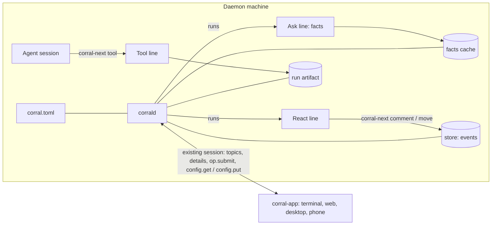

# Extensions for the simple engine

Status: **proposal**, 2026-11-22. Nothing here is implemented. Every number is a provisional proposal.

Two earlier revisions were rejected by the owner: the first reused the old engine's protocol (manifests,
framing, negotiation, digests) and was too complicated; the second was simple but designed around one use,
code facts. This revision starts from the range of things people would extend Corral for and keeps one
simple mechanism for all of them. Owner decisions so far: build Tool and Ask first; containers on the same
machine are enough for now, so `wrap` (6.1) is in scope and the runner command (6.2) is designed but deferred.

## 1. What people would extend Corral for

| # | Use | Example | Shape | Today |
|---|---|---|---|---|
| 1 | Give agents knowledge | Starting context for a task, project memory, docs lookup | Tool (3) | agents are told in project instructions to run tools themselves |
| 2 | Give agents abilities | Query a staging database, take a screenshot | Tool (3) | same |
| 3 | Deepen Corral's own views | Definitions and resolved references for the [system map](system-map.md) | Ask (4) | no |
| 4 | Advise a decision | Suggest a profile for a task; pick tests for a change | Ask (4) | static `routing` rules |
| 5 | Notify someone | Chat or phone message when a task is blocked or ready | React (5) | Web Push to paired devices only |
| 6 | Keep another system in step | Close the GitHub issue on landing; move a Linear card | React (5), then write back | no |
| 7 | After landing | Deploy, tag, release notes, start CI | React (5) | no |
| 8 | Bring work in | Turn labelled issues into Corral tasks | Write back, from a schedule the extension owns | `import` for legacy exports only |
| 9 | Run sessions somewhere else | A container; another machine | Wrap, or a runner command (6) | `runner.mode`: `herdr` or `process` |
| 10 | Check work | Security scan, licence check before landing | Existing gate lines | `projects.<name>.gate` |
| 11 | Use another agent program | A different coding CLI | Existing harness lines | `harnesses.<name>.command` |
| 12 | Show something of its own | CI status, a custom report | Later (9) | no |

Rows 10 and 11 show Corral already has the right habit: an extension point is a command line in
`corral.toml`. This design extends that habit instead of adding a second system.

## 2. One mechanism

**An extension is a named block in `corral.toml` holding command lines.** Corral runs a line with `sh -c`,
as it runs gate lines, writes one JSON object to its stdin, and reads its stdout. The owner wrote the line,
so the owner trusts it. There is no manifest, registration, negotiation, framing or long-lived process.

```toml
[extensions.codeindex]
projects = ["corral"]                         # omit for every project
facts = "my-indexer corral-facts"             # Ask: the system map's slot
[extensions.codeindex.tools]                  # Tool
context = { run = "my-indexer corral-context", about = "Starting points and related code for this task", record = true }

[extensions.notify]
on  = ["blocked", "ready", "landed"]          # React
run = "ntfy publish my-topic"
```

| Rule | Detail |
|---|---|
| Input | One JSON object on stdin with `"v": 1`, then end of input. Unknown fields are ignored on both sides |
| Output | stdout. stderr is kept only for the error message (last 4 KiB) |
| Success | Exit status 0. Anything else is a failure, shown where the result would have been; never retried in a loop |
| Limits | A deadline, after which the process group is killed; an output ceiling |
| Environment | The project's `env`, `CORRAL_NEXT_ROOT`, `CORRAL_PROJECT`, `CORRAL_EXTENSION=<name>`, `CORRAL_ACTOR=extension` |
| Writing back | An extension changes Corral by running the public CLI (`corral-next new`, `comment`, `move`, `artifact add`, …). There is no other write path |

`CORRAL_ACTOR=extension` needs one addition to the engine's types, `Actor::Extension`, so the event log says
a change came from an extension. It does not record which one; add that only if it proves needed.

Tool, Ask and React never sit on the path of an engine operation: no dispatch, gate or landing starts or
waits for them. Section 6 is the exception and says how it is bounded.

## 3. Tool: commands for agents and the owner (first)

- `corral-next tool` lists the current project's tools; `corral-next tool <name> [args...]` runs one and
  prints its stdout unchanged. Corral does not parse it.
- stdin carries what Corral knows about the caller, so the extension need not ask back:
  `{"v": 1, "args": [...], "role": "worker", "repo": "/abs/worktree", "base": "<commit>", "task": {id, title,
  body, parent, depends_on}, "run": "R2"}`. Task, run and role default from `CORRAL_TASK`, `CORRAL_RUN` and
  `CORRAL_ACTOR`, which every agent session already has. The working directory is the agent's worktree.
- When a project has tools, the run prompt (`crates/corral-engine/src/prompt.rs`) gains one fixed section
  listing each tool's name and its `about` line. Nothing runs while dispatching.
- `record = true` stores a tool's first output in a run as an artifact. Deadline: 60 s.

Task context is a tool named `context`. Project memory, a docs search and a screenshot helper are others.

## 4. Ask: slots a built-in feature defines (first)

A slot is a key Corral knows, with a page describing its request and its answer. Corral works without it
and gets better with it. If two enabled extensions fill the same slot for one project, `config check`
reports both.

| Slot | Asked by | Status |
|---|---|---|
| `facts` | system map | specified below |
| `route` | dispatch, to suggest a profile | idea only; would read from a cache, never during dispatch |
| `tests` | gate, to pick tests for a change | idea only |

### The `facts` slot

Called by the daemon's background worker. Deadline: 10 minutes. Output ceiling: 64 MiB.

```json
{"v": 1, "query": "snapshot", "repo": "/abs/repo", "rev": "<commit>", "want": ["files", "definitions", "references"]}
{"v": 1, "query": "delta", "repo": "/abs/repo", "base": "<commit>", "head": "<commit>", "want": ["changes", "dependents", "tests"]}
```

The answer is JSON Lines, one row per line, ending with one `done` row. A missing `done` row means the
output was cut short and the whole answer is discarded.

| Row | Fields |
|---|---|
| `file` | `path`, `read` (`complete`, `unsupported`, `failed`) |
| `definition` | `path`, `name` (full name within the file), `line`, `end_line`, `kind` |
| `reference` | `from`, `to` (file paths), `kind` (`import`, `use`, `call`), `count` |
| `change` | `change` (`added`, `removed`, `changed`), `fact` (`definition`, `reference`), `path`, `name`, `line`; for a reference also `to_path`, `to_name` |
| `dependent` | `path`, `name`, `line`, `of` (the changed definition it depends on) |
| `test` | `path`, `name` |
| `done` | `provided` (which `want` entries were answered), `skipped` (reason → count), `omitted` (limit → count) |

Rows speak only of files and definitions; Corral derives packages and modules and does all aggregation. A
`want` entry missing from `done.provided` shows in the app as "not provided", not as zero. Corral draws the
map from its own facts first and adds the extension's rows when they arrive, cached per tree hash under
`.corral-next/cache/`.

## 5. React: `on` and `run`

- The daemon runs `run` once per matching event, in sequence order, one at a time per extension, with the
  event on stdin in the engine's JSON form: `seq`, `ts`, `task`, `project`, `run`, `kind`, `actor`,
  `detail`. `on` lists event kinds; omitted means all.
- Each extension has a cursor (the last `seq` it finished) under `.corral-next/`. Delivery is at least once:
  after a crash an event may arrive again, so an extension should tolerate a repeat.
- A failing event is retried on later passes up to three times, then skipped. Deadline: 60 s.
- An extension that writes back sees its own events too; they carry `actor: extension`.
- Without a daemon nothing is delivered. `corral-next ext deliver` runs one pass, for CLI or cron setups.

## 6. Running sessions somewhere else

Two cases that look alike and are not.

### 6.1 Same machine, different environment: `wrap`

A container, a sandbox, another user, a Nix shell. The session is still a local process or a herdr pane, so
nothing else changes: status, stop, the log and the app all work as today.

```toml
[runner]
mode = "process"
wrap = "podman run --rm -v {root}:{root} -v {worktree}:{worktree} -w {worktree} corral-dev sh -c {command}"

[projects.site]
wrap = "…"                                    # a project may override it
```

Corral renders the harness line as now, then substitutes it, shell-quoted, for `{command}`. `{root}`,
`{worktree}` and `{dir}` (the run directory) are the other placeholders. The wrapped environment must see
the worktree, the workspace root (the agent runs `corral-next done` against `.corral-next/corral.db`) and the
Corral binary. This is a template, not an extension call: no JSON, no extra process beyond the one named.

Not yet determined: whether the built-in `pi` harness, which starts its host with a prepared command and a
socket in the run directory, can be wrapped the same way.

### 6.2 No local process stands for the session: a runner command

Another machine, a cloud sandbox, a cluster job. `runner.mode = "command"` names one line, called with a
verb as its argument and JSON on stdin, under the rules of section 2.

| Verb | stdin | stdout | Deadline | Called |
|---|---|---|---|---|
| `start` | the launch as Corral builds it: `label`, `cwd`, `command`, `env`, `dir` | `{"id": "<any string>"}`; the session keeps running after the command exits | 30 s | on dispatch, retry, review |
| `status` | `{id, dir}` | `{"status": "working" \| "idle" \| "blocked" \| "gone", "excerpt"?}` | 5 s | every sync pass, per live session |
| `send` | `{id, dir, text, origin}` | nothing | 10 s | on reply |
| `stop` | `{id, dir}` | nothing | 30 s | on stop, drop, landing |

- The runner must append the session's output to `<dir>/session.log` and write its exit status to
  `<dir>/exit_code` when it ends. Those are the process runner's existing files, so the daemon and the app
  read them with no change.
- A verb the runner cannot do exits non-zero with a message; Corral refuses the operation with that message,
  as the process runner already refuses `send`.
- This is the one place an extension is on the engine's path, because the engine needs a session to exist.
  It is bounded by the deadlines: a `start` that fails or times out fails the dispatch through the engine's
  existing launch rollback; a failing `status` records an `error` event and leaves the task as it is.
- New type: one more session reference, `{command: {id, dir}}`, beside herdr, process and pi.

**What this contract does not solve.** An agent on another machine must still reach Corral: it needs the
worktree and it runs `corral-next done`, `artifact add` and `tool`, and today the CLI opens the store's
files directly on the daemon's machine. So a truly remote session needs either a shared filesystem or a CLI
that can reach the daemon over the network. That is a separate decision, larger than this document.
Decided 2026-11-22: containers on the same machine are enough for now, so this section stays a design and
is not scheduled. `wrap` has no such dependency.

## 7. How this reaches the app

**The app never talks to an extension.** Extensions run on the daemon's machine, started by the daemon, the
CLI or the engine. What they produce lands in places the app already reads, or in two new reads for the
system map.



| What | Runs where | Leaves behind | The app shows it through | App work |
|---|---|---|---|---|
| Configuring an extension | n/a | a block in `corral.toml` | Settings › Configuration, which already reads and writes the whole file with `config.get` and `config.put`; its File part edits tables it has no form for | none once step 1 lets the engine accept the block; later a form part "Extensions" |
| Tool | in the agent's session, or the owner's shell | the command and its output in the session; an artifact when `record = true` | the session page (transcript or terminal), the task page's artifacts, Activity › Artifacts | none |
| Ask: `facts` | daemon background worker | rows in the facts cache | two new detail reads, `system_map {project, at}` and `system_review {task}`, and one new topic `system` (per project: commit, `building` or `ready`, the extension's last error), behind capability `system.v1` | the System page under Activity and an Impact view in the task page's Changes tab; this is the real UI work, specified in system-map.md |
| React | daemon | effects outside Corral; any write-back is an ordinary event with `actor: extension` | Activity › Feed, like any other event | none |
| `wrap` | engine, as part of the session's command | an ordinary session | Sessions and the session page, unchanged | none |
| Runner command | engine, through the runner | a session with `session.log` | Sessions and the session page; Focus pane stays listed with the reason it is unavailable | none |
| Extension health | daemon | last error per extension | the `settings` topic's snapshot gains a list: name, shapes, enabled, last error; shown in Settings and as a notice where a contribution is missing | small |

Consequences:

- Every paired device, including a phone, gets all of it with nothing installed on the device.
- An extension cannot add a screen, a button or a row type. If it needs to be seen, it writes a comment, an
  artifact or an event, or fills a slot a built-in view defines.
- The owner does not start tools from the app in this design. If that is wanted, it is one new request
  (`tool.run {task, name, args}`) answered with the output, and a "Run tool…" entry in a task's More menu.

Placement in the current app, decided 2026-11-22 so that the redesign's four places and three task tabs
stay as they are (`docs/app-design/REDESIGN.md`, decisions 3 and 12): the system map is a fifth page under
Activity (Feed, Timeline, Usage, Artifacts, System), key `m`, scoped by the project scope like the others;
a task's change map is a second view inside the task page's Changes tab, Diff or Impact.

## 8. What Corral adds, in order

| # | Step | Touches | Check | Agent |
|---|---|---|---|---|
| 1 | The runner function, the `[extensions.<name>]` block, `Actor::Extension`, `ext check` | `crates/corral-engine` (config, types), `crates/corral-next` | A line that sleeps past its deadline is killed and reported; a write-back under the variable appears in the log as `extension` | `task-easy` |
| 2 | **Tool**: `corral-next tool`, the prompt section, `record` | `crates/corral-next`, `crates/corral-engine/src/prompt.rs` | With a fixture tool the prompt lists it, the command prints its output and stores one artifact; with no tools the prompt is unchanged | `task-easy` |
| 3 | **Ask**: slot lookup and the `facts` slot, with the built-in facts, merge and cache | new `crates/corral-facts`, `crates/corral-daemon` | With a fixture script, definitions come from it and the rest from the built-in; with it failing, the answer still arrives and names the error | `task-hard` |
| 4 | Wire and app for the system map | `crates/corral-protocol`, `crates/corral-daemon`, `apps/corral-app` | See system-map.md | `task-hard`, then `ui-hard` |
| 5 | `wrap` | `crates/corral-engine` (config, launch) | A session wrapped in `env FOO=1 sh -c {command}` runs, reports done and is stopped like an unwrapped one | `task-easy` |
| 6 | **React**: delivery, cursor, retries, `ext deliver`; extension health in Settings | `crates/corral-daemon`, `crates/corral-next`, `apps/corral-app` | A fixture script receives `landed` once in order; killing the daemon mid-delivery redelivers; three failures skip the event and show in Settings | `task-hard`, then `ui-easy` |
| 7 | Runner command (deferred, see 6.2) | `crates/corral-engine` (runner), `crates/corral-types` | Not scheduled. A fixture runner starts, reports and stops a session; a hung `start` fails the dispatch within its deadline | `task-hard` |

Steps 2, 3, 5 and 6 are independent after step 1. Corral ships small example extensions in the repository,
one per shape, so each is tested and documented without any outside tool: a grep-based `context` tool, a
`facts` script that reads a tags file, and a notifier script.

## 9. Later, with the same mechanism

| Use | How it would fit | Why not now |
|---|---|---|
| An extension's own page (row 12) | A slot `page` whose answer is Markdown, shown in the app under the extension's name | No requested use yet |
| Scheduled work (row 8) | An event kind `tick` an extension can list in `on` | cron plus the CLI does this today |
| Tools started from the app | `tool.run` (section 7) | Agents are the main callers |
| Wrapping gate lines | The same `wrap` applied to `gate` | Decide once `wrap` is in use |

## 10. Left out on purpose

| Left out | Why | Add it when |
|---|---|---|
| The old protocol draft (`docs/extensions-protocol.md`) | It belongs to the old engine and is most of the complexity; it stays as old-engine history | a use needs a conversation instead of one request |
| Registration, manifests, executable digests | Gate and harness lines have none; an extension line is the same kind of thing | extensions are installed from untrusted sources |
| Permissions per extension | An extension is the owner's own command and uses the owner's CLI | several people share one Corral |
| Long-lived extension processes | One process per call is enough at these rates | a measured start-up cost hurts |
| Extension code or views in the app | Keeps one app working on terminal, web, desktop and phone | never as code; see `page` in section 9 |
| Exactly-once delivery | At least once with a cursor is enough for notifications and sync | an extension cannot be made repeat-safe |
