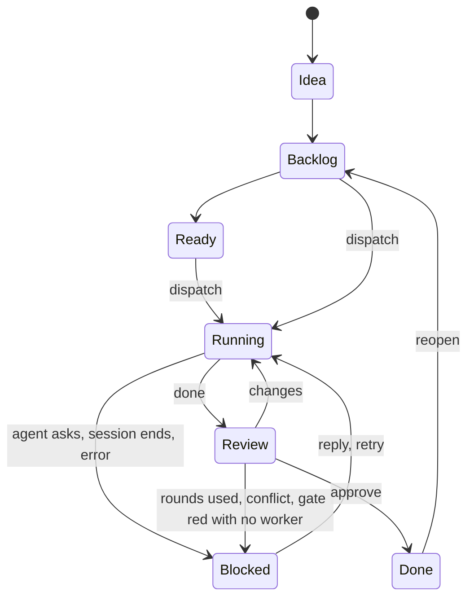

# Simple engine: replacement plan and contract

Owner decisions, 2026-11-17:

1. Replace the engine (`corral-ops` + `corral-core`); do not subtract in place.
2. Retire the classic ratatui board. The app is the surface, and it can force anything.
3. Rework the corral-pi host (see [corral-pi host](#corral-pi-host)).
4. No line budget.

Owner decisions, 2026-11-18:

5. A paired device is the owner: per-device authority classes, previews and proofs go.
6. The PM and the assistant merge into one chat agent.
7. A plan is a parent task with children and a Markdown document; no separate plan review.
8. In the app, Inbox merges into Now and Builds merges into Agents.
9. Landing a build session is a local rebase and fast-forward.
10. Rewind and checkpoints stay, inside the pi host.
11. A reviewer keeps its context between rounds of a task.

All work happens in worktrees under `corral/.worktrees/`. Nothing is written in the main checkout.

## Why

Measured on the workspace store on 2026-11-17 (976 tasks, 621 landed with full history):

- Landed tasks per week went 136, 174, 217, 74, 17, 3 while Rust source grew from 6 MB to 28 MB.
- Coding takes a median 31 min. Done to landed takes a median 73 min, mean 4.7 h, p90 12.4 h.
- A landed task averaged 4.9 gate runs, 2.3 reviews and 1.25 change rounds.
- 8,981 `dispatch_failed` events for 716 dispatches; 84% were corral waiting on its own locks.
- With the PM absent, 7 of 10 Blocked cards named the PM as the only unblocker.

## Rules

1. **The owner clears any state in one action.** No state exists that only an agent can leave.
   The assistant is optional, runs the same commands as the owner, and owns no states.
2. **Green is green.** A check passes or fails on a commit. A green rerun clears a red one.
   No attempts ledger, attribution, credits, tiers or receipts.
3. **One trust boundary: the network.** The local user is the owner on the CLI, the daemon
   socket and in agent panes. Only paired remote devices authenticate, and a paired device is
   the owner.
4. **State stays readable.** Tasks, runs, checks, artifacts, events. Nothing derived is stored.
5. **Every refusal names the command that gets past it**, including its `--force` form.

## Phases and worktrees

| Phase | Worktree and branch | Scope | Done when |
|---|---|---|---|
| 1 | `.worktrees/simple-engine`, `simple-engine` | `crates/corral-types` (shared types), `crates/corral-engine` (library), `crates/corral-next` (CLI) | The journeys under [Testing](#testing) pass and a task lands on a scratch repository through the CLI with a headless agent |
| 2 | `.worktrees/simple-app`, branched from phase 1 | Daemon serves the engine; protocol reduced; app gains force actions; classic TUI parity on the app's `tui` target | The app's `tui` and `web` targets drive new, dispatch, approve and every force action against the daemon |
| 3 | `.worktrees/simple-pi`, branched from phase 1 | corral-pi host rework and its `Runner` | A pi worker and a pi reviewer complete a task on the new engine, and the app chats with them |
| 4 | `simple-engine` | Import open tasks, rename the binary, delete the old crates and gate scripts | The exit criteria below hold on a product repository |

Until phase 4 the old `corral` binary and `.corral/` store keep running untouched. The new
engine uses its own state directory and binary name, so the two never share state.

## Engine contract

### Layout

```
<workspace>/.corral-next/
  corral.toml                 # configuration
  corral.db                   # SQLite, WAL
  blobs/sha256/<2>/<62>       # artifact bytes, content-addressed, uncompressed
  runs/<task>/<run>/          # prompt.md, session.log, exit_code
  runs/<task>/gate-<sha8>.log
  locks/<task>.pipeline       # held only while that task's pipeline runs
```

The workspace root is `--root`, else `CORRAL_NEXT_ROOT`, else the nearest ancestor of the
current directory that contains `.corral-next/`. At cutover the directory becomes `.corral/`.

### Configuration

```toml
[limits]
running = 4                  # tasks in Running or Blocked at once; Review, reviewers and gates hold no slot

[defaults]
profile = "omp-sol"          # worker profile when nothing else names one
# base = "release"           # optional; unset means the repository's default branch
max_rounds = 2
auto_dispatch = false        # start Ready tasks when a slot is free
auto_land = false            # land after gate and review without the owner
branch_prefix = "corral/"

[runner]
mode = "herdr"               # "herdr": one pane per session; "process": headless child process
herdr_session = ""           # optional herdr session name

[sync]
quiet_after_secs = 120
watch_secs = 5               # interval of `sync --watch`

[artifacts]
globs = ["docs/**/records/*", "**/*report*.html"]
max_bytes = 20000000

[harnesses.omp]              # built in: omo, omp, claude, generic; a table overrides or adds one
command = "omp {model_args} {prompt_ref}"
model_flag = "--model"
effort_flag = "--effort"

[profiles.omp-sol]
harness = "omp"
model = "gpt-6.2-sol"
effort = "medium"
args = []

[projects.mitimind-lite]
path = "mitimind-lite"       # relative to the workspace root
# base = "develop"           # optional target branch for this project's tasks
gate = ["just check"]        # optional; each line runs with `sh -c` in the worktree; exit 0 passes
reviewer = "omp-sol"         # optional profile; one pass per `done`
profile = "omp-sol"          # optional worker default
running = 2                  # optional per-project slot cap
env = { CARGO_TARGET_DIR = "/abs/target" }   # optional; exported to gate lines and sessions
auto_dispatch = false
auto_land = false
max_rounds = 2

[[routing]]                  # optional; first match wins
kind = ["ui"]
size = ["l", "xl"]
title_regex = "(?i)tui|frontend"
project = "corral"
profile = "omp-opus"
```

Worker profile resolution: dispatch flag, task `profile`, first matching `[[routing]]`
rule, project `profile`, `defaults.profile`. Project keys fall back to `[defaults]`.

Base branch resolution: dispatch flag, task `base`, project `base`, `defaults.base`, then
the repository's default branch (what `refs/remotes/origin/HEAD` points at, else the branch
checked out in the project's main checkout). Nothing assumes `main`.

Harness placeholders: `{prompt_file}` (absolute path), `{prompt_ref}` (one quoted argument
asking the agent to read that file), `{name}` (`T-042 title`), `{task}`, `{worktree}`,
`{corral}` (absolute path of this binary), `{model_args}` (model and effort flags plus the
profile's `args`). Gate lines and harness commands are owner-written shell lines and are
the only places a shell runs; git and herdr are called with argv.

Every session starts with `CORRAL_NEXT_ROOT`, `CORRAL_TASK`, `CORRAL_RUN` and
`CORRAL_ACTOR` (`agent` or `reviewer`) in its environment. The actor is attribution only;
nothing authenticates it.

### Model

The types below, `Op`, `Next` and `Refusal` live in the leaf crate `crates/corral-types`
(serde and jiff only, so it also compiles for the app's wasm target). The engine re-exports
them, and the protocol carries them as they are: there is no second set of wire structs.

```rust
pub enum Status { Idea, Backlog, Ready, Running, Blocked, Review, Done, Dropped }
pub enum Priority { P0, P1, P2, P3 }            // default P2
pub enum Actor { Owner, Agent, Reviewer, Assistant, Auto }

pub struct Task {
    pub id: String,                 // "T-042", allocated in the creating transaction
    pub title: String,
    pub body: String,               // Markdown: Goal, Acceptance, Notes
    pub status: Status,
    pub project: Option<String>,
    pub priority: Priority,
    pub kind: Option<String>,
    pub size: Option<String>,
    pub profile: Option<String>,    // pinned worker profile
    pub base: Option<String>,       // branch to start from and land onto
    pub parent: Option<String>,     // a plan is a parent task with children
    pub depends_on: Vec<String>,
    pub blocked: Option<Blocked>,   // Some exactly when status is Blocked
    pub round: u32,                 // automatic send-backs since the last owner action
    pub created: Timestamp,
    pub updated: Timestamp,
}

pub struct Next {
    pub op: Op,                     // the operation that clears the state
    pub force: bool,
}                                   // `Next::command()` renders the CLI line for display

pub struct Blocked {
    pub reason: String,             // one line
    pub detail: Option<String>,     // agent question excerpt, log tail, git error
    pub next: Vec<Next>,            // owner commands that clear it; the first is recommended
}

pub enum Role { Worker, Reviewer }
pub enum Outcome { Done, Landed, Failed, Stopped, Superseded }

pub struct Run {
    pub id: String,                 // "R1", per task
    pub task: String,
    pub role: Role,
    pub profile: String,
    pub harness: String,
    pub model: Option<String>,
    pub effort: Option<String>,
    pub worktree: PathBuf,
    pub branch: String,
    pub base: String,
    pub base_sha: String,
    pub session: Option<SessionRef>,
    pub started: Timestamp,
    pub ended: Option<Timestamp>,
    pub outcome: Option<Outcome>,
    pub summary: Option<String>,
    pub head_sha: Option<String>,   // at `done`
    pub quiet_since: Option<Timestamp>,
}

pub enum CheckKind { Gate, Review }
pub enum CheckResult { Pass, Fail }             // review: approve is Pass, changes is Fail

pub struct Check {
    pub task: String,
    pub kind: CheckKind,
    pub key: String,                // gate: commit sha; review: the task round
    pub result: CheckResult,
    pub notes: Option<String>,      // reviewer notes or failing gate line
    pub log: Option<String>,        // artifact ref
    pub by: Actor,
    pub at: Timestamp,
    pub round: Option<u32>,        // task round at recording; absent in older rows
    pub run: Option<String>,       // gate worker or associated reviewer run id, if available
}
```

A gate result belongs to one commit. A review belongs to one round and survives a rebase:
it judged the change, not the base. The newest check for a key decides.

A precondition failure is a typed `Refusal { reason: String, next: Vec<Next> }` inside the
`anyhow` error, so every caller can show why and what clears it. `next` is data, never
text to parse: the app renders one button per entry and submits that entry's `op`.

```rust
pub struct Usage {                  // one model request, reported by the agent host
    pub task: Option<String>,
    pub run: Option<String>,
    pub at: Timestamp,
    pub profile: Option<String>,
    pub model: String,
    pub input: u64,
    pub output: u64,
    pub cache_read: u64,
    pub cache_write: u64,
    pub usd: Option<f64>,           // None when the host could not price it
    pub billing: Option<String>,    // "subscription" or "api"
}
```

Usage rows are what `corral usage` and the app's Usage page total. A run with no rows ran
on a harness that reports none, and the totals say how many runs they cover.

### Statuses



`drop` moves any status to Dropped. `move --force` sets any status from any status.

### Operations

Every operation is one variant of `Op`, and `Engine::apply(op, force)` is the single entry
point the CLI, the daemon and the pipeline call:

```rust
pub enum Op {
    New { .. }, Edit { .. }, Comment { id, text }, Move { id, status },
    Dispatch { id, profile, base }, Reply { id, text }, Stop { id },
    Retry { id, profile, fresh, note }, Done { id, summary }, Gate { id },
    Review { id, profile }, Verdict { id, approve, notes }, Changes { id, text },
    Approve { id, onto }, Drop { id }, Reopen { id },
    ArtifactAdd { .. }, UsageAdd { .. }, Sync,
}
```

The CLI parses its arguments into an `Op`; the wire submits `{ op, force }` unchanged.

| Operation | Allowed when | Effect | `force` skips |
|---|---|---|---|
| `new` | always | Task in Idea, Backlog or Ready | n/a |
| `edit`, `comment` | always | Fields or body change; `edited` or `commented` event | n/a |
| `move` | among Idea, Backlog, Ready; Done or Dropped to Backlog | Status change | Every rule: any status to any status |
| `dispatch` | Backlog or Ready, project set, dependencies Done, a slot free | Worktree `<project>/.worktrees/<id>` on `<branch_prefix><id>`, prompt, worker session, Running | Dependencies and slots |
| `reply` | a live worker session | Text delivered; Blocked returns to Running | n/a |
| `done` | Running or Blocked with a worker run; a repeat while in Review succeeds and changes nothing | Uncommitted work is committed; diff, summary and glob artifacts stored; Review; pipeline starts | n/a |
| `gate` | the task has a worktree | Gate runs on HEAD; `Check` and log artifact recorded | n/a |
| `review` | Review, a reviewer profile resolves | Reviewer session in the worktree | n/a |
| `verdict` | Review | `Check` recorded; approve ends the reviewer session and continues the pipeline; changes sends work back and keeps the reviewer session for the next round | n/a |
| `changes` | Review or Blocked with a run | Owner note sent back; Running; `round` reset to 0 | n/a |
| `approve` | Review, gate green on the landed commit; the task's sessions are stopped as part of landing | Land (below) onto the run's base, or onto any existing branch with `onto`; Done | The gate, and the status rule: any task with a branch lands |
| `retry` | the task has had a run | New worker run on the same branch, or from base with `fresh` | n/a |
| `stop` | a live session | Session killed; Blocked `stopped by owner` | n/a |
| `drop`, `reopen` | always | Dropped, or back to Backlog | n/a |
| `sync` | always | Reconcile sessions, dispatch Ready work, resume stalled pipelines | n/a |

Moving to Done or Dropped stops the task's live sessions and keeps its worktree and branch.
`Auto` never forces. Each forced action appends one `forced` event listing what it skipped.

### After `done`: the pipeline

`done`, `verdict` and `gate` trigger `advance(task)` at once; nothing waits for a tick.
From the CLI it runs in a detached `corral-next pipeline <task>` process; the daemon calls
it directly. It holds `locks/<task>.pipeline` (non-blocking) and is safe to rerun.

```
while status is Review:
    head = branch HEAD
    gate configured and no gate check for head  -> run the gate; red: send back, stop
    reviewer configured and no review check for this round:
        review already requested this round -> stop (waiting for its verdict)
        reviewer session live -> send it the re-review request, stop
        else start a reviewer whose prompt carries the earlier rounds' notes, stop
    review check is Fail -> stop (sent back when the verdict arrived)
    auto_land -> land, stop
    else -> append `ready` once, stop (waiting for the owner)
```

### Landing

One function, under the per-repository lock (`corral_git::landing_lock`):

The target is the branch the run started from, unless `approve` names another with `onto`.
Any existing branch can be a target.

1. Rebase the worktree onto the target. On conflict: abort the rebase and send back
   `rebase onto <target> and resolve conflicts`.
2. If a gate is configured, not skipped, and no green check exists for the rebased HEAD,
   run it. Red: send back.
3. Fast-forward the target. If it is checked out in any worktree of the repository, run
   `git merge --ff-only <branch>` there; if it is checked out nowhere, update the ref with
   `git fetch . <branch>:<target>`. Git decides whether local changes collide; a refusal
   becomes Blocked with git's message. A target that does not exist is refused by name.
4. Close the task's sessions, remove the worktree, delete the branch, mark the run Landed,
   set Done, append `landed` with the sha.

Because the lock covers rebase through fast-forward, the base cannot move underneath a
landing, so a gate is rerun only when the rebase changed the commit.

### Sending work back

A red gate, a `changes` verdict and a rebase conflict all use one path:

- `round` at `max_rounds`: Blocked, with `next` naming `corral changes`, `corral retry` and
  `corral approve --force`.
- Otherwise `round += 1`, status Running, and the notes go to the live worker session, or
  to a new worker run on the same branch when no session is live.

The owner's `changes` and `retry` reset `round`.

### Sessions

```rust
pub enum SessionRef {
    Herdr { workspace: String, pane: String },
    Process { pid: u32, dir: PathBuf },
}

pub enum SessionStatus { Working, Blocked { excerpt: String }, Idle, Gone }

pub struct LaunchSpec {
    pub label: String,              // "T-042 title"
    pub cwd: PathBuf,
    pub command: String,            // rendered harness command
    pub env: Vec<(String, String)>,
    pub dir: PathBuf,               // runs/<task>/<run>/
    pub tokens: Vec<(String, String)>,   // task, run
}

pub trait Runner {
    fn start(&self, spec: &LaunchSpec) -> Result<SessionRef>;
    fn status(&self, session: &SessionRef) -> Result<SessionStatus>;
    /// `Origin::Owner` for a reply the owner typed, `Origin::Auto` for send-backs and nudges.
    /// A paused pi session holds `Auto` input until it is resumed; other runners ignore it.
    fn send(&self, session: &SessionRef, text: &str, origin: Origin) -> Result<()>;
    fn stop(&self, session: &SessionRef) -> Result<()>;
    fn focus(&self, session: &SessionRef) -> Result<()>;
}
```

- `HerdrRunner`: `workspace_create`, `pane_report_metadata`, `pane_run`; status from
  `pane_get`; `agent_prompt` to send; `pane_close` to stop.
- `ProcessRunner`: a detached `sh -c` child in its own process group, output to
  `session.log`, exit status written to `exit_code`. `Gone` once `exit_code` exists; `send`
  refuses, so a send-back starts a new run.
- A pi runner over the host bridge arrives in phase 3.

### Sync

One pass:

1. For each live worker run, read the session status. `Blocked`: task Blocked with the
   excerpt and `next = corral reply`. `Working` on a Blocked task: back to Running. `Gone`
   while Running: Blocked `agent session ended without corral done`, `next = corral retry`.
   `Idle` sets `quiet_since`; it never changes the status.
2. A reviewer session that is `Gone` without a verdict: Blocked, `next = corral review`.
3. With `auto_dispatch`: dispatch Ready tasks by priority then age while slots are free.
4. For each Review task without a held pipeline lock: `advance`.

### Events

`seq`, `ts`, `task`, `run`, `kind`, `actor`, `detail` (JSON). Kinds: `created`, `edited`,
`commented`, `moved`, `dispatched`, `blocked`, `resumed`, `replied`, `done`, `gate`,
`review_started`, `verdict`, `sent_back`, `ready`, `landed`, `forced`, `stopped`,
`dropped`, `reopened`, `artifact`, `error`. `wait` polls for the next matching `seq`.

### Store

SQLite through `rusqlite`, WAL, one file. Tables: `tasks`, `runs`, `checks`, `artifacts`,
`events`, `usage`, `meta`. The schema version is `PRAGMA user_version`; a newer version
than the binary knows is refused. `meta.next_task` allocates ids; `init --first-id N` sets
it so new ids do not collide with the old store during coexistence. The engine exposes read
functions for every table; the daemon never writes SQL.

### CLI

`corral-next` until cutover, then `corral`. Global `--root` and `--json`.

```
init [--first-id N]
new "<title>" [-p project] [--idea|--ready] [--priority P1] [--kind k] [--size s] [--base b] [--parent T] [--depends-on T,...]
list [--status s] [--project p] [--all]      show <id>      log <id>
edit <id> [--title t] [--body-file f] [--project p] [--priority P1] [--kind k] [--size s] [--profile p] [--base b] [--parent T] [--depends-on T,...]
                                              # with no flags: title and body through $EDITOR
comment <id> "<text>"      move <id> <status> [--force]
dispatch <id> [--profile p] [--base b] [--force]
reply <id> "<text>"      stop <id>      retry <id> [--profile p] [--fresh] [--note "<text>"]
done <id> --summary "<text>"
gate <id>      review <id> [--profile p]      verdict <id> approve|changes [--notes "<text>" | --notes-file f]
changes <id> "<text>"      approve <id> [--onto branch] [--force]
drop <id>      reopen <id>
sync [--watch]      wait [--for kinds] [--task id] [--project p] [--after seq] [--timeout 30m]
hook                                          # herdr plugin event entry: one sync pass, always exits 0
artifact add <id> <path> [--kind k] [--title t]      artifact list [<id>]      artifact show <ref>
usage add --model m [--task id] [--run r] [--input n] [--output n] [--cache-read n] [--cache-write n] [--usd x] [--billing b]
usage [--by profile|model|task|day]
config check
```

### Testing

Lowest layer that can fail; one end-to-end test per journey. Tests use temporary git
repositories and a fake `Runner`; none starts herdr or touches a live workspace.

1. Dispatch, done, green gate, approve: base fast-forwarded, worktree and branch removed.
2. Red gate sends back; at `max_rounds` the task is Blocked and `next` names the commands.
3. Reviewer `changes` then `approve`; `auto_land` lands without the owner.
4. Rebase conflict sends back; an unchanged commit does not rerun its gate.
5. Force: `approve --force` over a red gate; `dispatch --force` past dependencies and
   slots; `move --force` to Done stops the session.
6. Sync: blocked excerpt, session gone, auto-dispatch order.
7. CLI end to end with `ProcessRunner` and a shell-script agent that commits and calls `done`.

## Force

Force is not a second mechanism. There is one short list of checks, and the owner passes
any of them: dependencies, slot limits, the gate, status rules, a live session. What force
cannot skip is physical: a rebase conflict, a missing branch, a git refusal.

The app shows every operation in the table above on every card and session, with the
forced form offered whenever the normal form is refused. A paired device is the owner:
no per-device authority classes, previews or device proofs; destructive actions ask once.

## App and daemon

Phase 2, planned in `simple-daemon-app.md`. Direction:

- The daemon keeps its socket server, framing, pairing and device store, and serves read
  models built from this engine. It runs `sync` on herdr events, on a nudge and on a timer.
- The protocol keeps the command families the engine has operations for and drops the rest.
- A plan is a parent task with children and a Markdown document; the Plans screen reads that.
- The classic ratatui board is deleted once the app's `tui` target covers capture, dispatch,
  reply, review and approve, artifacts and settings.

## corral-pi host

Phase 3, planned in `simple-pi-host.md`. corral-pi is two things:

1. **The agent program.** Upstream Pi wrapped in a TypeScript host, with the chat stream
   the app shows. This is the product and stays, including its abilities (code mode,
   subagents, oracle, web, browser, LSP, MCP, todo).
2. **A private protocol between that program and corral.** 55 enumerated operations, each
   admitted, authenticated against a per-launch secret and stored as a receipt; one-shot
   secret files and asset digests at launch; generations and fences for restarts. Other
   harnesses just run `corral done` in a shell. This goes.

Direction:

- Agent to corral: the host's corral tools run the same commands as the owner. A repeated
  `done` is harmless because the task is already in Review.
- Corral and app to agent: one local socket per session for input, cancel and the live
  event stream. File permissions on the socket are the access control.
- A session is an id, a worktree, a transcript and a process. Restarting resumes the
  transcript. No generations, fences, bootstrap files, receipt caps or capability snapshots.
- Roles: worker, reviewer and one chat assistant (the PM and assistant merge). A build
  session is a worker without a task.
- A reviewer session lasts for the task, not the round: it stays alive after a `changes`
  verdict and gets the next round's request; a restarted reviewer reopens its transcript.
- Checkpoints and rewind stay as a host ability: snapshots to git refs per turn, and rewind
  saves the current worktree to a rescue ref, restores the checkpoint and cuts the transcript.
- A metered API key keeps one plain spending cap per session.

## Cutover

1. Import open tasks from the old store's export, keeping their ids.
2. Rename `corral-next` to `corral` and `.corral-next/` to `.corral/`; archive the old
   store read-only.
3. Delete `crates/corral-ops`, `crates/corral-core`, `crates/corral-tui`, the old
   `crates/corral`, and the gate tier, selection, lane and quarantine scripts.
4. Rewrite `docs/DESIGN.md` and the guides from this document.

## Exit criteria

- With no assistant running, `new`, `dispatch` and `approve` land a one-line change.
- A landed task runs its gate once per commit that is actually landed or sent back.
- Every Blocked card carries the command that clears it, and none names an agent.
- Every refusal names its force command, and the app offers each one.
