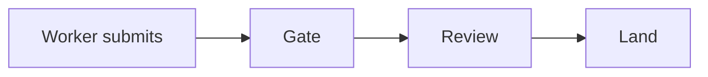

# Publish a Corral diagram

Use the same `corral-next` CLI in corral-pi and external CLI harnesses (use `$CORRAL` if provided). For workspace commands run within the Corral workspace, set `CORRAL_NEXT_ROOT`, or pass `--root <workspace-root>`; offline validation needs no workspace. Work within the current task/project and ordinary attachment permissions. Do not dispatch, promote to System, or generate HTML or JavaScript.

## Markdown and Mermaid

Write a `.md` file, for example:

````markdown
# Submit to land


````

Attach as below. The app renders supported Mermaid; unsupported syntax retains source/download. This format does not request evidence bindings. See `docs/guide/agent-diagrams.md` in the Corral repository for supported kinds and limits.

## Evidence-backed workflow

For the submit → gate → review → land journey in `corral:15`, start with this minimal v1 recipe in a local `workflow.json`:

```json
{
  "schema": "corral.workflow-diagram", "version": 1,
  "subject": { "project": "corral", "commit": "9f9f9314d3fcdc51d67ee48ab28da910dc828d42" },
  "start": "gate",
  "nodes": [
    { "id": "gate", "kind": "decision", "label": "Gate", "bindings": {
      "source": { "path": "crates/corral-engine/src/review.rs", "span": { "start": 101, "end": 112 } },
      "entity": { "kind": "file", "path": "crates/corral-engine/src/review.rs" }
    } },
    { "id": "land", "kind": "end", "label": "Land" },
    { "id": "retry", "kind": "end", "label": "Retry" }
  ],
  "edges": [
    { "id": "pass", "kind": "branch", "from": "gate", "to": "land", "label": "Pass" },
    { "id": "fail", "kind": "branch", "from": "gate", "to": "retry", "label": "Fail" }
  ]
}
```

Adapt the example to the actual project and workflow. Set `subject.project` to the exact configured owning project and `subject.commit` to the full immutable commit of that project's locally available Git repository (`git rev-parse --verify 'HEAD^{commit}'` there). Replace the example paths and spans with relevant committed bindings. Do not use a moving ref or substitute working-tree content for committed source. Use stable node/edge IDs, typed source/file or definition bindings, and explicit decision branches. Bind only what you intend to inspect; labels and edges are author claims, not verified relationships. If you have a Corral checkout, the fuller `docs/examples/submit-to-land.diagram.json` and `docs/guide/workflow-diagram-recipes.md` describe the complete journey, format and inspector statuses.

Run `corral-next --json artifact validate-diagram workflow.json`. Exit 0 means structurally valid only, 2 means refused (fix the diagnostic and revalidate), and 1 means CLI/I/O failure. Validation does not resolve the project, commit, source, entities or relationship. Before attaching, inspect the pinned commit and requested paths/spans using Git in the correct repository where possible; report each binding you cannot verify as unresolved, including missing commit/path/span or unchecked definitions. Git inspection is not the daemon's entity resolution and does not verify edges. Do not claim a provider result, coverage, or absence of relationships without observing it. If resolution is unavailable, say so rather than claiming success.

## Attach and report

After successful structural validation for JSON (and any required owner authorization), attach the exact validated bytes to a task belonging to `subject.project`, or to that project's library. In a corral-pi worker, use `corral_artifact` as required by its run contract; pass the path, kind and title, and `to` only for an authorized different target. In an external CLI harness use the same artifact service through the CLI:

```sh
corral-next artifact add T-12 workflow.json --kind report --title 'Submit to land'
# Or: corral-next artifact add PROJECT diagram.md --kind reference --title 'Workflow'
```

Use the actual target, path and appropriate `report`, `reference`, or `evidence` kind. Record and return the canonical reference from the command result (e.g. `T-12:3` or the returned project reference), not a filename or guessed number. If attachment fails, report the failure and do not invent a reference. To revise, attach again with `--replaces <reference>`; the old bytes remain available.

In the summary give the reference, pinned project/commit, structural validation result and unresolved or unverified bindings. The Corral app's artifact inspector can subsequently show committed source and independently derived facts, with coverage and `pending`, `missing`, `unavailable`, `ambiguous` or `not_provided` statuses. A declared binding or empty fact list does not prove an edge or absence of relationships. A normal task citation or Activity → Artifacts opens the saved artifact; no separate transport is needed.
